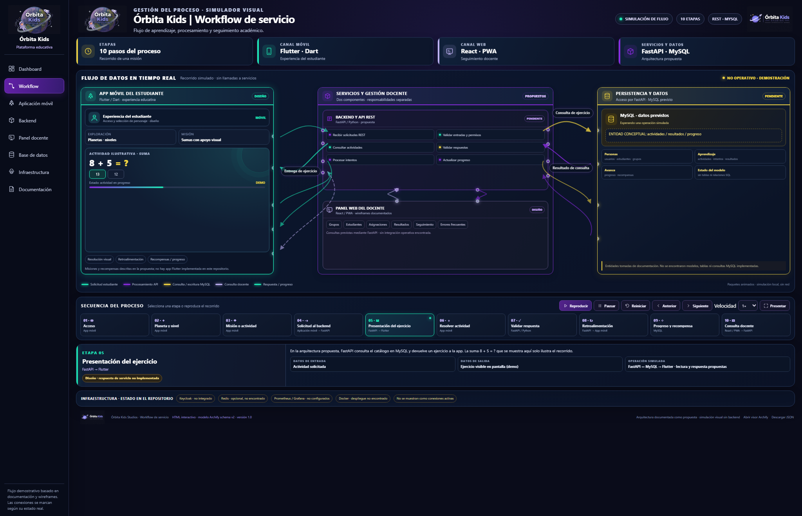

# 🚀 Órbita Kids | Workflow de servicio

**Diagrama interactivo del flujo de aprendizaje, procesamiento y seguimiento académico de Órbita Kids.**

Este proyecto presenta una representación visual e interactiva del funcionamiento de Órbita Kids, una plataforma educativa enfocada en el aprendizaje de matemáticas mediante actividades y experiencias espaciales.

El Workflow permite visualizar cómo interactúan los diferentes componentes de la plataforma: aplicación móvil del estudiante, servicios Backend, panel web del docente y persistencia de datos.

## 🌐 Demo interactiva

🚀 **[Abrir Workflow interactivo de Órbita Kids](https://obedguzmanguz.github.io/Orbita_Kids/Documentacion/Diagrama_WorkFlow/workflow-orbita-kids.html)**

## 📸 Vista previa



## 🎯 Objetivo del proyecto

Diseñar un diagrama interactivo que permita comprender el recorrido de una actividad matemática dentro de Órbita Kids, desde que el estudiante accede a la aplicación hasta que resuelve un ejercicio, recibe retroalimentación y se registra su progreso.

También busca representar la comunicación entre los componentes tecnológicos, identificar las responsabilidades de cada módulo y facilitar la comprensión de la arquitectura propuesta.

## ⚙️ ¿Qué hace el Workflow?

El Workflow funciona como un dashboard de simulación visual que permite explorar el proceso de aprendizaje y la interacción entre los componentes de la plataforma.

Sus principales funcionalidades son:

- **Visualización del flujo de datos:** representa la comunicación entre la aplicación móvil, Backend, panel docente y base de datos.
- **Simulación animada:** muestra paquetes luminosos que recorren las conexiones entre los diferentes componentes.
- **Exploración de etapas:** permite seleccionar cada una de las diez etapas para consultar su descripción, entradas, salidas y operaciones.
- **Control de reproducción:** incluye opciones para reproducir, pausar, reiniciar, avanzar, retroceder y modificar la velocidad de la simulación.
- **Seguimiento de operaciones:** permite visualizar las solicitudes, respuestas, validaciones y actualizaciones de progreso.
- **Navegación independiente:** cuenta con ocho secciones para explorar los diferentes módulos del proyecto.
- **Presentación visual:** permite ampliar el área de trabajo para explicar el funcionamiento de la arquitectura.

## 🔄 Etapas del proceso

El flujo está compuesto por diez etapas que representan el recorrido de una actividad matemática:

| N.º | Etapa | Descripción |
|:---:|---|---|
| 01 | Acceso | Entrada del estudiante a la aplicación móvil. |
| 02 | Planeta y nivel | Selección del planeta y nivel de aprendizaje. |
| 03 | Misión o actividad | Selección de una misión matemática. |
| 04 | Solicitud al Backend | Solicitud de la actividad a los servicios. |
| 05 | Presentación del ejercicio | Entrega del ejercicio a la aplicación móvil. |
| 06 | Resolver actividad | Interacción del estudiante con el ejercicio. |
| 07 | Validar respuesta | Procesamiento y validación de la respuesta. |
| 08 | Retroalimentación | Presentación de aciertos o errores. |
| 09 | Progreso y recompensa | Representación de avances y recompensas. |
| 10 | Consulta docente | Seguimiento de resultados desde el panel docente. |

## 🧩 Componentes principales

El diagrama organiza la arquitectura en tres grandes áreas:

### 1. Aplicación móvil del estudiante
**Flutter / Dart**

Representa la experiencia educativa del estudiante, incluyendo la selección de planetas, misiones, ejercicios matemáticos, apoyo visual, retroalimentación y progreso.

### 2. Servicios y gestión docente
**FastAPI / Python + React / PWA**

Representa los servicios encargados de recibir solicitudes, procesar actividades, validar respuestas y gestionar la información que consulta el personal docente.

### 3. Persistencia y datos
**MySQL**

Representa el almacenamiento conceptual de usuarios, grupos, actividades, resultados y progreso académico.

## 🖥️ Secciones del dashboard

El Workflow incluye ocho vistas independientes:

| Sección | Contenido |
|---|---|
| Dashboard | Resumen general del proyecto y sus componentes. |
| Workflow | Diagrama animado y secuencia del proceso. |
| Aplicación móvil | Funcionalidades de la experiencia del estudiante. |
| Backend | Servicios y procesamiento de solicitudes. |
| Panel docente | Gestión y seguimiento académico. |
| Base de datos | Entidades y relaciones conceptuales. |
| Infraestructura | Tecnologías y estado de integración. |
| Documentación | Recursos y archivos técnicos del proyecto. |

## 🛠️ Tecnologías y herramientas utilizadas

Las siguientes tecnologías se emplearon para desarrollar el dashboard, generar el diagrama y representar la arquitectura propuesta de Órbita Kids.

| Tecnología | Uso dentro del proyecto |
|---|---|
|  **HTML5** | Estructura del dashboard y sus vistas. |
|  **CSS3** | Diseño visual, estilos, animaciones y distribución. |
|  **JavaScript** | Navegación, simulación e interactividad. |
|  **SVG** | Conexiones, trayectorias y paquetes animados. |
|  **JSON** | Modelo editable del Workflow. |
|  **PowerShell** | Generación reproducible del dashboard. |
|  **Archify** | Modelado y representación del diagrama. |
|  **GitHub Pages** | Publicación y visualización web. |

### Tecnologías de la arquitectura propuesta

Estas tecnologías representan los componentes previstos para la plataforma educativa; su aparición en el diagrama no implica que estén integradas u operativas.

| Tecnología | Función prevista |
|---|---|
|  **Flutter / Dart** | Aplicación móvil del estudiante. |
|  **FastAPI / Python** | Servicios y API REST. |
|  **React** | Panel web del docente. |
|  **MySQL** | Persistencia de información. |

## 📂 Estructura del proyecto

```text
Diagrama_WorkFlow/
│
├── assets/
│   ├── logos/
│   ├── icons/
│   └── workflow-orbita-kids.archify.html
│
├── capturas/
│   ├── vista-dashboard.png
│   ├── vista-workflow.png
│   ├── vista-aplicacion-movil.png
│   ├── vista-backend.png
│   ├── vista-panel-docente.png
│   ├── vista-base-datos.png
│   ├── vista-infraestructura.png
│   ├── vista-documentacion.png
│   ├── workflow-preview.png
│   └── workflow-preview-1366x768.png
│
├── build-dashboard.ps1
├── workflow-orbita-kids.html
├── workflow-orbita-kids.json
└── README.md
```

## ▶️ Ejecución local

Para visualizar el proyecto localmente:

1. Descarga o clona el repositorio.
2. Accede a la carpeta `Documentacion/Diagrama_WorkFlow/`.
3. Abre `workflow-orbita-kids.html` en Google Chrome o Microsoft Edge.
4. Explora las diferentes secciones desde la barra lateral.
5. En Workflow, utiliza los controles para reproducir y explorar las diez etapas.

No requiere instalar dependencias adicionales ni conectarse a servicios externos para ejecutar la simulación.

### Regenerar el dashboard

Si se realizan modificaciones en el modelo o en la plantilla, se puede regenerar el HTML utilizando PowerShell:

```powershell
powershell -ExecutionPolicy Bypass -File .\build-dashboard.ps1
```

## 🧪 Validación y pruebas

El dashboard fue sometido a pruebas funcionales y visuales:

- 39 de 39 comprobaciones funcionales satisfactorias.
- Validación de las ocho rutas de navegación.
- Pruebas de selección y reproducción de las diez etapas.
- Comprobación de las ramas de respuesta correcta e incorrecta.
- Validación de controles de reproducción y velocidad.
- Verificación de conexiones SVG y animaciones.
- Pruebas de visualización en diferentes resoluciones.
- Validación del modelo Archify Workflow v2.

## ⚠️ Alcance y consideraciones

Este Workflow es una representación visual y una simulación del funcionamiento propuesto de Órbita Kids.

Las comunicaciones entre Flutter, FastAPI, React y MySQL son ilustrativas. No se realizan solicitudes reales a una API ni operaciones sobre una base de datos.

Las tecnologías de infraestructura y servicios adicionales se muestran de acuerdo con su estado documentado en el repositorio, diferenciando los elementos implementados de los propuestos o pendientes.

## 👨‍🚀 Proyecto

**Órbita Kids Studios**

*Creamos experiencias que inspiran.*

Plataforma educativa enfocada en fortalecer el aprendizaje de matemáticas mediante experiencias interactivas y actividades adaptadas al estudiante.

---

<sub>Órbita Kids · Workflow de servicio · Documentación técnica del proyecto.</sub>