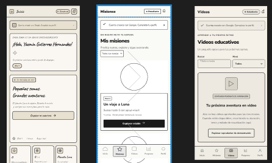
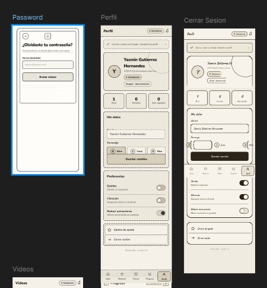
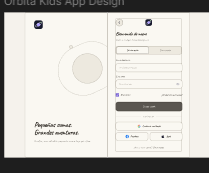
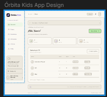
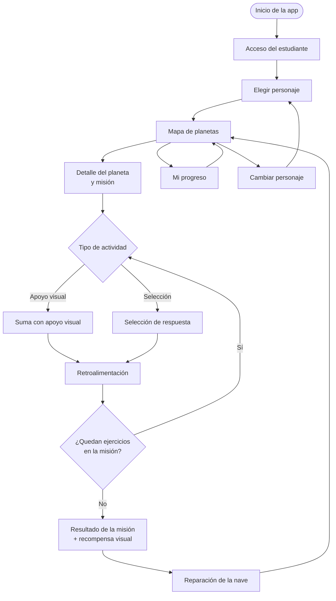
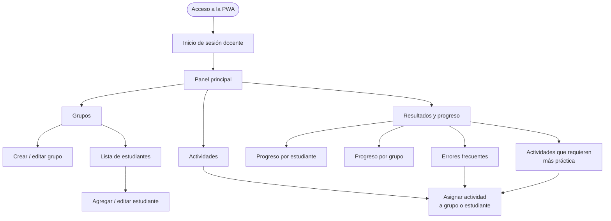
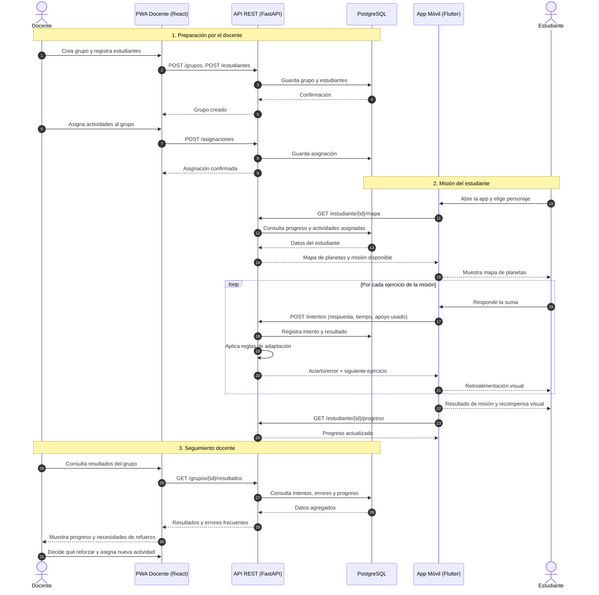
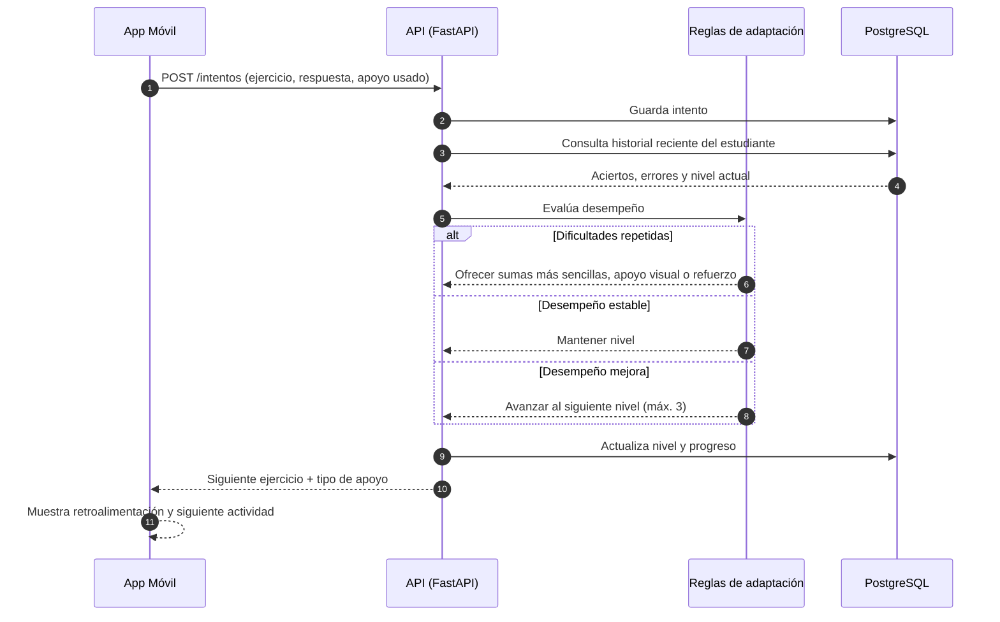

#  Órbita Kids — Navegación de los sketches y diagramas de secuencia

Este documento explica cómo se conectan las pantallas propuestas en los sketches de **Órbita Kids** y cómo interactúan la aplicación móvil del estudiante, la PWA del docente, la API y la base de datos durante el flujo de uso previsto.

> ⚠️ **Estado:** los sketches y diagramas representan el **alcance propuesto** de la primera versión. No son funcionalidades terminadas. Los nombres de pantalla pueden ajustarse para coincidir con los sketches finales.

---

##  Sketches en Figma

Los sketches de la aplicación móvil y de la PWA se pueden consultar en Figma:

🔗 **[Ver sketches en Figma](https://www.figma.com/design/NJvpRMCpqT1MHrAjRdWY9k/Orbita-Kids?node-id=8-6746&t=Bh7RA2nB0fxz8pHn-1)**

###  App 

| Sketch móvil 1 | Sketch móvil 2 |
|---|---|
|  |  |

###  PWA 

| Sketch PWA 1 | Sketch PWA 2 |
|---|---|
|  |  |

## 📑 Contenido

1. [Sketches en Figma](#-sketches-en-figma)
2. [Alcance cubierto](#-alcance-cubierto)
3. [Mapa de navegación — App del estudiante](#-mapa-de-navegación--app-del-estudiante)
4. [Mapa de navegación — PWA del docente](#-mapa-de-navegación--pwa-del-docente)
5. [Descripción de pantallas](#-descripción-de-pantallas)
6. [Diagrama de secuencia — Flujo completo de uso](#-diagrama-de-secuencia--flujo-completo-de-uso)
7. [Diagrama de secuencia — Adaptación de actividades](#-diagrama-de-secuencia--adaptación-de-actividades)
8. [Relación entre sketches y API](#-relación-entre-sketches-y-api)
9. [Cómo leer este documento junto a los sketches](#-cómo-leer-este-documento-junto-a-los-sketches)

---

##  Alcance cubierto

| Elemento | Primera versión |
|---|---|
| Tema matemático | Sumas |
| Niveles | 3 niveles de dificultad |
| Tipos de actividad | Suma con apoyo visual y selección de respuestas |
| App móvil (Flutter/Dart) | Personaje, mapa de planetas, misiones, recompensas, progreso |
| PWA docente (React) | Grupos, asignación de actividades, resultados y errores frecuentes |
| Backend | API REST con FastAPI + PostgreSQL |

Fuera de alcance: otras operaciones, chatbot o IA, interfaz para familias, multijugador y diagnóstico de dificultades de aprendizaje.

##  Mapa de navegación — App del estudiante

### Lectura del recorrido

1. **Inicio y acceso:** el estudiante ingresa a la aplicación.
2. **Elegir personaje:** personaliza su experiencia (se muestra la primera vez y puede cambiarse después).
3. **Mapa de planetas:** es la pantalla central (*hub*). Desde aquí se llega a cualquier misión, al progreso o al cambio de personaje.
4. **Misión:** cada planeta contiene una misión con ejercicios de suma, en alguno de los dos tipos de actividad.
5. **Retroalimentación:** después de cada respuesta se indica si fue correcta y, si no, se ofrece apoyo.
6. **Cierre de misión:** se muestra el resultado, se entrega una recompensa visual y se avanza en la reparación de la nave.
7. **Regreso al mapa:** el ciclo se repite con el siguiente planeta o nivel.

---

##  Mapa de navegación — PWA del docente

### Lectura del recorrido

- **Panel principal:** concentra los tres accesos del docente: *Grupos*, *Actividades* y *Resultados*.
- **Grupos:** permite organizar estudiantes antes de asignar actividades.
- **Actividades:** se asignan a un grupo completo o a estudiantes específicos.
- **Resultados:** desde errores frecuentes o actividades con bajo desempeño, el docente puede ir directo a **asignar refuerzo**, cerrando el ciclo de seguimiento.

##  Diagrama de secuencia — Flujo completo de uso

Corresponde al **flujo de uso previsto** del proyecto: el docente organiza y asigna, el estudiante realiza una misión, el sistema registra y aplica reglas, y el docente consulta resultados.

### Puntos clave

- **Ninguna interfaz se conecta directamente a la base de datos:** todo pasa por la API.
- Los pasos **1 a 3** son el flujo del documento original (organizar → misión → registro → reglas → retroalimentación → consulta docente).
- Los endpoints mostrados son **ilustrativos**; los nombres definitivos se fijarán durante el diseño de la API.

---

##  Diagrama de secuencia — Adaptación de actividades

Detalla qué ocurre después de cada intento. Las reglas son **programadas** (sin IA) y sus criterios deben **definirse y probarse con apoyo docente**.

**Decisiones posibles de las reglas:**

| Situación | Acción del sistema |
|---|---|
| El estudiante presenta dificultades | Sumas más sencillas, apoyos visuales o actividades adicionales de refuerzo |
| Su desempeño es estable | Mantener el nivel |
| Su desempeño mejora | Avanzar progresivamente dentro de los tres niveles |

> 📝 Pendiente: definir con docentes los umbrales concretos (por ejemplo, cuántos errores seguidos activan un refuerzo).

---

## 🔌 Relación entre sketches y API

Resumen **ilustrativo** de qué pantalla dispara qué comunicación con el backend.

| Pantalla | Acción | Comunicación con la API |
|---|---|---|
| E1 Acceso | Ingresar | Autenticación del estudiante |
| E2 Personaje | Guardar personaje | Actualizar perfil del estudiante |
| E3 Mapa | Cargar planetas y niveles | Consultar progreso y asignaciones |
| E5 / E6 Actividades | Responder ejercicio | Registrar intento y recibir siguiente ejercicio |
| E8 Progreso | Ver avance | Consultar progreso y recompensas |
| D1 Login | Ingresar | Autenticación del docente |
| D3 / D4 Grupos | Crear/editar | Gestión de grupos y estudiantes |
| D5 Asignar | Asignar actividad | Crear asignación |
| D6 Resultados | Consultar | Consultar intentos, errores frecuentes y progreso |

---

##  Cómo leer este documento junto a los sketches

1. Empieza por el **mapa de navegación** de cada aplicación para ubicar la pantalla central (mapa de planetas en la app, panel principal en la PWA).
2. Revisa la **tabla de pantallas** para ver el objetivo de cada sketch y a dónde navega.
3. Consulta el **diagrama de secuencia** para entender qué datos viajan entre la interfaz, la API y la base de datos.
4. Contrasta con las **reglas de adaptación** para comprender por qué el estudiante recibe cierto ejercicio o apoyo.

---

##  Equipo

Obed Guzmán Flores · Yazmin Gutierrez Hernandez · Citlalli Perez Dionicio · Michelle Castro Otero · Jennifer Bautista Barrios

 **Órbita Kids** — Aprender mate...