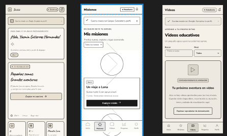
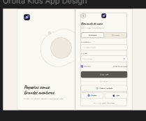
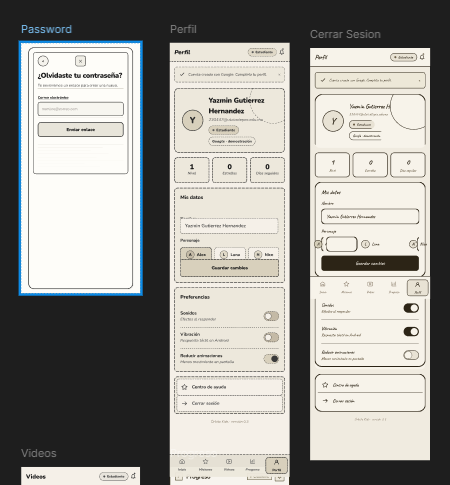
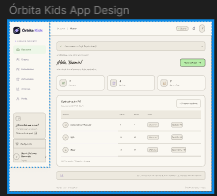

 <div align="center">


### 🌌 Un universo de aprendizaje, diseño e innovación educativa.

**Documentación técnica · Arquitectura · Experiencia de usuario · Planeación**

<br>

<a href="https://github.com/ObedGuzmanGuz/Orbita_Kids">
  
</a>
<a href="https://www.figma.com/design/NJvpRMCpqT1MHrAjRdWY9k/Orbita-Kids?node-id=8-6746&t=Bh7RA2nB0fxz8pHn-1">
  
</a>
<a href="https://obedguzmanguz.github.io/Orbita_Kids/Documentacion/ModelBusinesCanvas/">
  
</a>

</div>

---

<div align="center">

## ✨ EXPLORA EL UNIVERSO DE ÓRBITA KIDS

</div>

La documentación de **Órbita Kids** reúne los principales entregables que dan forma a la propuesta educativa: desde su arquitectura tecnológica hasta el diseño de interfaces y la definición de su modelo de negocio.

Cada apartado representa una parte del proceso de análisis, diseño y planeación del proyecto.

<details open>
<summary><b>🪐 Navegación rápida de documentación</b></summary>

<br>

| 🌠 Apartado | 📖 Contenido | 🔗 Acceso |
|---|---|---|
| 🏗️ Arquitectura | Estructura técnica y componentes. | [Explorar →](https://github.com/ObedGuzmanGuz/Orbita_Kids/tree/main/Documentacion/DiagramaDeArquitectura) |
| 👥 Roles de usuario | Actores y responsabilidades. | [Explorar →](https://github.com/ObedGuzmanGuz/Orbita_Kids/tree/main/Documentacion/DiagramaRolesUsuario) |
| 🎨 GUI y Sketches | Interfaces y navegación. | [Explorar →](https://github.com/ObedGuzmanGuz/Orbita_Kids/tree/main/Documentacion/GUI/Practica_Sketches) |
| 💼 Business Model Canvas | Modelo de negocio. | [Explorar →](https://github.com/ObedGuzmanGuz/Orbita_Kids/tree/main/Documentacion/ModelBusinesCanvas) |

</details>

---

# 🌌 01 · ARQUITECTURA DEL SISTEMA

<div align="center">

### 🏗️ Construyendo el universo tecnológico

**La estructura que conecta los componentes de Órbita Kids.**

</div>

Esta sección presenta la arquitectura técnica propuesta para la plataforma, sus componentes principales y la manera en que se relacionan las aplicaciones, los servicios y el almacenamiento de información.

<div align="center">

<a href="https://github.com/ObedGuzmanGuz/Orbita_Kids/tree/main/Documentacion/DiagramaDeArquitectura">
  
</a>
<a href="https://github.com/ObedGuzmanGuz/Orbita_Kids/blob/main/Documentacion/DiagramaDeArquitectura/readme.md">
  
</a>

</div>

### 🧩 Componentes tecnológicos

| Componente | Tecnología | Propósito |
|---|---|---|
| 📱 App estudiantil | Flutter · Dart | Experiencia móvil de aprendizaje. |
| 💻 PWA docente | React | Administración y seguimiento. |
| ⚙️ Backend | Python · FastAPI | Lógica y procesamiento. |
| 🔌 Comunicación | API REST | Intercambio de información. |
| 🗄️ Datos | Base de datos relacional | Gestión de información. |

<details>
<summary>📁 <b>Contenido de la carpeta</b></summary>

```text
DiagramaDeArquitectura/
├── img/
│   └── diagramaArquitectura.jpeg
└── readme.md
```

</details>

---

# 👥 02 · ROLES DE USUARIO

<div align="center">

### 🧑‍🚀 Los protagonistas de la experiencia

**Cada usuario tiene un papel dentro del ecosistema educativo.**

</div>

Este apartado describe los actores que interactúan con Órbita Kids, sus responsabilidades y las funcionalidades que corresponden a cada perfil.

<div align="center">

| 🎓 ESTUDIANTE | 👩‍🏫 DOCENTE | 🏫 INSTITUCIÓN |
|:---:|:---:|:---:|
| Actividades y misiones | Grupos y asignaciones | Adopción y seguimiento |
| Progreso personal | Evaluación de resultados | Contexto educativo |

</div>

### 📌 Material documentado

- Identificación de actores.
- Responsabilidades de cada perfil.
- Funcionalidades del sistema.
- Diagrama interactivo.
- Archivos de configuración y visualización.

<div align="center">

<a href="https://github.com/ObedGuzmanGuz/Orbita_Kids/tree/main/Documentacion/DiagramaRolesUsuario">
  
</a>
<a href="https://github.com/ObedGuzmanGuz/Orbita_Kids/blob/main/Documentacion/DiagramaRolesUsuario/index.html">
  
</a>

</div>

<details>
<summary>📁 <b>Contenido de la carpeta</b></summary>

```text
DiagramaRolesUsuario/
├── index.html
├── practica-05-roles.architecture.json
├── practica-05-roles.visual-check.html
├── practica-05-roles.visual-check.json
├── practica-05.css
├── practica-05.js
└── readme.md
```

</details>

---

# 🎨 03 · GUI Y PRÁCTICA DE SKETCHES

<div align="center">

### 🎨 Diseñando la experiencia de aprendizaje

**Ideas que toman forma a través de las interfaces.**

</div>

Esta sección reúne los bocetos de las dos interfaces principales de Órbita Kids:

- 📱 Aplicación móvil destinada a los estudiantes.
- 💻 PWA diseñada para docentes.

### 🖼️ Galería de sketches

<div align="center">

| 📱 Interfaz estudiantil | 💻 Interfaz docente |
|:---:|:---:|
|  |  |
| **Sketch 01** | **Sketch 03** |
|  |  |
| **Sketch 02** | **Sketch 04** |

</div>

### 📐 Documentación de diseño

También se incluyen mapas de navegación, descripciones de pantallas, diagramas de secuencia y referencias sobre la relación entre las interfaces y la API.

<div align="center">

<a href="https://github.com/ObedGuzmanGuz/Orbita_Kids/tree/main/Documentacion/GUI/Practica_Sketches">
  
</a>
<a href="https://www.figma.com/design/NJvpRMCpqT1MHrAjRdWY9k/Orbita-Kids?node-id=8-6746&t=Bh7RA2nB0fxz8pHn-1">
  
</a>

</div>

<details>
<summary>📁 <b>Contenido de la carpeta</b></summary>

```text
GUI/
└── Practica_Sketches/
    ├── img/
    │   ├── 1.png
    │   ├── 2.png
    │   ├── 3.png
    │   └── 4.png
    └── readme.md
```

</details>

---

# 💼 04 · BUSINESS MODEL CANVAS

<div align="center">

### 💫 Dando forma a una propuesta de valor

**La estrategia detrás de la experiencia educativa.**

</div>

El Business Model Canvas presenta la estructura del modelo de negocio de Órbita Kids mediante nueve bloques que permiten visualizar cómo se plantea la propuesta educativa.

### 🌟 Los nueve bloques del modelo

<div align="center">

| | |
|:---:|:---:|
| 👥 **Segmentos de clientes** | 💎 **Propuesta de valor** |
| 📡 **Canales** | 💬 **Relaciones con clientes** |
| 💰 **Fuentes de ingresos** | 🧰 **Recursos clave** |
| ⚙️ **Actividades clave** | 🤝 **Socios clave** |
| | 📊 **Estructura de costos** |

</div>

### 🌍 Contribución al ODS 4

La propuesta se relaciona con el **Objetivo de Desarrollo Sostenible 4: Educación de calidad**, mediante el planteamiento de una experiencia educativa orientada al aprendizaje inclusivo y al fortalecimiento de habilidades matemáticas.

<div align="center">

<a href="https://github.com/ObedGuzmanGuz/Orbita_Kids/tree/main/Documentacion/ModelBusinesCanvas">
  
</a>
<a href="https://obedguzmanguz.github.io/Orbita_Kids/Documentacion/ModelBusinesCanvas/">
  
</a>

</div>

<details>
<summary>📁 <b>Contenido de la carpeta</b></summary>

```text
ModelBusinesCanvas/
├── assets/
│   ├── imagenes/
│   ├── ILUSTRACIONES.md
│   └── orbita.svg
├── css/
│   └── styles.css
├── js/
│   └── app.js
├── index.html
└── README.md
```

</details>

---

# 🛠️ 05 · ORGANIZACIÓN DEL REPOSITORIO

Para conservar una documentación clara y fácil de mantener, los materiales se organizan por entregable.

| 📌 Criterio | 📝 Descripción |
|---|---|
| Organización | Una carpeta independiente por cada sección. |
| Documentación | Un README para explicar cada entregable. |
| Recursos gráficos | Imágenes agrupadas en carpetas específicas. |
| Código auxiliar | HTML, CSS, JS y JSON junto a su respectivo proyecto. |
| Actualización | Enlaces y estructura sincronizados con el repositorio. |

### 🔍 ¿Cómo consultar los recursos?

1. Selecciona el apartado que deseas revisar.
2. Accede a su carpeta mediante el enlace correspondiente.
3. Consulta su README para conocer el propósito del entregable.
4. Abre los diagramas, imágenes o presentaciones disponibles.

---

<div align="center">


# 🚀 ÓRBITA KIDS

### Aprender matemáticas explorando el espacio.

**Diseñando experiencias · Construyendo conocimiento · Transformando el aprendizaje**

[🌌 Repositorio principal](https://github.com/ObedGuzmanGuz/Orbita_Kids)

<sub>Documentación técnica y académica del proyecto Órbita Kids.</sub>

</div>