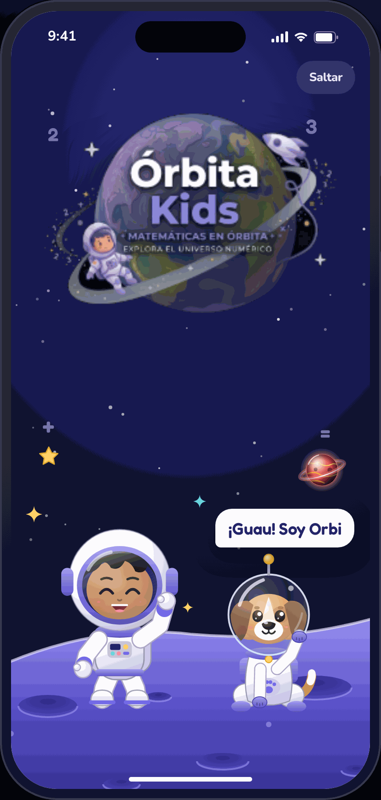
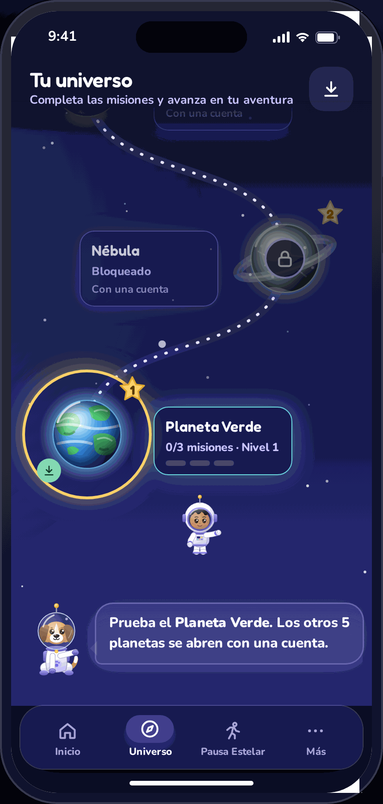
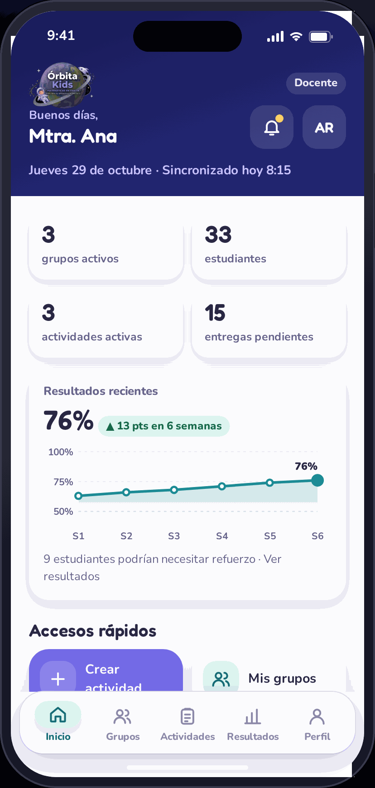
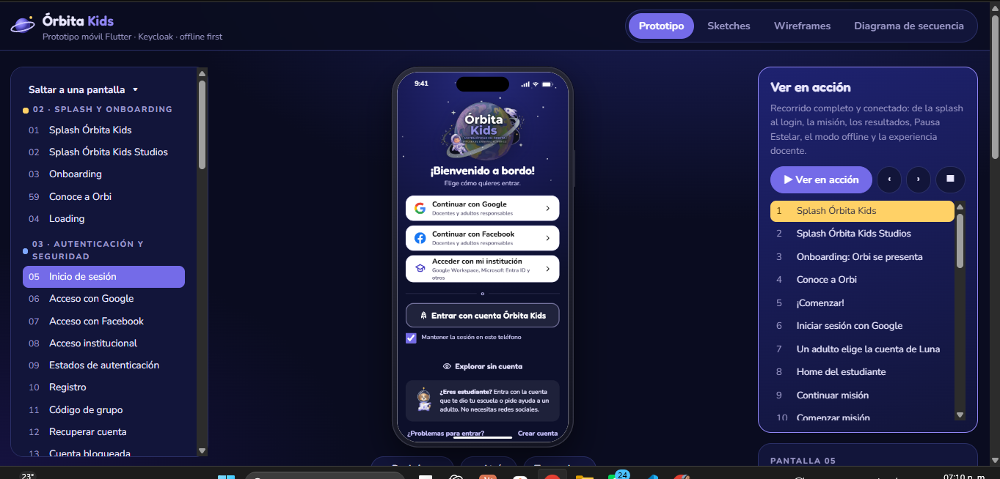

 

# 🪐 ` Ó R B I T A · K I D S ` 🚀

### ✨ EXPERIENCIAS QUE ACOMPAÑAN CADA DESCUBRIMIENTO ✨

# 📱 FRONTEND · APLICACIÓN MÓVIL

**ENTREGABLES INTERACTIVOS · EXPERIENCIA DEL ESTUDIANTE**

 

  

### 🚀 JUEGA · APRENDE · AVANZA

---

## 📸 PREVISUALIZACIÓN DE LA APLICACIÓN

*Un primer vistazo a la experiencia móvil de Órbita Kids.*

| 🌟 Vista 01 | 🚀 Vista 02 | 🪐 Vista 03 |
|:---:|:---:|:---:|
|  |  |  |

VISTAS DE LA INTERFAZ · APLICACIÓN MÓVIL

---

## 🪐 BIENVENIDO A LA EXPERIENCIA MÓVIL DE ÓRBITA KIDS

*Un espacio donde cada interacción abre las puertas a nuevos descubrimientos.*

## 🚀 01. Acerca del módulo

El módulo **Frontend Mobile de Órbita Kids** comprende el diseño, prototipado y desarrollo de la aplicación móvil, enfocada en proporcionar una experiencia educativa interactiva, accesible y adaptada a dispositivos móviles.

Su propósito es acercar las experiencias de aprendizaje a los estudiantes mediante interfaces intuitivas, actividades dinámicas y una navegación que fomente la curiosidad, la exploración y la participación.

La aplicación utiliza **Flutter y Dart** como tecnologías principales, manteniendo la identidad visual y los criterios de experiencia de usuario definidos para el ecosistema Órbita Kids.

## 🎯 02. Objetivo de la aplicación

Construir una experiencia móvil que permita a los estudiantes interactuar con los contenidos y actividades educativas de Órbita Kids desde sus dispositivos, favoreciendo un aprendizaje dinámico y una navegación sencilla.

Los principales objetivos son:

- **Aprendizaje interactivo:** facilitar la participación mediante actividades y experiencias educativas.
- **Exploración:** incorporar recorridos y experiencias inspiradas en la exploración espacial.
- **Usabilidad:** ofrecer interfaces intuitivas y adecuadas para la interacción táctil.
- **Personalización:** contemplar experiencias y elementos visuales personalizables.
- **Accesibilidad:** considerar diferentes necesidades de interacción y comprensión.
- **Disponibilidad:** contemplar el funcionamiento de determinadas experiencias sin conexión a Internet.

## 🌟 03. Experiencia del estudiante

La aplicación móvil está orientada principalmente al estudiante, quien representa el centro de la experiencia educativa.

Su diseño busca combinar aprendizaje, exploración e interacción mediante diferentes elementos que conforman el universo de Órbita Kids.

### 🧑‍🚀 Personalización del personaje

Experiencia orientada a la selección y personalización de un personaje que acompañe al estudiante durante su recorrido por la plataforma.

### 🧮 Aprendizaje mediante actividades

Actividades educativas que permiten trabajar contenidos como operaciones matemáticas mediante recursos visuales y apoyos interactivos.

### 🪐 Exploración espacial

Experiencias de exploración mediante planetas, misiones y escenarios que proporcionan un contexto atractivo para el aprendizaje.

### ⭐ Retroalimentación

Recursos visuales y respuestas de interacción que ayudan al estudiante a reconocer sus avances y comprender el resultado de sus actividades.

### 📚 Experiencia educativa

Organización de los contenidos y actividades para ofrecer una interacción progresiva, comprensible y adecuada a los objetivos de aprendizaje.

## 🔐 04. Autenticación y acceso

La arquitectura de acceso contempla **Keycloak** como solución de gestión de identidad y autenticación.

Su incorporación permite establecer una estructura centralizada para gestionar la autenticación de los usuarios y las sesiones de acceso dentro del ecosistema Órbita Kids.

La integración considera:

- Gestión de identidad y autenticación.
- Acceso mediante los mecanismos de inicio de sesión definidos para el proyecto.
- Organización de sesiones de usuario.
- Consideración de los diferentes perfiles de acceso.
- Integración con los servicios de la plataforma.

## 📡 05. Experiencia Offline-First

La aplicación móvil contempla un enfoque **Offline-First**, orientado a ofrecer una experiencia que no dependa exclusivamente de una conexión permanente a Internet.

Este enfoque considera la disponibilidad local de los recursos necesarios para determinadas interacciones y actividades, así como la gestión de información cuando la conectividad no está disponible.

Entre sus criterios de diseño se encuentran:

- Acceso a recursos previamente disponibles en el dispositivo.
- Consideración de actividades que puedan utilizarse sin conexión.
- Gestión de información local.
- Adaptación de la experiencia ante cambios en la conectividad.
- Consideración de mecanismos de sincronización cuando se restablezca la conexión.

*La disponibilidad de cada funcionalidad sin conexión dependerá de sus necesidades de datos y de las integraciones correspondientes.*

## 🎨 06. Diseño y entregables móviles

El diseño de la aplicación contempla los elementos visuales, estructurales y funcionales necesarios para representar la experiencia móvil de Órbita Kids.

### 🖌️ Diseño de interfaces (UI)

Definición de pantallas, jerarquías visuales, colores, tipografías, iconografía, componentes y elementos gráficos que conforman la identidad de la aplicación.

### 🧭 Experiencia de usuario (UX)

Organización de recorridos, navegación y relaciones entre pantallas para proporcionar una experiencia intuitiva y coherente.

### ✏️ Sketches

Representaciones iniciales de las ideas y propuestas de interfaz, utilizadas para explorar distribuciones, estructuras y posibles soluciones visuales.

### 📐 Wireframes

Representaciones estructurales de las pantallas que permiten definir la distribución de contenidos, elementos y componentes antes de desarrollar su diseño visual definitivo.

### 🧩 Prototipos interactivos

Representación de la navegación y las interacciones entre pantallas para visualizar el comportamiento esperado de la aplicación.

### 📱 Interfaces móviles

Diseños e implementaciones adaptados a las características de los dispositivos móviles, considerando la interacción táctil y la presentación de contenidos.

---

## 🧭 07. DIAGRAMA DE DISEÑO Y PROTOTIPADO

*Del primer boceto a la experiencia interactiva.*

El siguiente diagrama reúne los principales entregables de diseño y conceptualización de la aplicación móvil de Órbita Kids.

En él se integran tres elementos fundamentales del proceso:

- **Sketches:** exploración inicial de ideas y estructuras visuales.
- **Wireframes:** organización y distribución de los elementos de cada pantalla.
- **Prototipo:** representación de las interfaces y sus conexiones de navegación.

### 📱 PROTOTIPO · SKETCHES · WIREFRAMES

**Documentación visual de la experiencia móvil**

---

## 🛠️ 08. TECNOLOGÍAS Y HERRAMIENTAS

*Tecnologías que dan vida a la experiencia móvil.*

 

**DESARROLLO DE APLICACIONES**

  

**AUTENTICACIÓN E IDENTIDAD**

  

**DOCUMENTACIÓN Y DIAGRAMACIÓN**

---

## ✨ 09. PRINCIPIOS DE DISEÑO

*Una experiencia diseñada para aprender, explorar y descubrir.*

La experiencia móvil se desarrolla considerando principios que orientan tanto la presentación visual como la interacción con la aplicación.

| Principio | Aplicación en Mobile |
|---|---|
| **Intuitividad** | Navegación sencilla y comprensible. |
| **Accesibilidad** | Interfaces que consideran diferentes necesidades de interacción. |
| **Interactividad** | Actividades que favorecen la participación del estudiante. |
| **Adaptabilidad** | Interfaces adecuadas a diferentes dimensiones de pantalla. |
| **Continuidad** | Consideración de experiencias disponibles sin conexión. |
| **Personalización** | Elementos que permiten adaptar la experiencia del estudiante. |
| **Identidad visual** | Uso consistente del lenguaje gráfico de Órbita Kids. |

## 🌠 10. Nuestra visión

La aplicación móvil de Órbita Kids busca transformar los dispositivos móviles en espacios de exploración y aprendizaje, donde los estudiantes puedan descubrir, interactuar y desarrollar conocimientos mediante experiencias digitales.

Cada pantalla, personaje, actividad e interacción forma parte de un universo educativo diseñado para despertar la curiosidad y acompañar el proceso de aprendizaje.

### 💜 APRENDER ES UNA AVENTURA. CADA ESTUDIANTE TIENE UN UNIVERSO POR DESCUBRIR.

---

### 🪐 ÓRBITA KIDS

**EXPLORA · APRENDE · DESCUBRE**

*Cada descubrimiento comienza con una pregunta.*

 

 

### ✨ ¡GRACIAS POR EXPLORAR CON NOSOTROS! ✨

**DESARROLLADO POR ÓRBITA STUDIO**

FLUTTER · DART &nbsp; | &nbsp; EXPERIENCIA MÓVIL

 

© 2026 Órbita Studio · Todos los derechos reservados.

