# Diagramas de secuencia · Órbita Kids

**7 diagramas de secuencia UML** (138 mensajes) que muestran cómo colaboran los usuarios, la app Flutter, Keycloak, los proveedores de identidad, la API REST (FastAPI + MySQL) y el almacenamiento local en los flujos principales del prototipo. Es una propuesta técnica coherente con la arquitectura del proyecto; el prototipo no se conecta a servicios reales.

También se ven en la pestaña **Diagrama de secuencia** de `../prototipo/Órbita_Kids_Prototipo.html`.

| Diagrama | Flujo | Mensajes |
|---|---|---|
| [SD-01](#sd-01) | Arranque y restauración de sesión | 20 |
| [SD-02](#sd-02) | Inicio de sesión federado con Keycloak | 27 |
| [SD-03](#sd-03) | Registro de estudiante con código de grupo | 20 |
| [SD-04](#sd-04) | Resolver una misión (offline first) | 20 |
| [SD-05](#sd-05) | Sincronización al reconectar | 18 |
| [SD-06](#sd-06) | Docente publica una actividad y revisa el progreso | 21 |
| [SD-07](#sd-07) | Cerrar sesión de forma segura | 12 |

## Archivos

| Carpeta | Contenido |
|---|---|
| `png/` | Imagen 2× de cada diagrama, en fondo **claro** (para documentos e impresión) y **oscuro** (para presentaciones) |
| `svg/` | Vector de cada diagrama en ambos fondos |
| `mermaid/` | Código fuente `.mmd` editable; se puede pegar en [mermaid.live](https://mermaid.live), GitHub, GitLab, Notion u Obsidian |

## Notación

| Elemento | Significado |
|---|---|
| Flecha continua con punta llena | Mensaje síncrono (petición que espera respuesta) |
| Flecha punteada con punta abierta | Respuesta |
| Flecha continua con punta abierta | Mensaje asíncrono (no espera respuesta) |
| Barra vertical sobre la línea de vida | Activación: el participante está procesando |
| Marco `alt` | Alternativas excluyentes; la condición va entre corchetes |
| Marco `opt` | Ocurre solo si se cumple la condición |
| Marco `loop` | Se repite |
| Marco `break` | Si se cumple la condición, se ejecuta y termina el flujo |
| Marco `ref` | Remite a otro diagrama |
| Nota amarilla | Aclaración |

Los mensajes están numerados en orden. Se usan los mismos números en las tablas de abajo y en el código Mermaid (`autonumber`).

---

## SD-01

### Arranque y restauración de sesión

Qué ocurre desde que se abre la app hasta llegar al Home del rol: las dos splash en orden, el onboarding solo en el primer acceso y la restauración segura de la sesión, con y sin Internet.

- **Participantes:** Usuario (actor), App Flutter, Almac. seguro, Base local, Keycloak, API REST
- **Precondición:** App instalada. Puede o no haber una sesión guardada en el teléfono.
- **Resultado:** El usuario ve el Home de su rol, el inicio de sesión o el aviso de sesión vencida.
- **Pantallas del prototipo:** 01 · Splash Órbita Kids, 02 · Splash Órbita Kids Studios, 03a · Onboarding, 04a · Loading, 15a · Home estudiante, 09a · Estados de autenticación

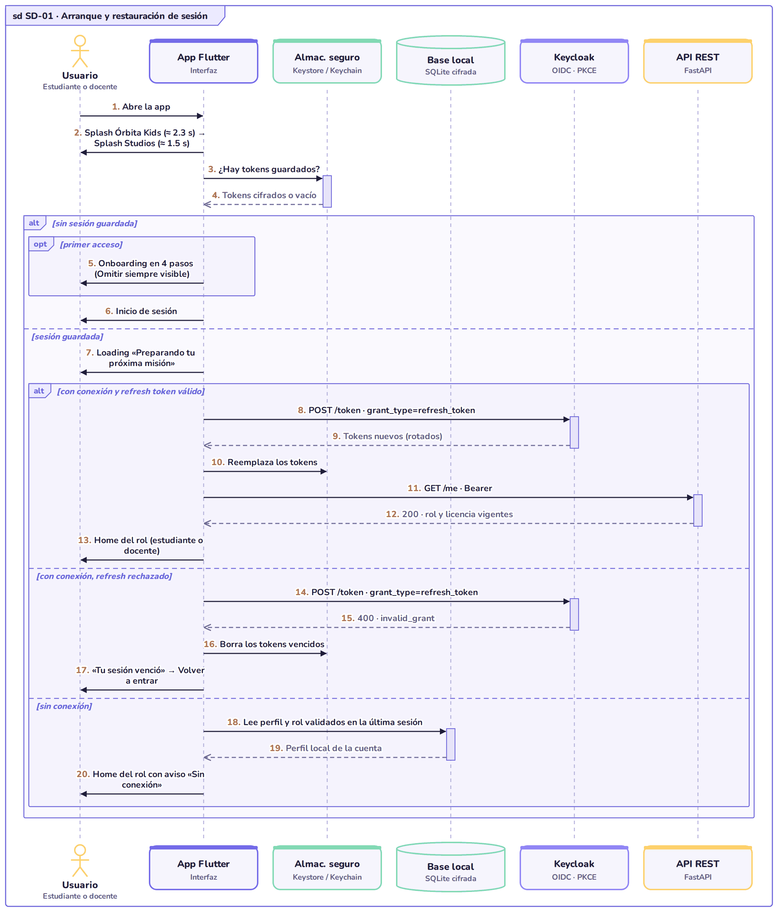

Archivos: [PNG claro](png/SD-01_arranque_y_restauracion_de_sesion_claro.png) · [PNG oscuro](png/SD-01_arranque_y_restauracion_de_sesion_oscuro.png) · [SVG claro](svg/SD-01_arranque_y_restauracion_de_sesion_claro.svg) · [SVG oscuro](svg/SD-01_arranque_y_restauracion_de_sesion_oscuro.svg) · [Mermaid](mermaid/SD-01_arranque_y_restauracion_de_sesion.mmd)

Código Mermaid

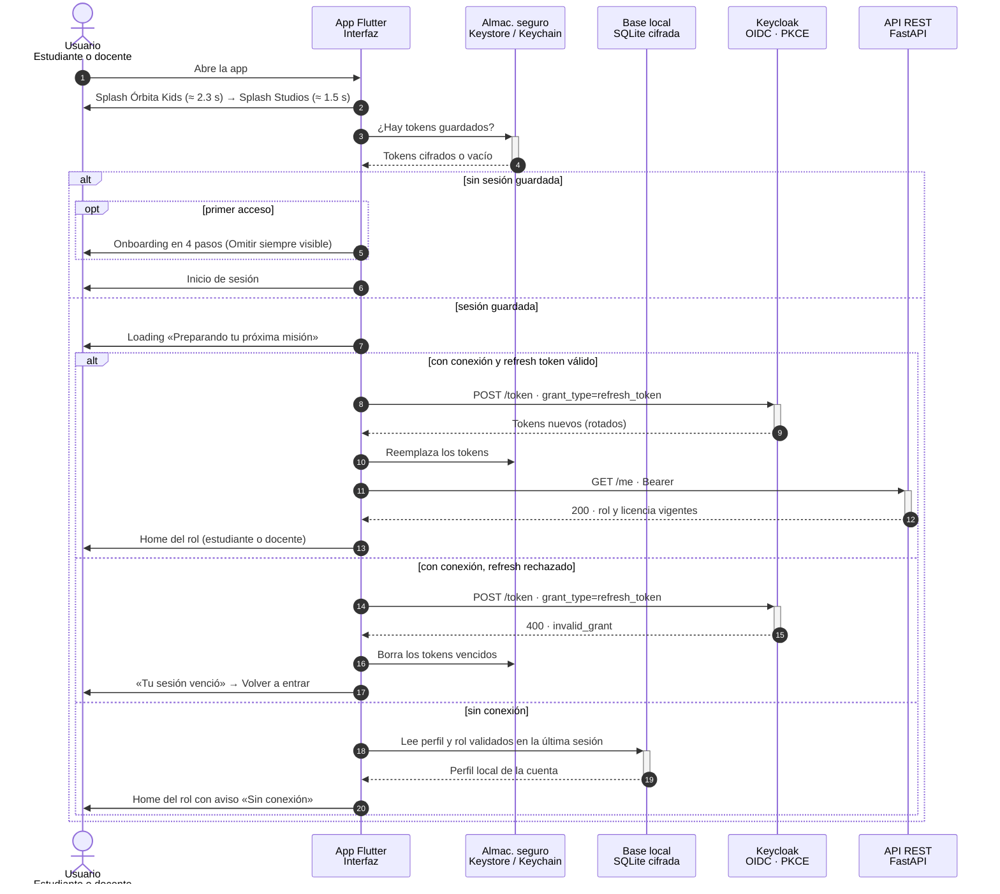

| # | De → a | Tipo | Mensaje | Contexto |
|---|---|---|---|---|
| 1 | Usuario → App Flutter | Síncrono | Abre la app | — |
| 2 | App Flutter → Usuario | Síncrono | Splash Órbita Kids (≈ 2.3 s) → Splash Studios (≈ 1.5 s) — Siempre en este orden; un toque omite la primera. Con «Reducir movimiento» aparecen sin desplazamientos. | — |
| 3 | App Flutter → Almac. seguro | Síncrono | ¿Hay tokens guardados? | — |
| 4 | Almac. seguro → App Flutter | Respuesta | Tokens cifrados o vacío | — |
| 5 | App Flutter → Usuario | Síncrono | Onboarding en 4 pasos (Omitir siempre visible) | alt [sin sesión guardada] › opt [primer acceso] |
| 6 | App Flutter → Usuario | Síncrono | Inicio de sesión — Continúa en SD-02. | alt [sin sesión guardada] |
| 7 | App Flutter → Usuario | Síncrono | Loading «Preparando tu próxima misión» | alt [sesión guardada] |
| 8 | App Flutter → Keycloak | Síncrono | POST /token · grant_type=refresh_token | alt [sesión guardada] › alt [con conexión y refresh token válido] |
| 9 | Keycloak → App Flutter | Respuesta | Tokens nuevos (rotados) | alt [sesión guardada] › alt [con conexión y refresh token válido] |
| 10 | App Flutter → Almac. seguro | Síncrono | Reemplaza los tokens | alt [sesión guardada] › alt [con conexión y refresh token válido] |
| 11 | App Flutter → API REST | Síncrono | GET /me · Bearer — El rol siempre lo decide el backend. | alt [sesión guardada] › alt [con conexión y refresh token válido] |
| 12 | API REST → App Flutter | Respuesta | 200 · rol y licencia vigentes | alt [sesión guardada] › alt [con conexión y refresh token válido] |
| 13 | App Flutter → Usuario | Síncrono | Home del rol (estudiante o docente) | alt [sesión guardada] › alt [con conexión y refresh token válido] |
| 14 | App Flutter → Keycloak | Síncrono | POST /token · grant_type=refresh_token | alt [sesión guardada] › alt [con conexión, refresh rechazado] |
| 15 | Keycloak → App Flutter | Respuesta | 400 · invalid_grant | alt [sesión guardada] › alt [con conexión, refresh rechazado] |
| 16 | App Flutter → Almac. seguro | Síncrono | Borra los tokens vencidos | alt [sesión guardada] › alt [con conexión, refresh rechazado] |
| 17 | App Flutter → Usuario | Síncrono | «Tu sesión venció» → Volver a entrar | alt [sesión guardada] › alt [con conexión, refresh rechazado] |
| 18 | App Flutter → Base local | Síncrono | Lee perfil y rol validados en la última sesión | alt [sesión guardada] › alt [sin conexión] |
| 19 | Base local → App Flutter | Respuesta | Perfil local de la cuenta | alt [sesión guardada] › alt [sin conexión] |
| 20 | App Flutter → Usuario | Síncrono | Home del rol con aviso «Sin conexión» — Solo funciona lo descargado; los envíos esperan en la cola. | alt [sesión guardada] › alt [sin conexión] |

---

## SD-02

### Inicio de sesión federado con Keycloak

Authorization Code Flow con PKCE en el navegador seguro del sistema. Keycloak centraliza Google, Facebook, la identidad institucional y la cuenta Órbita Kids; el backend asigna el rol.

- **Participantes:** Usuario (actor), App Flutter, Navegador, Keycloak, Proveedor, Almac. seguro, API REST, Base de datos
- **Precondición:** Con Internet. El usuario está en Inicio de sesión.
- **Resultado:** Tokens guardados en almacenamiento seguro y Home del rol, o una pantalla de estado con salida.
- **Pantallas del prototipo:** 05a · Inicio de sesión, 06 · Acceso con Google, 08a · Acceso institucional, 04a · Loading, 09a · Estados de autenticación

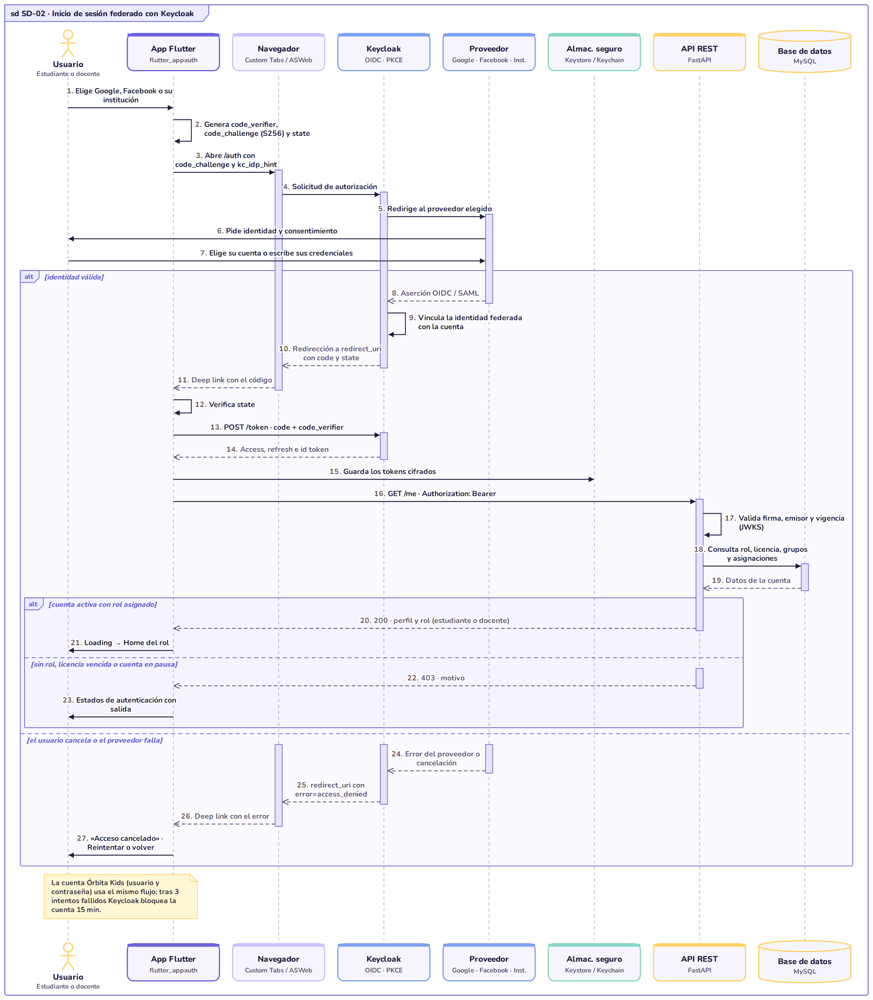

Archivos: [PNG claro](png/SD-02_inicio_de_sesion_federado_con_keycloak_claro.png) · [PNG oscuro](png/SD-02_inicio_de_sesion_federado_con_keycloak_oscuro.png) · [SVG claro](svg/SD-02_inicio_de_sesion_federado_con_keycloak_claro.svg) · [SVG oscuro](svg/SD-02_inicio_de_sesion_federado_con_keycloak_oscuro.svg) · [Mermaid](mermaid/SD-02_inicio_de_sesion_federado_con_keycloak.mmd)

Código Mermaid

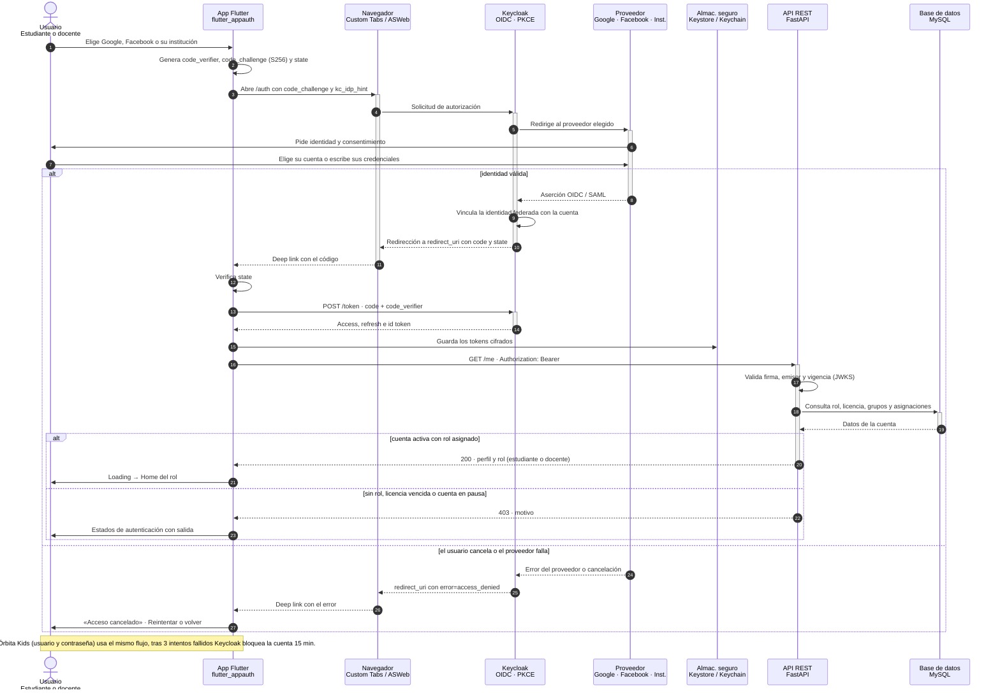

| # | De → a | Tipo | Mensaje | Contexto |
|---|---|---|---|---|
| 1 | Usuario → App Flutter | Síncrono | Elige Google, Facebook o su institución | — |
| 2 | App Flutter → App Flutter | Síncrono | Genera code_verifier, code_challenge (S256) y state — No hay secreto de cliente dentro de la app. | — |
| 3 | App Flutter → Navegador | Síncrono | Abre /auth con code_challenge y kc_idp_hint — Nunca un WebView: el navegador del sistema protege las credenciales. | — |
| 4 | Navegador → Keycloak | Síncrono | Solicitud de autorización | — |
| 5 | Keycloak → Proveedor | Síncrono | Redirige al proveedor elegido | — |
| 6 | Proveedor → Usuario | Síncrono | Pide identidad y consentimiento | — |
| 7 | Usuario → Proveedor | Síncrono | Elige su cuenta o escribe sus credenciales | — |
| 8 | Proveedor → Keycloak | Respuesta | Aserción OIDC / SAML | alt [identidad válida] |
| 9 | Keycloak → Keycloak | Síncrono | Vincula la identidad federada con la cuenta | alt [identidad válida] |
| 10 | Keycloak → Navegador | Respuesta | Redirección a redirect_uri con code y state | alt [identidad válida] |
| 11 | Navegador → App Flutter | Respuesta | Deep link con el código | alt [identidad válida] |
| 12 | App Flutter → App Flutter | Síncrono | Verifica state | alt [identidad válida] |
| 13 | App Flutter → Keycloak | Síncrono | POST /token · code + code_verifier | alt [identidad válida] |
| 14 | Keycloak → App Flutter | Respuesta | Access, refresh e id token | alt [identidad válida] |
| 15 | App Flutter → Almac. seguro | Síncrono | Guarda los tokens cifrados | alt [identidad válida] |
| 16 | App Flutter → API REST | Síncrono | GET /me · Authorization: Bearer | alt [identidad válida] |
| 17 | API REST → API REST | Síncrono | Valida firma, emisor y vigencia (JWKS) | alt [identidad válida] |
| 18 | API REST → Base de datos | Síncrono | Consulta rol, licencia, grupos y asignaciones | alt [identidad válida] |
| 19 | Base de datos → API REST | Respuesta | Datos de la cuenta | alt [identidad válida] |
| 20 | API REST → App Flutter | Respuesta | 200 · perfil y rol (estudiante o docente) | alt [identidad válida] › alt [cuenta activa con rol asignado] |
| 21 | App Flutter → Usuario | Síncrono | Loading → Home del rol | alt [identidad válida] › alt [cuenta activa con rol asignado] |
| 22 | API REST → App Flutter | Respuesta | 403 · motivo | alt [identidad válida] › alt [sin rol, licencia vencida o cuenta en pausa] |
| 23 | App Flutter → Usuario | Síncrono | Estados de autenticación con salida — Rol no asignado, cuenta en pausa o error del backend: siempre hay Reintentar, Ayuda o Volver al login. | alt [identidad válida] › alt [sin rol, licencia vencida o cuenta en pausa] |
| 24 | Proveedor → Keycloak | Respuesta | Error del proveedor o cancelación | alt [el usuario cancela o el proveedor falla] |
| 25 | Keycloak → Navegador | Respuesta | redirect_uri con error=access_denied | alt [el usuario cancela o el proveedor falla] |
| 26 | Navegador → App Flutter | Respuesta | Deep link con el error | alt [el usuario cancela o el proveedor falla] |
| 27 | App Flutter → Usuario | Síncrono | «Acceso cancelado» · Reintentar o volver | alt [el usuario cancela o el proveedor falla] |

---

## SD-03

### Registro de estudiante con código de grupo

El estudiante se une al grupo de su maestra con un código de la licencia escolar. El backend valida vigencia y lugares antes de crear la cuenta en Keycloak.

- **Participantes:** Estudiante (actor), App Flutter, API REST, Keycloak, Base de datos
- **Precondición:** Con Internet. El estudiante tiene un código de grupo y la ayuda de un adulto.
- **Resultado:** Cuenta creada con rol estudiante dentro del grupo, o un mensaje que explica cómo seguir.
- **Pantallas del prototipo:** 10a · Registro, 11a · Código de grupo

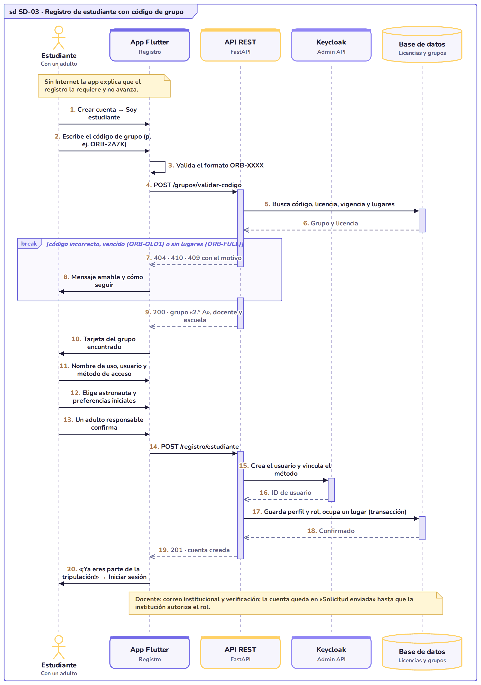

Archivos: [PNG claro](png/SD-03_registro_de_estudiante_con_codigo_de_grupo_claro.png) · [PNG oscuro](png/SD-03_registro_de_estudiante_con_codigo_de_grupo_oscuro.png) · [SVG claro](svg/SD-03_registro_de_estudiante_con_codigo_de_grupo_claro.svg) · [SVG oscuro](svg/SD-03_registro_de_estudiante_con_codigo_de_grupo_oscuro.svg) · [Mermaid](mermaid/SD-03_registro_de_estudiante_con_codigo_de_grupo.mmd)

Código Mermaid

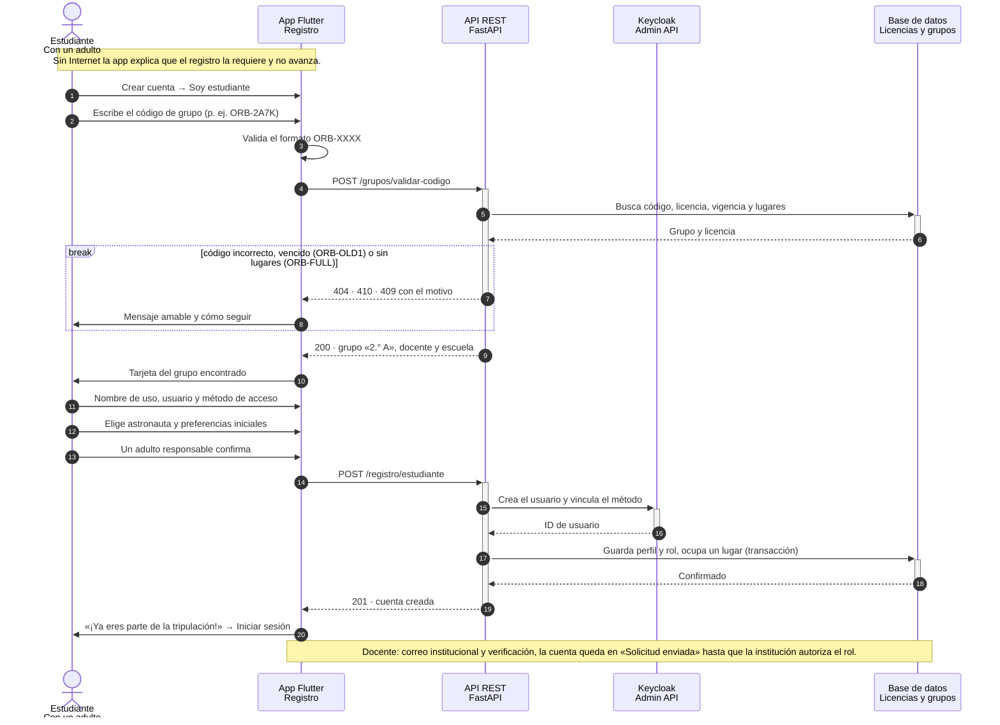

| # | De → a | Tipo | Mensaje | Contexto |
|---|---|---|---|---|
| 1 | Estudiante → App Flutter | Síncrono | Crear cuenta → Soy estudiante | — |
| 2 | Estudiante → App Flutter | Síncrono | Escribe el código de grupo (p. ej. ORB-2A7K) | — |
| 3 | App Flutter → App Flutter | Síncrono | Valida el formato ORB-XXXX | — |
| 4 | App Flutter → API REST | Síncrono | POST /grupos/validar-codigo | — |
| 5 | API REST → Base de datos | Síncrono | Busca código, licencia, vigencia y lugares | — |
| 6 | Base de datos → API REST | Respuesta | Grupo y licencia | — |
| 7 | API REST → App Flutter | Respuesta | 404 · 410 · 409 con el motivo | break [código incorrecto, vencido (ORB-OLD1) o sin lugares (ORB-FULL)] |
| 8 | App Flutter → Estudiante | Síncrono | Mensaje amable y cómo seguir — Pedir un código nuevo a la maestra o revisar lo escrito. El estudiante nunca crea códigos. | break [código incorrecto, vencido (ORB-OLD1) o sin lugares (ORB-FULL)] |
| 9 | API REST → App Flutter | Respuesta | 200 · grupo «2.° A», docente y escuela | — |
| 10 | App Flutter → Estudiante | Síncrono | Tarjeta del grupo encontrado | — |
| 11 | Estudiante → App Flutter | Síncrono | Nombre de uso, usuario y método de acceso | — |
| 12 | Estudiante → App Flutter | Síncrono | Elige astronauta y preferencias iniciales | — |
| 13 | Estudiante → App Flutter | Síncrono | Un adulto responsable confirma | — |
| 14 | App Flutter → API REST | Síncrono | POST /registro/estudiante | — |
| 15 | API REST → Keycloak | Síncrono | Crea el usuario y vincula el método | — |
| 16 | Keycloak → API REST | Respuesta | ID de usuario | — |
| 17 | API REST → Base de datos | Síncrono | Guarda perfil y rol, ocupa un lugar (transacción) | — |
| 18 | Base de datos → API REST | Respuesta | Confirmado | — |
| 19 | API REST → App Flutter | Respuesta | 201 · cuenta creada | — |
| 20 | App Flutter → Estudiante | Síncrono | «¡Ya eres parte de la tripulación!» → Iniciar sesión | — |

---

## SD-04

### Resolver una misión (offline first)

Una misión de sumas completa sin depender de Internet. Cada intento se guarda en la base local con un UUID y se encola; el motor de reglas (sin IA) adapta la ayuda y la recomendación.

- **Participantes:** Estudiante (actor), App Flutter, Motor de reglas, Base local, Cola de sync
- **Precondición:** Sesión de estudiante y misión descargada. La conexión es opcional.
- **Resultado:** Intentos, resultado e insignias guardados localmente y en cola para sincronizar.
- **Pantallas del prototipo:** 15a · Home estudiante, 19a · Detalle de misión, 20a · Sumas con apoyo visual, 21a · Selección de respuestas, 22a · Resultados y recompensas, 26a · Pausa Estelar

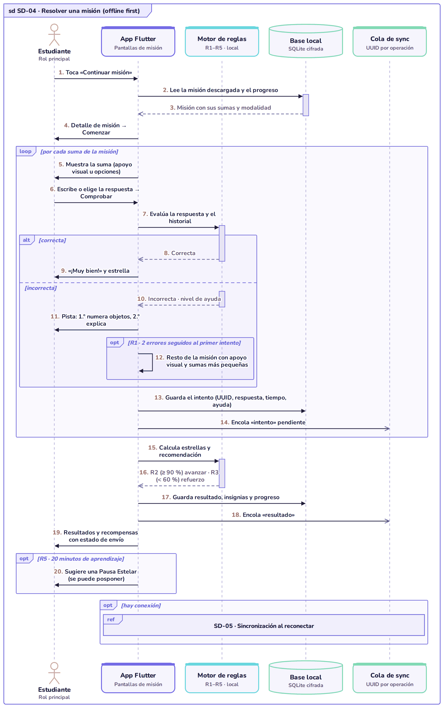

Archivos: [PNG claro](png/SD-04_resolver_una_mision_offline_first_claro.png) · [PNG oscuro](png/SD-04_resolver_una_mision_offline_first_oscuro.png) · [SVG claro](svg/SD-04_resolver_una_mision_offline_first_claro.svg) · [SVG oscuro](svg/SD-04_resolver_una_mision_offline_first_oscuro.svg) · [Mermaid](mermaid/SD-04_resolver_una_mision_offline_first.mmd)

Código Mermaid

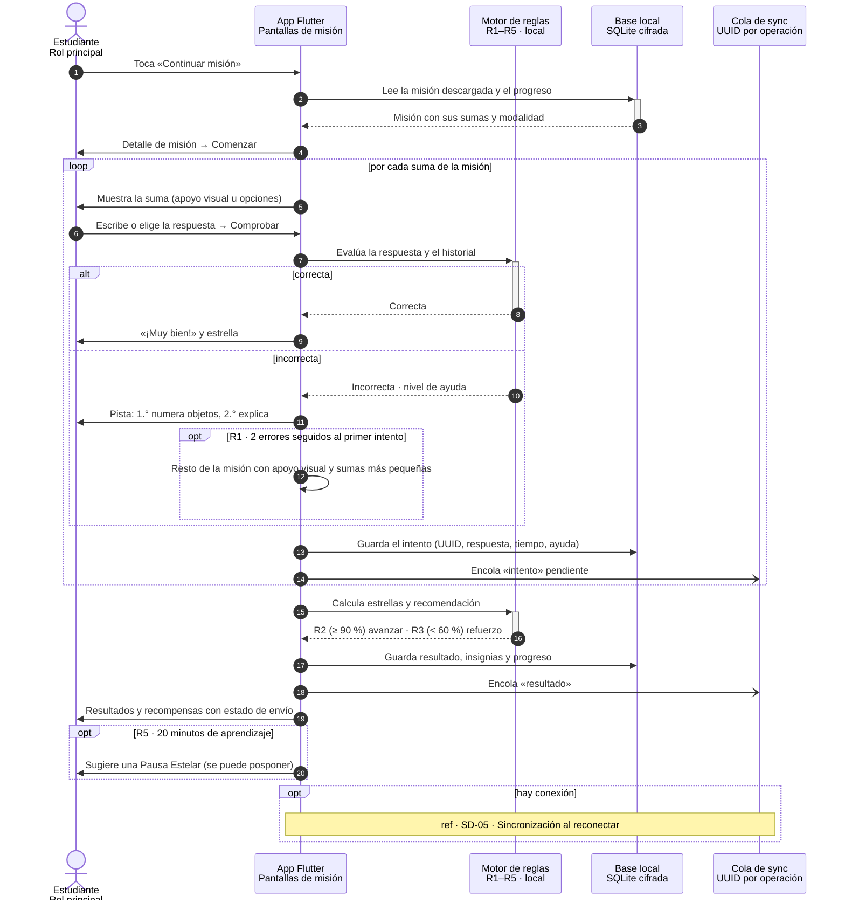

| # | De → a | Tipo | Mensaje | Contexto |
|---|---|---|---|---|
| 1 | Estudiante → App Flutter | Síncrono | Toca «Continuar misión» | — |
| 2 | App Flutter → Base local | Síncrono | Lee la misión descargada y el progreso | — |
| 3 | Base local → App Flutter | Respuesta | Misión con sus sumas y modalidad | — |
| 4 | App Flutter → Estudiante | Síncrono | Detalle de misión → Comenzar | — |
| 5 | App Flutter → Estudiante | Síncrono | Muestra la suma (apoyo visual u opciones) | loop [por cada suma de la misión] |
| 6 | Estudiante → App Flutter | Síncrono | Escribe o elige la respuesta → Comprobar | loop [por cada suma de la misión] |
| 7 | App Flutter → Motor de reglas | Síncrono | Evalúa la respuesta y el historial | loop [por cada suma de la misión] |
| 8 | Motor de reglas → App Flutter | Respuesta | Correcta | loop [por cada suma de la misión] › alt [correcta] |
| 9 | App Flutter → Estudiante | Síncrono | «¡Muy bien!» y estrella | loop [por cada suma de la misión] › alt [correcta] |
| 10 | Motor de reglas → App Flutter | Respuesta | Incorrecta · nivel de ayuda | loop [por cada suma de la misión] › alt [incorrecta] |
| 11 | App Flutter → Estudiante | Síncrono | Pista: 1.° numera objetos, 2.° explica — Sin mensajes negativos. En selección de respuestas, la correcta se revela al segundo intento. | loop [por cada suma de la misión] › alt [incorrecta] |
| 12 | App Flutter → App Flutter | Síncrono | Resto de la misión con apoyo visual y sumas más pequeñas | loop [por cada suma de la misión] › alt [incorrecta] › opt [R1 · 2 errores seguidos al primer intento] |
| 13 | App Flutter → Base local | Síncrono | Guarda el intento (UUID, respuesta, tiempo, ayuda) | loop [por cada suma de la misión] |
| 14 | App Flutter → Cola de sync | Asíncrono | Encola «intento» pendiente | loop [por cada suma de la misión] |
| 15 | App Flutter → Motor de reglas | Síncrono | Calcula estrellas y recomendación | — |
| 16 | Motor de reglas → App Flutter | Respuesta | R2 (≥ 90 %) avanzar · R3 (< 60 %) refuerzo | — |
| 17 | App Flutter → Base local | Síncrono | Guarda resultado, insignias y progreso | — |
| 18 | App Flutter → Cola de sync | Asíncrono | Encola «resultado» | — |
| 19 | App Flutter → Estudiante | Síncrono | Resultados y recompensas con estado de envío | — |
| 20 | App Flutter → Estudiante | Síncrono | Sugiere una Pausa Estelar (se puede posponer) | opt [R5 · 20 minutos de aprendizaje] |
| — | — | ref | SD-05 · Sincronización al reconectar | opt [hay conexión] |

---

## SD-05

### Sincronización al reconectar

La cola local envía cada operación con su UUID como clave de idempotencia. Lo confirmado en el servidor gana y solo se retiran de la cola los registros confirmados.

- **Participantes:** App Flutter, Monitor de red, Servicio sync, Cola local, Keycloak, API REST, Base de datos
- **Precondición:** Hay operaciones pendientes en la cola local y la conexión vuelve.
- **Resultado:** Cola vacía o con reintentos programados; progreso local y remoto coinciden.
- **Pantallas del prototipo:** 38a · Estado de conexión, 40a · Sincronización, 22a · Resultados y recompensas

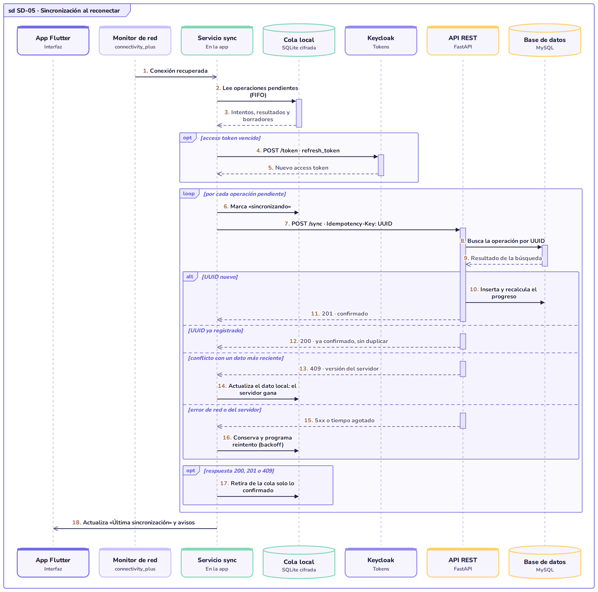

Archivos: [PNG claro](png/SD-05_sincronizacion_al_reconectar_claro.png) · [PNG oscuro](png/SD-05_sincronizacion_al_reconectar_oscuro.png) · [SVG claro](svg/SD-05_sincronizacion_al_reconectar_claro.svg) · [SVG oscuro](svg/SD-05_sincronizacion_al_reconectar_oscuro.svg) · [Mermaid](mermaid/SD-05_sincronizacion_al_reconectar.mmd)

Código Mermaid

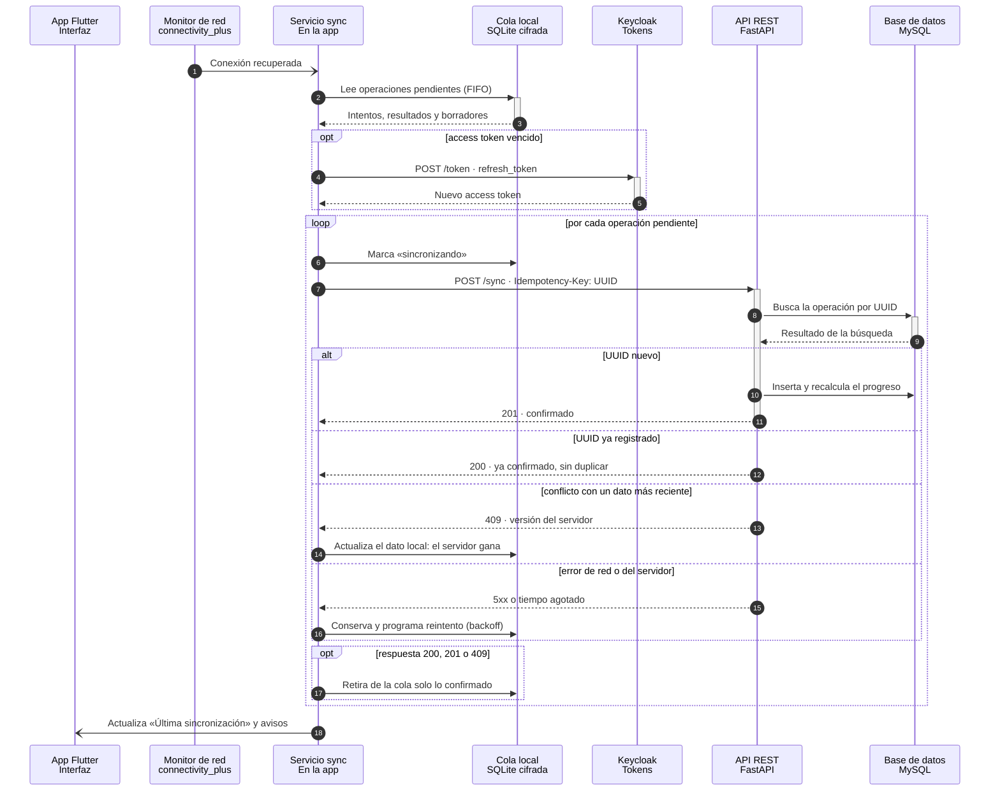

| # | De → a | Tipo | Mensaje | Contexto |
|---|---|---|---|---|
| 1 | Monitor de red → Servicio sync | Asíncrono | Conexión recuperada | — |
| 2 | Servicio sync → Cola local | Síncrono | Lee operaciones pendientes (FIFO) | — |
| 3 | Cola local → Servicio sync | Respuesta | Intentos, resultados y borradores | — |
| 4 | Servicio sync → Keycloak | Síncrono | POST /token · refresh_token | opt [access token vencido] |
| 5 | Keycloak → Servicio sync | Respuesta | Nuevo access token | opt [access token vencido] |
| 6 | Servicio sync → Cola local | Síncrono | Marca «sincronizando» | loop [por cada operación pendiente] |
| 7 | Servicio sync → API REST | Síncrono | POST /sync · Idempotency-Key: UUID | loop [por cada operación pendiente] |
| 8 | API REST → Base de datos | Síncrono | Busca la operación por UUID | loop [por cada operación pendiente] |
| 9 | Base de datos → API REST | Respuesta | Resultado de la búsqueda | loop [por cada operación pendiente] |
| 10 | API REST → Base de datos | Síncrono | Inserta y recalcula el progreso | loop [por cada operación pendiente] › alt [UUID nuevo] |
| 11 | API REST → Servicio sync | Respuesta | 201 · confirmado | loop [por cada operación pendiente] › alt [UUID nuevo] |
| 12 | API REST → Servicio sync | Respuesta | 200 · ya confirmado, sin duplicar | loop [por cada operación pendiente] › alt [UUID ya registrado] |
| 13 | API REST → Servicio sync | Respuesta | 409 · versión del servidor | loop [por cada operación pendiente] › alt [conflicto con un dato más reciente] |
| 14 | Servicio sync → Cola local | Síncrono | Actualiza el dato local: el servidor gana — Nunca se sobrescribe el servidor con registros antiguos. | loop [por cada operación pendiente] › alt [conflicto con un dato más reciente] |
| 15 | API REST → Servicio sync | Respuesta | 5xx o tiempo agotado | loop [por cada operación pendiente] › alt [error de red o del servidor] |
| 16 | Servicio sync → Cola local | Síncrono | Conserva y programa reintento (backoff) | loop [por cada operación pendiente] › alt [error de red o del servidor] |
| 17 | Servicio sync → Cola local | Síncrono | Retira de la cola solo lo confirmado | loop [por cada operación pendiente] › opt [respuesta 200, 201 o 409] |
| 18 | Servicio sync → App Flutter | Asíncrono | Actualiza «Última sincronización» y avisos | — |

---

## SD-06

### Docente publica una actividad y revisa el progreso

El docente prepara la actividad (también sin Internet como borrador), la publica para su grupo y luego revisa resultados. El backend verifica que el grupo le pertenezca.

- **Participantes:** Docente (actor), App docente, API REST, Base de datos, App estudiante, Estudiante (actor)
- **Precondición:** Sesión docente autorizada con al menos un grupo.
- **Resultado:** Actividad activa en las apps del grupo y reporte disponible para el docente.
- **Pantallas del prototipo:** 29 · Home docente, 33a · Crear actividad, 34a · Actividades, 16a · Mis actividades, 35 · Resultados y reportes, 32 · Detalle del estudiante

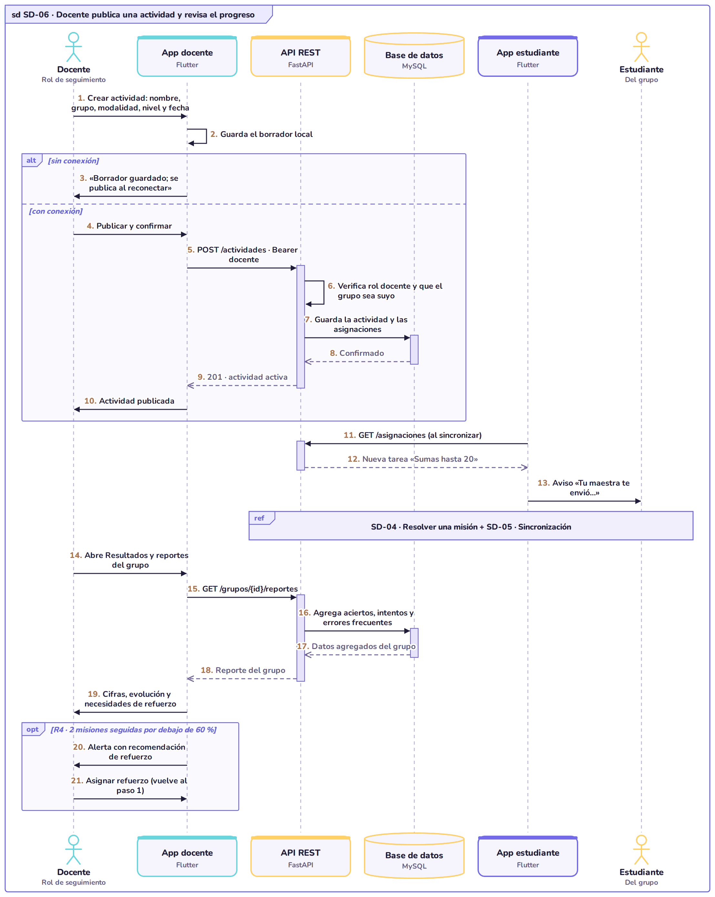

Archivos: [PNG claro](png/SD-06_docente_publica_una_actividad_y_revisa_el_progreso_claro.png) · [PNG oscuro](png/SD-06_docente_publica_una_actividad_y_revisa_el_progreso_oscuro.png) · [SVG claro](svg/SD-06_docente_publica_una_actividad_y_revisa_el_progreso_claro.svg) · [SVG oscuro](svg/SD-06_docente_publica_una_actividad_y_revisa_el_progreso_oscuro.svg) · [Mermaid](mermaid/SD-06_docente_publica_una_actividad_y_revisa_el_progreso.mmd)

Código Mermaid

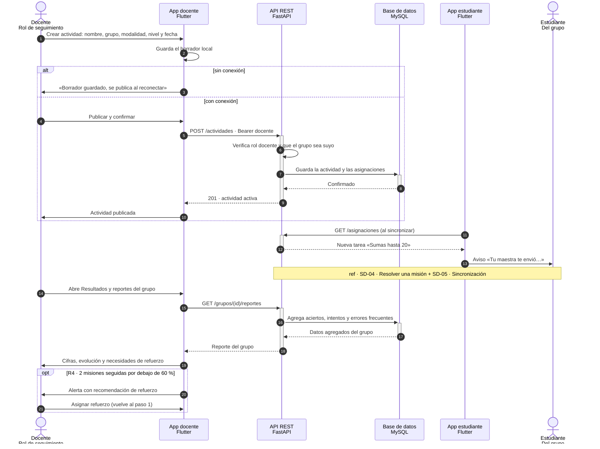

| # | De → a | Tipo | Mensaje | Contexto |
|---|---|---|---|---|
| 1 | Docente → App docente | Síncrono | Crear actividad: nombre, grupo, modalidad, nivel y fecha | — |
| 2 | App docente → App docente | Síncrono | Guarda el borrador local | — |
| 3 | App docente → Docente | Síncrono | «Borrador guardado; se publica al reconectar» | alt [sin conexión] |
| 4 | Docente → App docente | Síncrono | Publicar y confirmar | alt [con conexión] |
| 5 | App docente → API REST | Síncrono | POST /actividades · Bearer docente | alt [con conexión] |
| 6 | API REST → API REST | Síncrono | Verifica rol docente y que el grupo sea suyo | alt [con conexión] |
| 7 | API REST → Base de datos | Síncrono | Guarda la actividad y las asignaciones | alt [con conexión] |
| 8 | Base de datos → API REST | Respuesta | Confirmado | alt [con conexión] |
| 9 | API REST → App docente | Respuesta | 201 · actividad activa | alt [con conexión] |
| 10 | App docente → Docente | Síncrono | Actividad publicada | alt [con conexión] |
| 11 | App estudiante → API REST | Síncrono | GET /asignaciones (al sincronizar) | — |
| 12 | API REST → App estudiante | Respuesta | Nueva tarea «Sumas hasta 20» | — |
| 13 | App estudiante → Estudiante | Síncrono | Aviso «Tu maestra te envió…» | — |
| — | — | ref | SD-04 · Resolver una misión  +  SD-05 · Sincronización | — |
| 14 | Docente → App docente | Síncrono | Abre Resultados y reportes del grupo | — |
| 15 | App docente → API REST | Síncrono | GET /grupos/{id}/reportes | — |
| 16 | API REST → Base de datos | Síncrono | Agrega aciertos, intentos y errores frecuentes | — |
| 17 | Base de datos → API REST | Respuesta | Datos agregados del grupo | — |
| 18 | API REST → App docente | Respuesta | Reporte del grupo | — |
| 19 | App docente → Docente | Síncrono | Cifras, evolución y necesidades de refuerzo | — |
| 20 | App docente → Docente | Síncrono | Alerta con recomendación de refuerzo | opt [R4 · 2 misiones seguidas por debajo de 60 %] |
| 21 | Docente → App docente | Síncrono | Asignar refuerzo (vuelve al paso 1) | opt [R4 · 2 misiones seguidas por debajo de 60 %] |

---

## SD-07

### Cerrar sesión de forma segura

Salir no borra el progreso pendiente: primero intenta enviarlo, luego revoca la sesión en Keycloak y retira los tokens del teléfono. Sin conexión, aísla los pendientes de la cuenta.

- **Participantes:** Usuario (actor), App Flutter, Cola local, Almac. seguro, Keycloak
- **Precondición:** Sesión iniciada (estudiante o docente).
- **Resultado:** Tokens retirados, memoria limpia y la app en Inicio de sesión.
- **Pantallas del prototipo:** 25 · Perfil del estudiante, 49a · Cerrar sesión, 05a · Inicio de sesión

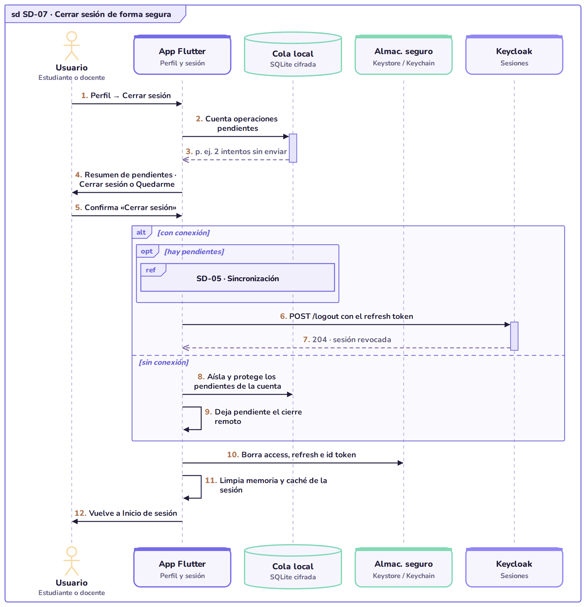

Archivos: [PNG claro](png/SD-07_cerrar_sesion_de_forma_segura_claro.png) · [PNG oscuro](png/SD-07_cerrar_sesion_de_forma_segura_oscuro.png) · [SVG claro](svg/SD-07_cerrar_sesion_de_forma_segura_claro.svg) · [SVG oscuro](svg/SD-07_cerrar_sesion_de_forma_segura_oscuro.svg) · [Mermaid](mermaid/SD-07_cerrar_sesion_de_forma_segura.mmd)

Código Mermaid

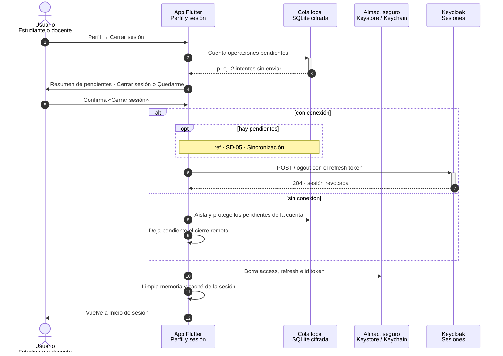

| # | De → a | Tipo | Mensaje | Contexto |
|---|---|---|---|---|
| 1 | Usuario → App Flutter | Síncrono | Perfil → Cerrar sesión | — |
| 2 | App Flutter → Cola local | Síncrono | Cuenta operaciones pendientes | — |
| 3 | Cola local → App Flutter | Respuesta | p. ej. 2 intentos sin enviar | — |
| 4 | App Flutter → Usuario | Síncrono | Resumen de pendientes · Cerrar sesión o Quedarme | — |
| 5 | Usuario → App Flutter | Síncrono | Confirma «Cerrar sesión» | — |
| — | — | ref | SD-05 · Sincronización | alt [con conexión] › opt [hay pendientes] |
| 6 | App Flutter → Keycloak | Síncrono | POST /logout con el refresh token | alt [con conexión] |
| 7 | Keycloak → App Flutter | Respuesta | 204 · sesión revocada | alt [con conexión] |
| 8 | App Flutter → Cola local | Síncrono | Aísla y protege los pendientes de la cuenta | alt [sin conexión] |
| 9 | App Flutter → App Flutter | Síncrono | Deja pendiente el cierre remoto | alt [sin conexión] |
| 10 | App Flutter → Almac. seguro | Síncrono | Borra access, refresh e id token | — |
| 11 | App Flutter → App Flutter | Síncrono | Limpia memoria y caché de la sesión | — |
| 12 | App Flutter → Usuario | Síncrono | Vuelve a Inicio de sesión | — |
