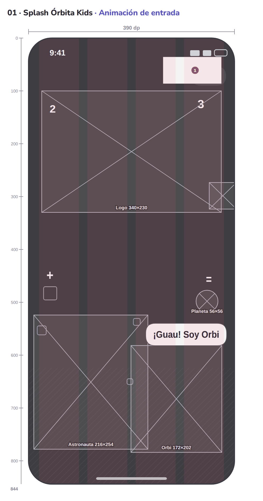
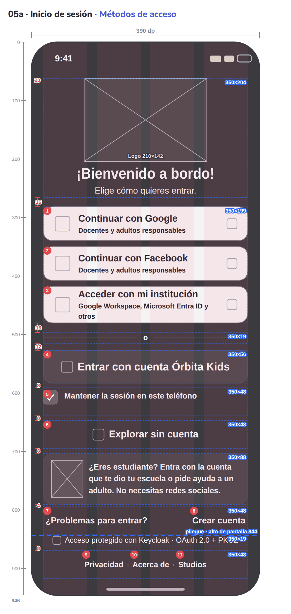
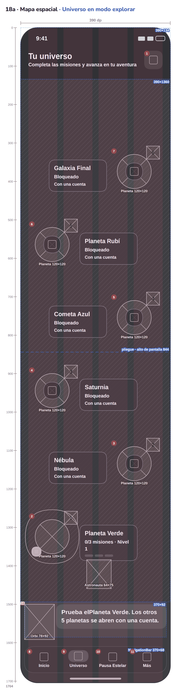

 

# 🪐 ` Ó R B I T A · K I D S ` 🚀

### ✨ CADA DETALLE GUÍA EL APRENDIZAJE ✨

# 📐 WIREFRAMES · MÓVIL

**ESTRUCTURA VISUAL · MEDIDAS Y ACCIONES DE LA APP**

 

  

### 📏 ORDENA · VALIDA · CONSTRUYE

---

## 📸 Previsualización de wireframes

*Estructuras visuales que organizan las pantallas y sus medidas para la implementación móvil.*

| Inicio | Autenticación | Exploración |
|:---:|:---:|:---:|
|  |  |  |

---

## Contexto dentro de Órbita Kids

Los wireframes convierten las ideas de los sketches y de la propuesta visual en una estructura que puede revisarse con precisión. En ellos se comprueban jerarquías, espacios, tamaños, áreas táctiles y recorridos de cada pantalla de la aplicación móvil.

Se construyen sobre una referencia de **390 × 844 dp**, con rejilla, márgenes y componentes definidos para mantener consistencia entre las distintas secciones de Órbita Kids. El resultado funciona como una guía visual cercana a la implementación: ayuda a que el equipo traduzca las decisiones de diseño a widgets, layouts y estados de Flutter sin depender solo de una imagen decorativa.

Los wireframes, disponibles en PNG y SVG, también permiten comparar la estructura con el prototipo y detectar antes del desarrollo problemas de legibilidad, navegación o accesibilidad táctil.

## 🎯 Objetivo dentro del desarrollo móvil

Los wireframes sirven como especificación visual intermedia entre la idea y el código. Permiten revisar cómo se distribuyen los contenidos, qué elementos son interactivos y qué espacio necesita cada componente antes de construir las vistas en Flutter.

## 🧭 Proceso y alcance

Se elaboran a partir de los recorridos definidos en Figma y de los estados explorados en los sketches. Cada pantalla aplica una referencia común de ancho, alto, márgenes, rejilla y áreas táctiles para que la experiencia conserve coherencia entre onboarding, autenticación, actividades, perfiles, modo offline y configuración.

El conjunto representa la estructura funcional de las pantallas móviles; no busca sustituir el diseño visual final, sino establecer una base medible para UI, accesibilidad y desarrollo.

## 🛠️ Tecnologías y herramientas

- **Figma:** organización de pantallas y flujos de referencia.
- **Flutter y dp:** unidad de medida y contexto de implementación.
- **PNG y SVG:** consulta, presentación y edición de los wireframes.
- **Markdown:** documentación de medidas, componentes y relaciones.

## ✨ Principios de diseño

Los wireframes priorizan jerarquía, consistencia, legibilidad, accesibilidad táctil y adaptación al dispositivo móvil. Cada medida busca que la interfaz sea comprensible y cómoda para la interacción del estudiante y del docente.

Cada estado está en dos formatos dentro de su sección:

- `NNN_….png` · imagen lista para presentar (2×).
- `svg/NNN_….svg` · vector editable (se abre en Figma, Illustrator, Inkscape o el navegador).

## Cómo leerlos

| Marca | Significado |
|---|---|
| Columnas rosas | Rejilla de 4 columnas |
| Recuadro azul punteado con «ancho×alto» | Bloque y su tamaño en dp |
| Cota roja a la izquierda | Espacio vertical entre bloques o margen (dp) |
| Círculo rojo con número | Acción numerada (misma numeración que el sketch) |
| Rectángulo con una X y su tamaño | Imagen o ilustración |
| Regla superior e izquierda | Ancho de 390 dp y alto en dp |
| Línea azul «pliegue» | Fin de la primera pantalla (844 dp) en pantallas desplazables |

## Sistema de medidas

- **Unidad:** dp lógicos de Flutter; 1 px del prototipo = 1 dp.
- **Lienzo de referencia:** 390 × 844 dp. El contenido empieza en y = 58 (área segura + aire).
- **Padding de pantalla:** `EdgeInsets.fromLTRB(20, 58, 20, 28)` → ancho útil 350 dp.
- **Rejilla:** 4 columnas · margen 20 · medianil 16 · columna de 75.5 dp.

| Componente | Medida | Widget |
|---|---|---|
| Botón principal | alto 56 · radio 18 | `FilledButton` |
| Botón de ícono | 48 × 48 | `IconButton` (mínimo táctil 48) |
| Campo de texto | alto 56 | `TextField` |
| Chip | alto 40 | `ChoiceChip` |
| Fila de lista | alto 68 | `ListTile` |
| Tarjeta | radio 22 | `Card` |
| Encabezado | radio inferior 32 | `Container` con gradiente |
| Navegación inferior | alto 68 (incluye área segura) | `NavigationBar` |

Tamaños de letra usados (dp): 11 · 12 · 13 · 14 · 15 · 16 · 17 · 18 · 19 · 20 · 21 · 22 · 23 · 24 · 26 · 28 · 30 · 40 · 42 · 44 · 46 · 54 · 58. Fredoka para títulos y números, Nunito para texto; todo escala con `TextScaler` (100 % a 160 %).

La ficha completa de cada wireframe (bloques, posiciones, medidas relativas, tipografía y áreas táctiles) está en la pestaña **Wireframes** del prototipo (`../prototipo/Órbita_Kids_Prototipo.html`), botón «Ampliar».

## Carpetas

| Carpeta | Sección | Wireframes |
|---|---|---|
| `02_splash_y_onboarding/` | 02 · Splash y onboarding | 10 |
| `03_autenticacion_y_seguridad/` | 03 · Autenticación y seguridad | 43 |
| `03b_modo_explorar_sin_cuenta/` | 03b · Modo explorar (sin cuenta) | 4 |
| `04_estudiante/` | 04 · Estudiante | 29 |
| `05_bienestar/` | 05 · Bienestar | 6 |
| `09_planes_y_expansion/` | 09 · Planes y expansión | 4 |
| `06_docente/` | 06 · Docente | 15 |
| `07_modo_offline/` | 07 · Modo offline | 7 |
| `08_configuracion_y_accesibilidad/` | 08 · Configuración y accesibilidad | 12 |

## Índice

### 02 · Splash y onboarding

| # | PNG | SVG | Pantalla · estado | Lienzo | Acciones |
|---|---|---|---|---|---|
| 1 | [01](02_splash_y_onboarding/001_01_splash-orbita-kids_animacion-de-entrada.png) | [svg](02_splash_y_onboarding/svg/001_01_splash-orbita-kids_animacion-de-entrada.svg) | Splash Órbita Kids · Animación de entrada | 390 × 844 | 1 |
| 2 | [02](02_splash_y_onboarding/002_02_splash-orbita-kids-studios_marca-de-la-empresa.png) | [svg](02_splash_y_onboarding/svg/002_02_splash-orbita-kids-studios_marca-de-la-empresa.svg) | Splash Órbita Kids Studios · Marca de la empresa | 390 × 844 | 0 |
| 3 | [03a](02_splash_y_onboarding/003_03a_onboarding_paso-1-de-5-hola-soy-orbi.png) | [svg](02_splash_y_onboarding/svg/003_03a_onboarding_paso-1-de-5-hola-soy-orbi.svg) | Onboarding · Paso 1 de 5: ¡Hola! Soy Orbi | 390 × 844 | 4 |
| 4 | [03b](02_splash_y_onboarding/004_03b_onboarding_paso-2-de-5-aprende-matematicas.png) | [svg](02_splash_y_onboarding/svg/004_03b_onboarding_paso-2-de-5-aprende-matematicas.svg) | Onboarding · Paso 2 de 5: Aprende matemáticas | 390 × 844 | 4 |
| 5 | [03c](02_splash_y_onboarding/005_03c_onboarding_paso-3-de-5-explora-nuevos-planeta.png) | [svg](02_splash_y_onboarding/svg/005_03c_onboarding_paso-3-de-5-explora-nuevos-planeta.svg) | Onboarding · Paso 3 de 5: Explora nuevos planetas | 390 × 844 | 4 |
| 6 | [03d](02_splash_y_onboarding/006_03d_onboarding_paso-4-de-5-completa-misiones.png) | [svg](02_splash_y_onboarding/svg/006_03d_onboarding_paso-4-de-5-completa-misiones.svg) | Onboarding · Paso 4 de 5: Completa misiones | 390 × 844 | 4 |
| 7 | [03e](02_splash_y_onboarding/007_03e_onboarding_paso-5-de-5-muevete-fuera-de-la-pa.png) | [svg](02_splash_y_onboarding/svg/007_03e_onboarding_paso-5-de-5-muevete-fuera-de-la-pa.svg) | Onboarding · Paso 5 de 5: Muévete fuera de la pantalla | 390 × 844 | 3 |
| 8 | [59](02_splash_y_onboarding/008_59_conoce-a-orbi_presentacion-de-orbi.png) | [svg](02_splash_y_onboarding/svg/008_59_conoce-a-orbi_presentacion-de-orbi.svg) | Conoce a Orbi · Presentación de Orbi | 390 × 1544 (desplazable) | 3 |
| 9 | [04a](02_splash_y_onboarding/009_04a_loading_flujo-keycloak-paso-a-paso.png) | [svg](02_splash_y_onboarding/svg/009_04a_loading_flujo-keycloak-paso-a-paso.svg) | Loading · Flujo Keycloak paso a paso | 390 × 844 | 0 |
| 10 | [04b](02_splash_y_onboarding/010_04b_loading_preparando-la-mision.png) | [svg](02_splash_y_onboarding/svg/010_04b_loading_preparando-la-mision.svg) | Loading · Preparando la misión | 390 × 844 | 0 |

### 03 · Autenticación y seguridad

| # | PNG | SVG | Pantalla · estado | Lienzo | Acciones |
|---|---|---|---|---|---|
| 11 | [05a](03_autenticacion_y_seguridad/011_05a_inicio-de-sesion_metodos-de-acceso.png) | [svg](03_autenticacion_y_seguridad/svg/011_05a_inicio-de-sesion_metodos-de-acceso.svg) | Inicio de sesión · Métodos de acceso | 390 × 946 (desplazable) | 11 |
| 12 | [05b](03_autenticacion_y_seguridad/012_05b_inicio-de-sesion_cuenta-orbita-kids.png) | [svg](03_autenticacion_y_seguridad/svg/012_05b_inicio-de-sesion_cuenta-orbita-kids.svg) | Inicio de sesión · Cuenta Órbita Kids | 390 × 1202 (desplazable) | 15 |
| 13 | [05c](03_autenticacion_y_seguridad/013_05c_inicio-de-sesion_campos-con-error.png) | [svg](03_autenticacion_y_seguridad/svg/013_05c_inicio-de-sesion_campos-con-error.svg) | Inicio de sesión · Campos con error | 390 × 1254 (desplazable) | 15 |
| 14 | [05d](03_autenticacion_y_seguridad/014_05d_inicio-de-sesion_sin-conexion.png) | [svg](03_autenticacion_y_seguridad/svg/014_05d_inicio-de-sesion_sin-conexion.svg) | Inicio de sesión · Sin conexión | 390 × 1094 (desplazable) | 12 |
| 16 | [06](03_autenticacion_y_seguridad/016_06_acceso-con-google_navegador-seguro-de-google.png) | [svg](03_autenticacion_y_seguridad/svg/016_06_acceso-con-google_navegador-seguro-de-google.svg) | Acceso con Google · Navegador seguro de Google | 390 × 844 | 12 |
| 17 | [07](03_autenticacion_y_seguridad/017_07_acceso-con-facebook_navegador-seguro-de-facebook.png) | [svg](03_autenticacion_y_seguridad/svg/017_07_acceso-con-facebook_navegador-seguro-de-facebook.svg) | Acceso con Facebook · Navegador seguro de Facebook | 390 × 844 | 11 |
| 18 | [08a](03_autenticacion_y_seguridad/018_08a_acceso-institucional_buscar-institucion.png) | [svg](03_autenticacion_y_seguridad/svg/018_08a_acceso-institucional_buscar-institucion.svg) | Acceso institucional · Buscar institución | 390 × 844 | 5 |
| 19 | [08b](03_autenticacion_y_seguridad/019_08b_acceso-institucional_cuentas-de-la-institucion.png) | [svg](03_autenticacion_y_seguridad/svg/019_08b_acceso-institucional_cuentas-de-la-institucion.svg) | Acceso institucional · Cuentas de la institución | 390 × 844 | 4 |
| 20 | [09a](03_autenticacion_y_seguridad/020_09a_estados-de-autenticacion_acceso-cancelado.png) | [svg](03_autenticacion_y_seguridad/svg/020_09a_estados-de-autenticacion_acceso-cancelado.svg) | Estados de autenticación · Acceso cancelado | 390 × 844 | 2 |
| 21 | [09b](03_autenticacion_y_seguridad/021_09b_estados-de-autenticacion_el-proveedor-tuvo-un-problema.png) | [svg](03_autenticacion_y_seguridad/svg/021_09b_estados-de-autenticacion_el-proveedor-tuvo-un-problema.svg) | Estados de autenticación · El proveedor tuvo un problema | 390 × 844 | 2 |
| 22 | [09c](03_autenticacion_y_seguridad/022_09c_estados-de-autenticacion_aun-no-tienes-cuenta.png) | [svg](03_autenticacion_y_seguridad/svg/022_09c_estados-de-autenticacion_aun-no-tienes-cuenta.svg) | Estados de autenticación · Aún no tienes cuenta | 390 × 844 | 2 |
| 23 | [09d](03_autenticacion_y_seguridad/023_09d_estados-de-autenticacion_cuenta-en-pausa.png) | [svg](03_autenticacion_y_seguridad/svg/023_09d_estados-de-autenticacion_cuenta-en-pausa.svg) | Estados de autenticación · Cuenta en pausa | 390 × 844 | 2 |
| 24 | [09e](03_autenticacion_y_seguridad/024_09e_estados-de-autenticacion_tu-cuenta-aun-no-tiene-rol.png) | [svg](03_autenticacion_y_seguridad/svg/024_09e_estados-de-autenticacion_tu-cuenta-aun-no-tiene-rol.svg) | Estados de autenticación · Tu cuenta aún no tiene rol | 390 × 844 | 2 |
| 25 | [09f](03_autenticacion_y_seguridad/025_09f_estados-de-autenticacion_proveedor-no-disponible.png) | [svg](03_autenticacion_y_seguridad/svg/025_09f_estados-de-autenticacion_proveedor-no-disponible.svg) | Estados de autenticación · Proveedor no disponible | 390 × 844 | 2 |
| 26 | [09g](03_autenticacion_y_seguridad/026_09g_estados-de-autenticacion_tu-sesion-termino.png) | [svg](03_autenticacion_y_seguridad/svg/026_09g_estados-de-autenticacion_tu-sesion-termino.svg) | Estados de autenticación · Tu sesión terminó | 390 × 844 | 1 |
| 27 | [09h](03_autenticacion_y_seguridad/027_09h_estados-de-autenticacion_sin-conexion.png) | [svg](03_autenticacion_y_seguridad/svg/027_09h_estados-de-autenticacion_sin-conexion.svg) | Estados de autenticación · Sin conexión | 390 × 844 | 2 |
| 28 | [09i](03_autenticacion_y_seguridad/028_09i_estados-de-autenticacion_vincular-cuentas.png) | [svg](03_autenticacion_y_seguridad/svg/028_09i_estados-de-autenticacion_vincular-cuentas.svg) | Estados de autenticación · Vincular cuentas | 390 × 844 | 2 |
| 29 | [09j](03_autenticacion_y_seguridad/029_09j_estados-de-autenticacion_no-pudimos-confirmar-tus-permisos.png) | [svg](03_autenticacion_y_seguridad/svg/029_09j_estados-de-autenticacion_no-pudimos-confirmar-tus-permisos.svg) | Estados de autenticación · No pudimos confirmar tus permisos | 390 × 844 | 2 |
| 30 | [10a](03_autenticacion_y_seguridad/030_10a_registro_elegir-tipo-de-cuenta.png) | [svg](03_autenticacion_y_seguridad/svg/030_10a_registro_elegir-tipo-de-cuenta.svg) | Registro · Elegir tipo de cuenta | 390 × 844 | 4 |
| 31 | [10b](03_autenticacion_y_seguridad/031_10b_registro_estudiante-paso-1-codigo.png) | [svg](03_autenticacion_y_seguridad/svg/031_10b_registro_estudiante-paso-1-codigo.svg) | Registro · Estudiante · paso 1: código | 390 × 844 | 2 |
| 32 | [10c](03_autenticacion_y_seguridad/032_10c_registro_estudiante-paso-1-grupo-validado.png) | [svg](03_autenticacion_y_seguridad/svg/032_10c_registro_estudiante-paso-1-grupo-validado.svg) | Registro · Estudiante · paso 1: grupo validado | 390 × 844 | 4 |
| 33 | [10d](03_autenticacion_y_seguridad/033_10d_registro_estudiante-paso-2-nombre.png) | [svg](03_autenticacion_y_seguridad/svg/033_10d_registro_estudiante-paso-2-nombre.svg) | Registro · Estudiante · paso 2: nombre | 390 × 844 | 5 |
| 34 | [10e](03_autenticacion_y_seguridad/034_10e_registro_estudiante-paso-2-errores.png) | [svg](03_autenticacion_y_seguridad/svg/034_10e_registro_estudiante-paso-2-errores.svg) | Registro · Estudiante · paso 2: errores | 390 × 844 | 5 |
| 35 | [10f](03_autenticacion_y_seguridad/035_10f_registro_estudiante-paso-3-acceso.png) | [svg](03_autenticacion_y_seguridad/svg/035_10f_registro_estudiante-paso-3-acceso.svg) | Registro · Estudiante · paso 3: acceso | 390 × 908 (desplazable) | 10 |
| 36 | [10g](03_autenticacion_y_seguridad/036_10g_registro_estudiante-paso-4-astronauta.png) | [svg](03_autenticacion_y_seguridad/svg/036_10g_registro_estudiante-paso-4-astronauta.svg) | Registro · Estudiante · paso 4: astronauta | 390 × 885 (desplazable) | 19 |
| 37 | [10h](03_autenticacion_y_seguridad/037_10h_registro_estudiante-paso-5-confirmar.png) | [svg](03_autenticacion_y_seguridad/svg/037_10h_registro_estudiante-paso-5-confirmar.svg) | Registro · Estudiante · paso 5: confirmar | 390 × 844 | 4 |
| 38 | [10i](03_autenticacion_y_seguridad/038_10i_registro_estudiante-cuenta-creada.png) | [svg](03_autenticacion_y_seguridad/svg/038_10i_registro_estudiante-cuenta-creada.svg) | Registro · Estudiante · cuenta creada | 390 × 844 | 1 |
| 39 | [10j](03_autenticacion_y_seguridad/039_10j_registro_docente-paso-1-datos.png) | [svg](03_autenticacion_y_seguridad/svg/039_10j_registro_docente-paso-1-datos.svg) | Registro · Docente · paso 1: datos | 390 × 844 | 6 |
| 40 | [10k](03_autenticacion_y_seguridad/040_10k_registro_docente-paso-2-metodo.png) | [svg](03_autenticacion_y_seguridad/svg/040_10k_registro_docente-paso-2-metodo.svg) | Registro · Docente · paso 2: método | 390 × 844 | 7 |
| 41 | [10l](03_autenticacion_y_seguridad/041_10l_registro_docente-paso-3-verificar-correo.png) | [svg](03_autenticacion_y_seguridad/svg/041_10l_registro_docente-paso-3-verificar-correo.svg) | Registro · Docente · paso 3: verificar correo | 390 × 844 | 9 |
| 42 | [10m](03_autenticacion_y_seguridad/042_10m_registro_docente-paso-4-permisos.png) | [svg](03_autenticacion_y_seguridad/svg/042_10m_registro_docente-paso-4-permisos.svg) | Registro · Docente · paso 4: permisos | 390 × 844 | 4 |
| 43 | [10n](03_autenticacion_y_seguridad/043_10n_registro_docente-solicitud-enviada.png) | [svg](03_autenticacion_y_seguridad/svg/043_10n_registro_docente-solicitud-enviada.svg) | Registro · Docente · solicitud enviada | 390 × 844 | 1 |
| 44 | [11a](03_autenticacion_y_seguridad/044_11a_codigo-de-grupo_escribir-codigo.png) | [svg](03_autenticacion_y_seguridad/svg/044_11a_codigo-de-grupo_escribir-codigo.svg) | Código de grupo · Escribir código | 390 × 844 | 4 |
| 45 | [11b](03_autenticacion_y_seguridad/045_11b_codigo-de-grupo_codigo-valido.png) | [svg](03_autenticacion_y_seguridad/svg/045_11b_codigo-de-grupo_codigo-valido.svg) | Código de grupo · Código válido | 390 × 844 | 4 |
| 46 | [11c](03_autenticacion_y_seguridad/046_11c_codigo-de-grupo_codigo-vencido.png) | [svg](03_autenticacion_y_seguridad/svg/046_11c_codigo-de-grupo_codigo-vencido.svg) | Código de grupo · Código vencido | 390 × 844 | 4 |
| 47 | [12a](03_autenticacion_y_seguridad/047_12a_recuperar-cuenta_elegir-como-entras.png) | [svg](03_autenticacion_y_seguridad/svg/047_12a_recuperar-cuenta_elegir-como-entras.svg) | Recuperar cuenta · Elegir cómo entras | 390 × 844 | 4 |
| 48 | [12b](03_autenticacion_y_seguridad/048_12b_recuperar-cuenta_revisa-tu-correo.png) | [svg](03_autenticacion_y_seguridad/svg/048_12b_recuperar-cuenta_revisa-tu-correo.svg) | Recuperar cuenta · Revisa tu correo | 390 × 844 | 4 |
| 49 | [12c](03_autenticacion_y_seguridad/049_12c_recuperar-cuenta_nueva-contrasena.png) | [svg](03_autenticacion_y_seguridad/svg/049_12c_recuperar-cuenta_nueva-contrasena.svg) | Recuperar cuenta · Nueva contraseña | 390 × 844 | 7 |
| 50 | [12d](03_autenticacion_y_seguridad/050_12d_recuperar-cuenta_contrasena-cambiada.png) | [svg](03_autenticacion_y_seguridad/svg/050_12d_recuperar-cuenta_contrasena-cambiada.svg) | Recuperar cuenta · Contraseña cambiada | 390 × 844 | 1 |
| 51 | [13](03_autenticacion_y_seguridad/051_13_cuenta-bloqueada_cuenta-bloqueada-15-min.png) | [svg](03_autenticacion_y_seguridad/svg/051_13_cuenta-bloqueada_cuenta-bloqueada-15-min.svg) | Cuenta bloqueada · Cuenta bloqueada 15 min | 390 × 844 | 3 |
| 52 | [14a](03_autenticacion_y_seguridad/052_14a_codigo-de-desbloqueo_escribir-codigo.png) | [svg](03_autenticacion_y_seguridad/svg/052_14a_codigo-de-desbloqueo_escribir-codigo.svg) | Código de desbloqueo · Escribir código | 390 × 844 | 10 |
| 53 | [14b](03_autenticacion_y_seguridad/053_14b_codigo-de-desbloqueo_codigo-incorrecto.png) | [svg](03_autenticacion_y_seguridad/svg/053_14b_codigo-de-desbloqueo_codigo-incorrecto.svg) | Código de desbloqueo · Código incorrecto | 390 × 844 | 10 |
| 54 | [14c](03_autenticacion_y_seguridad/054_14c_codigo-de-desbloqueo_cuenta-desbloqueada.png) | [svg](03_autenticacion_y_seguridad/svg/054_14c_codigo-de-desbloqueo_cuenta-desbloqueada.svg) | Código de desbloqueo · Cuenta desbloqueada | 390 × 844 | 2 |

### 03b · Modo explorar (sin cuenta)

| # | PNG | SVG | Pantalla · estado | Lienzo | Acciones |
|---|---|---|---|---|---|
| 15 | [54](03b_modo_explorar_sin_cuenta/015_54_explorar-sin-cuenta_explorar-sin-cuenta.png) | [svg](03b_modo_explorar_sin_cuenta/svg/015_54_explorar-sin-cuenta_explorar-sin-cuenta.svg) | Explorar sin cuenta · Explorar sin cuenta | 390 × 844 | 3 |
| 55 | [55](03b_modo_explorar_sin_cuenta/055_55_inicio-en-modo-explorar_inicio-sin-cuenta.png) | [svg](03b_modo_explorar_sin_cuenta/svg/055_55_inicio-en-modo-explorar_inicio-sin-cuenta.svg) | Inicio en modo explorar · Inicio sin cuenta | 390 × 1111 (desplazable) | 11 |
| 57 | [56](03b_modo_explorar_sin_cuenta/057_56_mas-modo-explorar_mas-opciones.png) | [svg](03b_modo_explorar_sin_cuenta/svg/057_56_mas-modo-explorar_mas-opciones.svg) | Más (modo explorar) · Más opciones | 390 × 1111 (desplazable) | 11 |
| 58 | [57](03b_modo_explorar_sin_cuenta/058_57_disponible-con-cuenta_disponible-con-cuenta.png) | [svg](03b_modo_explorar_sin_cuenta/svg/058_57_disponible-con-cuenta_disponible-con-cuenta.svg) | Disponible con cuenta · Disponible con cuenta | 390 × 844 | 3 |

### 04 · Estudiante

| # | PNG | SVG | Pantalla · estado | Lienzo | Acciones |
|---|---|---|---|---|---|
| 56 | [18a](04_estudiante/056_18a_mapa-espacial_universo-en-modo-explorar.png) | [svg](04_estudiante/svg/056_18a_mapa-espacial_universo-en-modo-explorar.svg) | Mapa espacial · Universo en modo explorar | 390 × 1704 (desplazable) | 11 |
| 59 | [15a](04_estudiante/059_15a_home-estudiante_inicio-con-mision-actual.png) | [svg](04_estudiante/svg/059_15a_home-estudiante_inicio-con-mision-actual.svg) | Home estudiante · Inicio con misión actual | 390 × 1379 (desplazable) | 20 |
| 60 | [15b](04_estudiante/060_15b_home-estudiante_inicio-sin-internet.png) | [svg](04_estudiante/svg/060_15b_home-estudiante_inicio-sin-internet.svg) | Home estudiante · Inicio sin Internet | 390 × 1435 (desplazable) | 21 |
| 61 | [16a](04_estudiante/061_16a_mis-actividades_tareas-de-la-maestra.png) | [svg](04_estudiante/svg/061_16a_mis-actividades_tareas-de-la-maestra.svg) | Mis actividades · Tareas de la maestra | 390 × 844 | 5 |
| 62 | [16b](04_estudiante/062_16b_mis-actividades_mis-misiones.png) | [svg](04_estudiante/svg/062_16b_mis-actividades_mis-misiones.svg) | Mis actividades · Mis misiones | 390 × 844 | 9 |
| 63 | [17](04_estudiante/063_17_personaliza-tu-astronauta_personalizar-astronauta.png) | [svg](04_estudiante/svg/063_17_personaliza-tu-astronauta_personalizar-astronauta.svg) | Personaliza tu astronauta · Personalizar astronauta | 390 × 1303 (desplazable) | 28 |
| 64 | [18b](04_estudiante/064_18b_mapa-espacial_tu-universo-6-planetas.png) | [svg](04_estudiante/svg/064_18b_mapa-espacial_tu-universo-6-planetas.svg) | Mapa espacial · Tu universo: 6 planetas | 390 × 1707 (desplazable) | 12 |
| 65 | [19a](04_estudiante/065_19a_detalle-de-mision_detalle-de-mision.png) | [svg](04_estudiante/svg/065_19a_detalle-de-mision_detalle-de-mision.svg) | Detalle de misión · Detalle de misión | 390 × 1048 (desplazable) | 6 |
| 66 | [19b](04_estudiante/066_19b_detalle-de-mision_mision-sin-descargar.png) | [svg](04_estudiante/svg/066_19b_detalle-de-mision_mision-sin-descargar.svg) | Detalle de misión · Misión sin descargar | 390 × 844 | 3 |
| 67 | [20a](04_estudiante/067_20a_sumas-con-apoyo-visual_ejercicio-con-dibujos.png) | [svg](04_estudiante/svg/067_20a_sumas-con-apoyo-visual_ejercicio-con-dibujos.svg) | Sumas con apoyo visual · Ejercicio con dibujos | 390 × 844 | 14 |
| 68 | [20b](04_estudiante/068_20b_sumas-con-apoyo-visual_respuesta-escrita.png) | [svg](04_estudiante/svg/068_20b_sumas-con-apoyo-visual_respuesta-escrita.svg) | Sumas con apoyo visual · Respuesta escrita | 390 × 844 | 14 |
| 69 | [20c](04_estudiante/069_20c_sumas-con-apoyo-visual_pista-tras-un-error.png) | [svg](04_estudiante/svg/069_20c_sumas-con-apoyo-visual_pista-tras-un-error.svg) | Sumas con apoyo visual · Pista tras un error | 390 × 844 | 14 |
| 70 | [20d](04_estudiante/070_20d_sumas-con-apoyo-visual_respuesta-correcta.png) | [svg](04_estudiante/svg/070_20d_sumas-con-apoyo-visual_respuesta-correcta.svg) | Sumas con apoyo visual · Respuesta correcta | 390 × 844 | 3 |
| 71 | [20e](04_estudiante/071_20e_sumas-con-apoyo-visual_respuesta-mostrada.png) | [svg](04_estudiante/svg/071_20e_sumas-con-apoyo-visual_respuesta-mostrada.svg) | Sumas con apoyo visual · Respuesta mostrada | 390 × 844 | 3 |
| 72 | [20f](04_estudiante/072_20f_sumas-con-apoyo-visual_decenas-y-unidades-nivel-5.png) | [svg](04_estudiante/svg/072_20f_sumas-con-apoyo-visual_decenas-y-unidades-nivel-5.svg) | Sumas con apoyo visual · Decenas y unidades (nivel 5) | 390 × 844 | 14 |
| 73 | [20g](04_estudiante/073_20g_sumas-con-apoyo-visual_salir-de-la-mision.png) | [svg](04_estudiante/svg/073_20g_sumas-con-apoyo-visual_salir-de-la-mision.svg) | Sumas con apoyo visual · ¿Salir de la misión? | 390 × 844 | 2 |
| 74 | [21a](04_estudiante/074_21a_seleccion-de-respuestas_elige-la-respuesta.png) | [svg](04_estudiante/svg/074_21a_seleccion-de-respuestas_elige-la-respuesta.svg) | Selección de respuestas · Elige la respuesta | 390 × 844 | 6 |
| 75 | [21b](04_estudiante/075_21b_seleccion-de-respuestas_opcion-incorrecta.png) | [svg](04_estudiante/svg/075_21b_seleccion-de-respuestas_opcion-incorrecta.svg) | Selección de respuestas · Opción incorrecta | 390 × 844 | 7 |
| 76 | [21c](04_estudiante/076_21c_seleccion-de-respuestas_pista-con-dibujos.png) | [svg](04_estudiante/svg/076_21c_seleccion-de-respuestas_pista-con-dibujos.svg) | Selección de respuestas · Pista con dibujos | 390 × 844 | 6 |
| 77 | [21d](04_estudiante/077_21d_seleccion-de-respuestas_opcion-correcta.png) | [svg](04_estudiante/svg/077_21d_seleccion-de-respuestas_opcion-correcta.svg) | Selección de respuestas · Opción correcta | 390 × 844 | 7 |
| 78 | [21e](04_estudiante/078_21e_seleccion-de-respuestas_respuesta-mostrada.png) | [svg](04_estudiante/svg/078_21e_seleccion-de-respuestas_respuesta-mostrada.svg) | Selección de respuestas · Respuesta mostrada | 390 × 844 | 7 |
| 79 | [22a](04_estudiante/079_22a_resultados-y-recompensas_mision-perfecta.png) | [svg](04_estudiante/svg/079_22a_resultados-y-recompensas_mision-perfecta.svg) | Resultados y recompensas · Misión perfecta | 390 × 917 (desplazable) | 3 |
| 80 | [22b](04_estudiante/080_22b_resultados-y-recompensas_refuerzo-sugerido-r3.png) | [svg](04_estudiante/svg/080_22b_resultados-y-recompensas_refuerzo-sugerido-r3.svg) | Resultados y recompensas · Refuerzo sugerido (R3) | 390 × 1003 (desplazable) | 4 |
| 81 | [22c](04_estudiante/081_22c_resultados-y-recompensas_guardado-sin-internet.png) | [svg](04_estudiante/svg/081_22c_resultados-y-recompensas_guardado-sin-internet.svg) | Resultados y recompensas · Guardado sin Internet | 390 × 844 | 3 |
| 82 | [22d](04_estudiante/082_22d_resultados-y-recompensas_recordatorio-de-descanso-r5.png) | [svg](04_estudiante/svg/082_22d_resultados-y-recompensas_recordatorio-de-descanso-r5.svg) | Resultados y recompensas · Recordatorio de descanso (R5) | 390 × 844 | 3 |
| 83 | [23](04_estudiante/083_23_mi-progreso_mi-progreso.png) | [svg](04_estudiante/svg/083_23_mi-progreso_mi-progreso.svg) | Mi progreso · Mi progreso | 390 × 2617 (desplazable) | 10 |
| 84 | [24](04_estudiante/084_24_avisos-del-estudiante_avisos-del-estudiante.png) | [svg](04_estudiante/svg/084_24_avisos-del-estudiante_avisos-del-estudiante.svg) | Avisos del estudiante · Avisos del estudiante | 390 × 844 | 9 |
| 85 | [25](04_estudiante/085_25_perfil-del-estudiante_perfil-del-estudiante.png) | [svg](04_estudiante/svg/085_25_perfil-del-estudiante_perfil-del-estudiante.svg) | Perfil del estudiante · Perfil del estudiante | 390 × 1415 (desplazable) | 17 |
| 118 | [18c](04_estudiante/118_18c_mapa-espacial_carga-esqueleto-mapa.png) | [svg](04_estudiante/svg/118_18c_mapa-espacial_carga-esqueleto-mapa.svg) | Mapa espacial · Carga esqueleto: mapa | 390 × 844 | 5 |

### 05 · Bienestar

| # | PNG | SVG | Pantalla · estado | Lienzo | Acciones |
|---|---|---|---|---|---|
| 86 | [26a](05_bienestar/086_26a_pausa-estelar_todas-las-actividades.png) | [svg](05_bienestar/svg/086_26a_pausa-estelar_todas-las-actividades.svg) | Pausa Estelar · Todas las actividades | 390 × 3205 (desplazable) | 33 |
| 87 | [26b](05_bienestar/087_26b_pausa-estelar_filtro-movimiento.png) | [svg](05_bienestar/svg/087_26b_pausa-estelar_filtro-movimiento.svg) | Pausa Estelar · Filtro: movimiento | 390 × 1361 (desplazable) | 16 |
| 88 | [27](05_bienestar/088_27_detalle-de-actividad_detalle-de-actividad.png) | [svg](05_bienestar/svg/088_27_detalle-de-actividad_detalle-de-actividad.svg) | Detalle de actividad · Detalle de actividad | 390 × 1167 (desplazable) | 3 |
| 89 | [28a](05_bienestar/089_28a_actividad-en-curso_actividad-en-curso.png) | [svg](05_bienestar/svg/089_28a_actividad-en-curso_actividad-en-curso.svg) | Actividad en curso · Actividad en curso | 390 × 844 | 3 |
| 90 | [28b](05_bienestar/090_28b_actividad-en-curso_con-temporizador.png) | [svg](05_bienestar/svg/090_28b_actividad-en-curso_con-temporizador.svg) | Actividad en curso · Con temporizador | 390 × 844 | 2 |
| 91 | [28](05_bienestar/091_28_actividad-en-curso_actividad-cumplida.png) | [svg](05_bienestar/svg/091_28_actividad-en-curso_actividad-cumplida.svg) | Actividad en curso · ¡Actividad cumplida! | 390 × 844 | 2 |

### 09 · Planes y expansión

| # | PNG | SVG | Pantalla · estado | Lienzo | Acciones |
|---|---|---|---|---|---|
| 92 | [53a](09_planes_y_expansion/092_53a_nuevas-galaxias_nuevas-galaxias-proximamente.png) | [svg](09_planes_y_expansion/svg/092_53a_nuevas-galaxias_nuevas-galaxias-proximamente.svg) | Nuevas Galaxias · Nuevas Galaxias (próximamente) | 390 × 844 | 8 |
| 93 | [53b](09_planes_y_expansion/093_53b_nuevas-galaxias_detalle-de-galaxia.png) | [svg](09_planes_y_expansion/svg/093_53b_nuevas-galaxias_detalle-de-galaxia.svg) | Nuevas Galaxias · Detalle de galaxia | 390 × 844 | 1 |
| 108 | [52a](09_planes_y_expansion/108_52a_planes-institucionales_planes-institucionales.png) | [svg](09_planes_y_expansion/svg/108_52a_planes-institucionales_planes-institucionales.svg) | Planes institucionales · Planes institucionales | 390 × 1824 (desplazable) | 4 |
| 109 | [52b](09_planes_y_expansion/109_52b_planes-institucionales_solicitud-institucional.png) | [svg](09_planes_y_expansion/svg/109_52b_planes-institucionales_solicitud-institucional.svg) | Planes institucionales · Solicitud institucional | 390 × 844 | 1 |

### 06 · Docente

| # | PNG | SVG | Pantalla · estado | Lienzo | Acciones |
|---|---|---|---|---|---|
| 94 | [29](06_docente/094_29_home-docente_inicio-docente.png) | [svg](06_docente/svg/094_29_home-docente_inicio-docente.svg) | Home docente · Inicio docente | 390 × 1621 (desplazable) | 22 |
| 95 | [30a](06_docente/095_30a_mis-grupos_mis-grupos.png) | [svg](06_docente/svg/095_30a_mis-grupos_mis-grupos.svg) | Mis grupos · Mis grupos | 390 × 1108 (desplazable) | 16 |
| 96 | [30b](06_docente/096_30b_mis-grupos_crear-grupo.png) | [svg](06_docente/svg/096_30b_mis-grupos_crear-grupo.svg) | Mis grupos · Crear grupo | 390 × 844 | 3 |
| 97 | [31a](06_docente/097_31a_detalle-del-grupo_estudiantes-del-grupo.png) | [svg](06_docente/svg/097_31a_detalle-del-grupo_estudiantes-del-grupo.svg) | Detalle del grupo · Estudiantes del grupo | 390 × 1513 (desplazable) | 22 |
| 98 | [31b](06_docente/098_31b_detalle-del-grupo_actividades-del-grupo.png) | [svg](06_docente/svg/098_31b_detalle-del-grupo_actividades-del-grupo.svg) | Detalle del grupo · Actividades del grupo | 390 × 844 | 7 |
| 99 | [32](06_docente/099_32_detalle-del-estudiante_detalle-del-estudiante.png) | [svg](06_docente/svg/099_32_detalle-del-estudiante_detalle-del-estudiante.svg) | Detalle del estudiante · Detalle del estudiante | 390 × 1862 (desplazable) | 3 |
| 100 | [33a](06_docente/100_33a_crear-actividad_formulario.png) | [svg](06_docente/svg/100_33a_crear-actividad_formulario.svg) | Crear actividad · Formulario | 390 × 1531 (desplazable) | 22 |
| 101 | [33b](06_docente/101_33b_crear-actividad_campos-con-error.png) | [svg](06_docente/svg/101_33b_crear-actividad_campos-con-error.svg) | Crear actividad · Campos con error | 390 × 1582 (desplazable) | 22 |
| 102 | [33c](06_docente/102_33c_crear-actividad_confirmar-publicacion.png) | [svg](06_docente/svg/102_33c_crear-actividad_confirmar-publicacion.svg) | Crear actividad · Confirmar publicación | 390 × 844 | 2 |
| 103 | [34a](06_docente/103_34a_actividades_actividades.png) | [svg](06_docente/svg/103_34a_actividades_actividades.svg) | Actividades · Actividades | 390 × 1319 (desplazable) | 21 |
| 104 | [34b](06_docente/104_34b_actividades_filtro-borradores.png) | [svg](06_docente/svg/104_34b_actividades_filtro-borradores.svg) | Actividades · Filtro: borradores | 390 × 844 | 16 |
| 105 | [35](06_docente/105_35_resultados-y-reportes_resultados-del-grupo.png) | [svg](06_docente/svg/105_35_resultados-y-reportes_resultados-del-grupo.svg) | Resultados y reportes · Resultados del grupo | 390 × 2114 (desplazable) | 15 |
| 106 | [36](06_docente/106_36_avisos-del-docente_avisos-del-docente.png) | [svg](06_docente/svg/106_36_avisos-del-docente_avisos-del-docente.svg) | Avisos del docente · Avisos del docente | 390 × 865 (desplazable) | 9 |
| 107 | [37](06_docente/107_37_perfil-docente_perfil-docente.png) | [svg](06_docente/svg/107_37_perfil-docente_perfil-docente.svg) | Perfil docente · Perfil docente | 390 × 1308 (desplazable) | 16 |
| 117 | [30c](06_docente/117_30c_mis-grupos_carga-esqueleto-lista.png) | [svg](06_docente/svg/117_30c_mis-grupos_carga-esqueleto-lista.svg) | Mis grupos · Carga esqueleto: lista | 390 × 844 | 5 |

### 07 · Modo offline

| # | PNG | SVG | Pantalla · estado | Lienzo | Acciones |
|---|---|---|---|---|---|
| 110 | [38a](07_modo_offline/110_38a_estado-de-conexion_con-conexion.png) | [svg](07_modo_offline/svg/110_38a_estado-de-conexion_con-conexion.svg) | Estado de conexión · Con conexión | 390 × 856 (desplazable) | 3 |
| 111 | [38b](07_modo_offline/111_38b_estado-de-conexion_sin-conexion.png) | [svg](07_modo_offline/svg/111_38b_estado-de-conexion_sin-conexion.svg) | Estado de conexión · Sin conexión | 390 × 908 (desplazable) | 4 |
| 112 | [39a](07_modo_offline/112_39a_centro-de-descargas_centro-de-descargas.png) | [svg](07_modo_offline/svg/112_39a_centro-de-descargas_centro-de-descargas.svg) | Centro de descargas · Centro de descargas | 390 × 1140 (desplazable) | 5 |
| 113 | [39b](07_modo_offline/113_39b_centro-de-descargas_eliminar-descarga.png) | [svg](07_modo_offline/svg/113_39b_centro-de-descargas_eliminar-descarga.svg) | Centro de descargas · ¿Eliminar descarga? | 390 × 844 | 2 |
| 114 | [40a](07_modo_offline/114_40a_sincronizacion_pendientes-por-enviar.png) | [svg](07_modo_offline/svg/114_40a_sincronizacion_pendientes-por-enviar.svg) | Sincronización · Pendientes por enviar | 390 × 844 | 4 |
| 115 | [40b](07_modo_offline/115_40b_sincronizacion_error-de-sincronizacion.png) | [svg](07_modo_offline/svg/115_40b_sincronizacion_error-de-sincronizacion.svg) | Sincronización · Error de sincronización | 390 × 844 | 4 |
| 116 | [58](07_modo_offline/116_58_carga-esqueleto_carga-esqueleto-inicio.png) | [svg](07_modo_offline/svg/116_58_carga-esqueleto_carga-esqueleto-inicio.svg) | Carga esqueleto · Carga esqueleto: inicio | 390 × 1010 (desplazable) | 5 |

### 08 · Configuración y accesibilidad

| # | PNG | SVG | Pantalla · estado | Lienzo | Acciones |
|---|---|---|---|---|---|
| 119 | [41](08_configuracion_y_accesibilidad/119_41_configuracion_configuracion.png) | [svg](08_configuracion_y_accesibilidad/svg/119_41_configuracion_configuracion.svg) | Configuración · Configuración | 390 × 1658 (desplazable) | 21 |
| 120 | [42](08_configuracion_y_accesibilidad/120_42_accesibilidad_accesibilidad.png) | [svg](08_configuracion_y_accesibilidad/svg/120_42_accesibilidad_accesibilidad.svg) | Accesibilidad · Accesibilidad | 390 × 1287 (desplazable) | 16 |
| 121 | [43](08_configuracion_y_accesibilidad/121_43_apariencia_tema-y-colores.png) | [svg](08_configuracion_y_accesibilidad/svg/121_43_apariencia_tema-y-colores.svg) | Apariencia · Tema y colores | 390 × 844 | 4 |
| 122 | [44](08_configuracion_y_accesibilidad/122_44_editar-perfil_editar-perfil.png) | [svg](08_configuracion_y_accesibilidad/svg/122_44_editar-perfil_editar-perfil.svg) | Editar perfil · Editar perfil | 390 × 844 | 5 |
| 123 | [45](08_configuracion_y_accesibilidad/123_45_privacidad_privacidad.png) | [svg](08_configuracion_y_accesibilidad/svg/123_45_privacidad_privacidad.svg) | Privacidad · Privacidad | 390 × 947 (desplazable) | 2 |
| 124 | [46](08_configuracion_y_accesibilidad/124_46_seguridad-y-sesiones_seguridad.png) | [svg](08_configuracion_y_accesibilidad/svg/124_46_seguridad-y-sesiones_seguridad.svg) | Seguridad y sesiones · Seguridad | 390 × 844 | 3 |
| 125 | [47](08_configuracion_y_accesibilidad/125_47_ayuda-y-soporte_ayuda-y-soporte.png) | [svg](08_configuracion_y_accesibilidad/svg/125_47_ayuda-y-soporte_ayuda-y-soporte.svg) | Ayuda y soporte · Ayuda y soporte | 390 × 1091 (desplazable) | 11 |
| 126 | [48](08_configuracion_y_accesibilidad/126_48_terminos-y-condiciones_terminos-y-condiciones.png) | [svg](08_configuracion_y_accesibilidad/svg/126_48_terminos-y-condiciones_terminos-y-condiciones.svg) | Términos y condiciones · Términos y condiciones | 390 × 930 (desplazable) | 1 |
| 127 | [49a](08_configuracion_y_accesibilidad/127_49a_cerrar-sesion_cerrar-sesion.png) | [svg](08_configuracion_y_accesibilidad/svg/127_49a_cerrar-sesion_cerrar-sesion.svg) | Cerrar sesión · Cerrar sesión | 390 × 844 | 3 |
| 128 | [49b](08_configuracion_y_accesibilidad/128_49b_cerrar-sesion_cerrar-sesion-con-pendientes.png) | [svg](08_configuracion_y_accesibilidad/svg/128_49b_cerrar-sesion_cerrar-sesion-con-pendientes.svg) | Cerrar sesión · Cerrar sesión con pendientes | 390 × 998 (desplazable) | 4 |
| 129 | [50](08_configuracion_y_accesibilidad/129_50_acerca-de-orbita-kids_acerca-de-orbita-kids.png) | [svg](08_configuracion_y_accesibilidad/svg/129_50_acerca-de-orbita-kids_acerca-de-orbita-kids.svg) | Acerca de Órbita Kids · Acerca de Órbita Kids | 390 × 1782 (desplazable) | 1 |
| 130 | [51](08_configuracion_y_accesibilidad/130_51_orbita-kids-studios_orbita-kids-studios.png) | [svg](08_configuracion_y_accesibilidad/svg/130_51_orbita-kids-studios_orbita-kids-studios.svg) | Órbita Kids Studios · Órbita Kids Studios | 390 × 1378 (desplazable) | 1 |

### 🪐 ÓRBITA KIDS

**EXPLORA · APRENDE · DESCUBRE**

*Cada descubrimiento comienza con una pregunta.*

 

 

### ✨ ¡GRACIAS POR EXPLORAR CON NOSOTROS! ✨

**DESARROLLADO POR ÓRBITA STUDIO**

© 2026 Órbita Studio · Todos los derechos reservados.

