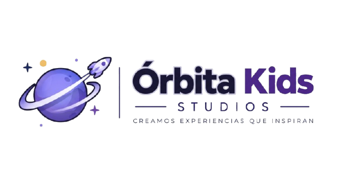
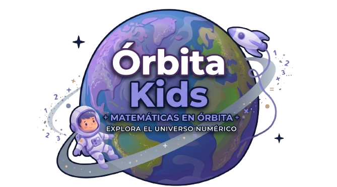

<div align="center">




<br>

# 🪐 ` Ó R B I T A · K I D S ` 🚀

### ✨ EXPERIENCIAS QUE ACOMPAÑAN CADA DESCUBRIMIENTO ✨

<br>

# 📱 FRONTEND · FLUTTER

**APLICACIÓN MÓVIL NATIVA · EXPERIENCIA INTERACTIVA**

<br>

## Descripción

La aplicación Flutter nativa se encuentra en [`orbita_kids/`](./orbita_kids). Está diseñada para que estudiantes exploren planetas y practiquen sumas, y para que docentes administren actividades, grupos y reportes. Implementa las pantallas 01 a 59 del diseño de Figma.

La aplicación usa Flutter 3.47, Material 3, Riverpod, GoRouter, Dio, SQLite, almacenamiento seguro, conectividad, notificaciones locales, OIDC con PKCE y síntesis de voz.

## Cómo ejecutar

```bash
cd orbita_kids
flutter pub get
flutter run
flutter test
```

Sin configuración de servidor, la aplicación inicia en modo demo. Para conectarla al backend local:

```bash
flutter run -d chrome --web-port 5000 `
  --dart-define=API_BASE_URL=http://localhost:3000/v1 `
  --dart-define=API_DEV_AUTH=true
```

En Windows PowerShell, el carácter `` ` `` permite continuar el comando en la siguiente línea. El backend debe estar ejecutándose desde [`Backend/backend/`](../../Backend/backend).

## Funcionalidades

- Inicio de sesión demo o mediante Keycloak con OIDC y PKCE.
- Roles de estudiante y docente.
- Actividades, intentos, progreso y reportes.
- Trabajo offline con cola de sincronización.
- Persistencia local con SQLite y almacenamiento seguro de credenciales.
- Integración con el backend Node.js y MySQL del proyecto.

Las cuentas, códigos de grupo, variables `--dart-define`, configuración de Keycloak y contrato de API están documentados en [`orbita_kids/README.md`](./orbita_kids/README.md).

<br>

### 🪐 ÓRBITA KIDS

**EXPLORA · APRENDE · DESCUBRE**

*Cada descubrimiento comienza con una pregunta.*

<br>


<br>

### ✨ ¡GRACIAS POR EXPLORAR CON NOSOTROS! ✨

**DESARROLLADO POR ÓRBITA STUDIO**

<sub>FLUTTER · DART &nbsp; | &nbsp; EXPERIENCIA MÓVIL</sub>

<br>

<sub>© 2026 Órbita Studio · Todos los derechos reservados.</sub>

</div>