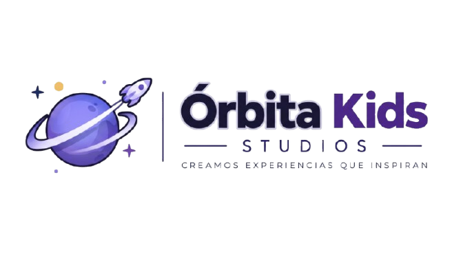
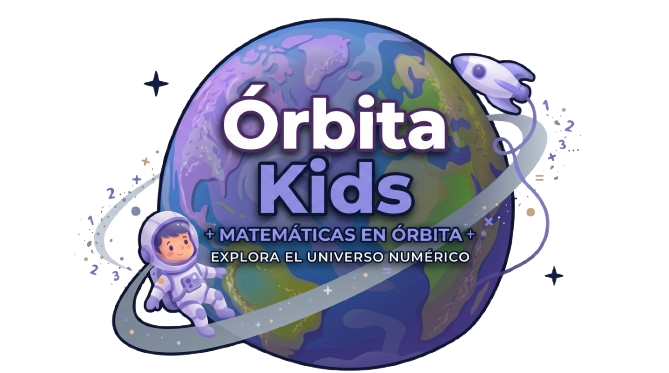

<div align="center">




<br>

# 🪐 ` Ó R B I T A · K I D S ` 🚀

### ✨ CREAMOS EXPERIENCIAS QUE INSPIRAN ✨

<br>

# 💻 FRONTEND · APLICACIÓN WEB

**EXPERIENCIA WEB · REACT**

<br>

## Descripción

La aplicación web React se encuentra en [`orbita-kids/`](./orbita-kids). Es una PWA construida con React y Vite que incluye el sitio público, acceso de usuarios, espacio docente, espacio institucional, instalación como aplicación y funcionamiento sin conexión.

El proyecto contiene un backend local con Express y SQLite para la demostración. La interfaz guarda los datos offline en IndexedDB cifrado y utiliza una cola de cambios para sincronizar al recuperar la conexión.

## Cómo ejecutar

```bash
cd orbita-kids
npm install
npm run dev
```

Comandos disponibles:

```bash
npm run build
npm run preview
npm start
npm test
npm run lint
npm run db:reset
```

`npm run dev` inicia el frontend y la API de demostración. Para validar la instalación y el modo sin conexión, usa `npm run preview` y abre la aplicación en Chrome o Edge.

## Características principales

- PWA instalable con service worker y actualización controlada.
- Sesiones con cookies `httpOnly`, protección CSRF y límites de intentos.
- Roles de docente e institución con grupos, actividades, reportes y licencias.
- Datos offline cifrados por cuenta con AES-256-GCM.
- Sincronización idempotente de cambios mediante `/api/sync`.
- Rutas públicas, autenticación, invitaciones, cuenta y espacios de trabajo.

La lista completa de rutas, cuentas demo, arquitectura y configuración de producción está en [`orbita-kids/README.md`](./orbita-kids/README.md).

<br>

### 🪐 ÓRBITA KIDS

**EXPLORA · APRENDE · DESCUBRE**

*Cada descubrimiento comienza con una pregunta.*

<br>


<br>

### ✨ ¡GRACIAS POR EXPLORAR CON NOSOTROS! ✨

**DESARROLLADO POR ÓRBITA STUDIO**

<sub>REACT · EXPERIENCIA WEB</sub>

<br>

<sub>© 2026 Órbita Studio · Todos los derechos reservados.</sub>

</div>