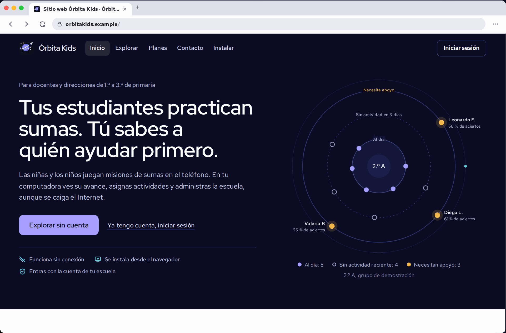
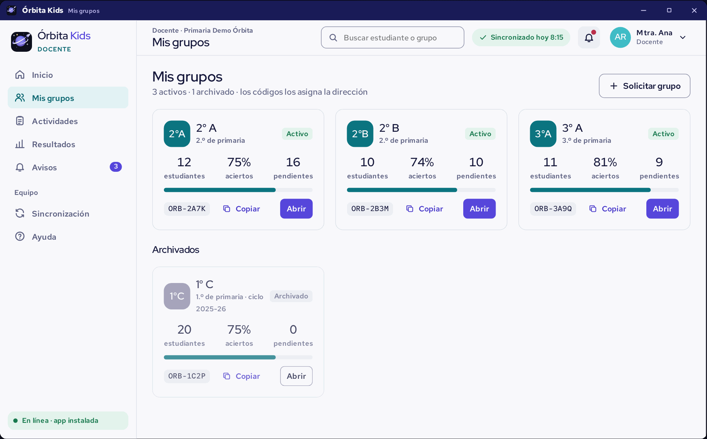
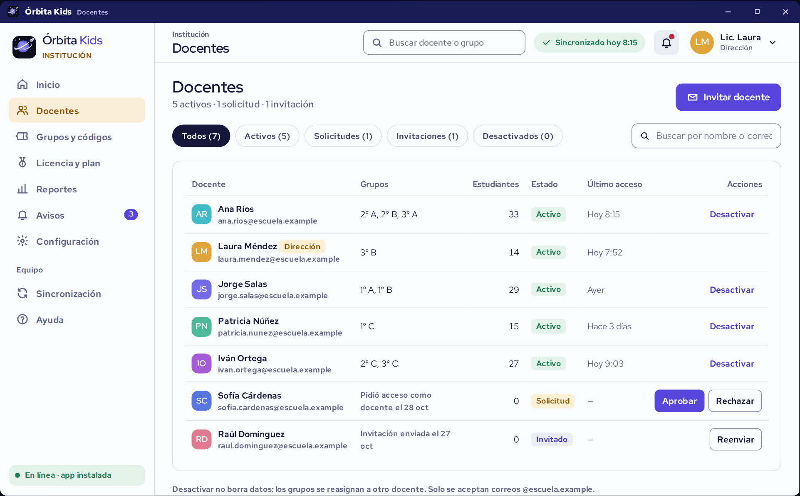
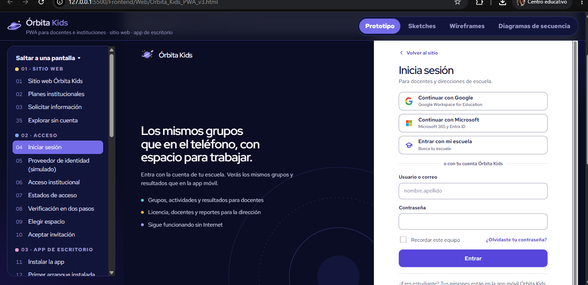

<div align="center">


<br>

# 🪐 ` Ó R B I T A · K I D S ` 🚀

### ✨ EXPERIENCIAS QUE CONECTAN A CADA COMUNIDAD ✨

# 🌐 FRONTEND · APLICACIÓN WEB

**PWA EDUCATIVA · DOCENTES E INSTITUCIONES**

<br>


<br><br>

### 🌍 CONECTA · ACOMPAÑA · CRECE


</div>

## 📸 PREVISUALIZACIÓN DE LA APLICACIÓN

*Un primer vistazo a la experiencia web de Órbita Kids.*

</div>

| 🌟 Vista 01 | 🚀 Vista 02 | 🪐 Vista 03 |
|:---:|:---:|:---:|
|  |  |  |

<div align="center">

<sub>VISTAS DE LA INTERFAZ · APLICACIÓN WEB</sub>

</div>


<div align="center">

## 🪐 BIENVENIDO A LA EXPERIENCIA WEB DE ÓRBITA KIDS

*Un espacio digital que conecta el aprendizaje, el acompañamiento educativo y la comunidad.*

</div>

## 🌐 01. Acerca del módulo

El módulo **Frontend Web de Órbita Kids** comprende el diseño, prototipado y desarrollo de una plataforma web progresiva (PWA), concebida para ampliar las experiencias educativas del proyecto y facilitar la interacción de docentes e instituciones con el ecosistema de Órbita Kids.

Su propósito es proporcionar un entorno digital organizado, intuitivo y accesible que permita presentar las experiencias de la plataforma, facilitar el acompañamiento educativo y ofrecer una estructura de navegación adaptada a los diferentes perfiles de usuario.

La aplicación utiliza **React, Vite y JavaScript** como tecnologías principales, mediante una arquitectura basada en componentes que favorece la organización de las interfaces, la reutilización de elementos y la evolución de la plataforma.

La propuesta mantiene una identidad visual coherente con la aplicación móvil, pero adapta sus interfaces, estructuras y recorridos a las necesidades del entorno web.

## 🎯 02. Objetivo de la plataforma

Diseñar y desarrollar una experiencia web que permita conectar las herramientas educativas de Órbita Kids con docentes e instituciones, proporcionando una interfaz clara, organizada y funcional.

Los principales objetivos son:

- **Acompañamiento educativo:** proporcionar una experiencia orientada a las necesidades de docentes y comunidades educativas.
- **Organización:** estructurar las secciones, herramientas y contenidos de forma comprensible.
- **Experiencia de usuario (UX):** definir recorridos de navegación claros y relaciones coherentes entre las diferentes vistas.
- **Interfaz de usuario (UI):** construir una presentación visual atractiva, consistente y alineada con la identidad de marca.
- **Adaptabilidad:** contemplar diferentes dimensiones de pantalla y dispositivos.
- **Accesibilidad:** considerar criterios que faciliten la comprensión y utilización de la plataforma.
- **Experiencia progresiva:** incorporar las características y posibilidades de una Progressive Web App.

## 🌟 03. Experiencia de usuario y perfiles

La plataforma web contempla experiencias dirigidas principalmente a docentes e instituciones educativas, considerando sus diferentes contextos y necesidades de interacción con Órbita Kids.

### 👩‍🏫 Experiencia docente

La experiencia docente está orientada al acompañamiento de las actividades educativas y a la interacción con las herramientas contempladas dentro de la plataforma.

Su diseño considera:

- Organización de información y herramientas educativas.
- Acceso a las vistas correspondientes al perfil docente.
- Presentación de actividades y elementos de acompañamiento.
- Navegación entre las diferentes secciones.
- Interacción con las funcionalidades representadas para el entorno educativo.

### 🏫 Experiencia institucional

La experiencia institucional considera las necesidades de visualización y organización relacionadas con el contexto de una institución educativa.

Su representación contempla:

- Vistas orientadas al contexto institucional.
- Organización de información relevante para la comunidad educativa.
- Estructuras de navegación adaptadas al perfil correspondiente.
- Presentación de herramientas contempladas para la dirección institucional.

### 🌐 Acceso y exploración

La plataforma también contempla recorridos de exploración que permiten conocer determinadas secciones y experiencias sin iniciar sesión.

Dentro de los materiales de prototipado se representan escenarios como la vista docente, la vista de dirección y la asignación de actividades sin conexión.

Estos escenarios permiten documentar y evaluar diferentes posibilidades de interacción dentro de la PWA.

## 🔐 04. Autenticación y acceso

La arquitectura de acceso contempla **Keycloak** como solución de gestión de identidad y autenticación.

Su incorporación permite establecer una estructura centralizada para gestionar la identificación de usuarios y las sesiones de acceso dentro del ecosistema Órbita Kids.

La integración considera:

- Gestión de identidad y autenticación.
- Acceso mediante los mecanismos de inicio de sesión definidos para el proyecto.
- Organización de sesiones de usuario.
- Consideración de los diferentes perfiles de acceso.
- Relación entre los procesos de autenticación y las vistas correspondientes.

La estructura de acceso busca mantener una experiencia coherente entre las plataformas web y móvil.

## 📡 05. Experiencia Progressive Web App (PWA)

Órbita Kids contempla un enfoque de aplicación web progresiva, buscando ampliar las posibilidades de acceso a la plataforma desde diferentes dispositivos y navegadores.

La experiencia PWA considera aspectos como:

- **Adaptabilidad:** interfaces que responden a diferentes dimensiones de pantalla.
- **Accesibilidad:** acceso a la experiencia desde navegadores compatibles.
- **Instalabilidad:** consideración de las capacidades de instalación propias de una PWA.
- **Continuidad:** diseño de experiencias que contemplan diferentes condiciones de conectividad.
- **Experiencia multiplataforma:** una interfaz web organizada para distintos entornos de utilización.

### 🔌 Interacción sin conexión

Dentro de los materiales de prototipado se contempla el flujo de asignación sin conexión, representado como parte de la experiencia de exploración.

Este escenario permite documentar cómo podría desarrollarse una interacción cuando no existe conectividad, así como las consideraciones necesarias para mantener la continuidad de determinadas experiencias.

La disponibilidad definitiva de las funciones offline dependerá de su implementación y de las condiciones de sincronización de la información.

## 🎨 06. Diseño y entregables web

El módulo reúne los materiales de diseño, conceptualización, prototipado y documentación que permiten representar la experiencia web de Órbita Kids.

### 🖌️ Diseño de interfaces (UI)

Definición de la apariencia de las pantallas, jerarquías visuales, distribución de elementos, colores, tipografías, iconografía y componentes que conforman la identidad de la PWA.

### 🧭 Experiencia de usuario (UX)

Organización de recorridos, relaciones entre vistas, navegación y acciones disponibles para proporcionar una experiencia comprensible y coherente para los distintos perfiles.

### ✏️ Sketches

Representaciones iniciales de las ideas y estructuras de interfaz, utilizadas para explorar distribuciones, posibilidades de navegación y soluciones visuales antes de establecer los diseños definitivos.

### 📐 Wireframes

Representaciones estructurales de las pantallas que permiten definir la distribución de contenidos y componentes, utilizando una estructura visual organizada, una rejilla de 12 columnas y medidas de referencia en píxeles CSS.

### 🧩 Prototipo interactivo

Representación navegable de la plataforma que permite explorar las pantallas, transiciones, estados e interacciones contempladas para la experiencia web.

### 📊 Diagramas de secuencia

Documentación visual de los flujos de interacción y comunicación entre los elementos que participan en determinados procesos de la plataforma.

Estos entregables siguen un proceso de diseño progresivo: las ideas se organizan mediante sketches, se convierten en estructuras medibles a través de wireframes y posteriormente se representan mediante un prototipo interactivo.

En conjunto, los materiales establecen una referencia común entre diseño, navegación y desarrollo, facilitando la comprensión de cada pantalla y de las relaciones que conforman la experiencia de Órbita Kids.

### 📈 Alcance de los entregables

La documentación de la plataforma web comprende:

- **35 pantallas** distribuidas en 7 secciones.
- **53 estados** documentados en el prototipo.
- **644 acciones** numeradas en sketches y wireframes.
- **50 sketches** en formato PNG.
- **50 wireframes** en formato PNG y 50 versiones vectoriales SVG.
- **1 prototipo interactivo** en formato HTML.
- **53 capturas** correspondientes a los estados del prototipo.
- **4 diagramas de secuencia** con 58 mensajes documentados.

Los estados 35a (Vista docente), 35b (Vista de dirección) y 35c (Asignar sin conexión), pertenecientes a «Explorar sin cuenta», corresponden a demostraciones dentro del sitio y cuentan únicamente con capturas del prototipo, sin sketches ni wireframes individuales.

Estos estados permiten documentar escenarios adicionales sin confundirlos con los entregables gráficos desarrollados individualmente para cada pantalla.

## 🧭 07. Diagramas y documentación de flujos

Los diagramas de secuencia complementan los materiales de diseño y prototipado, proporcionando una representación técnica de los procesos y las interacciones que conforman la experiencia web.

La documentación comprende cuatro diagramas con un total de 58 mensajes, mediante los cuales se describen las secuencias de acciones, participantes e intercambios correspondientes a los flujos clave de la PWA.

### 📊 Diagramación · Flujos web

**4 diagramas de secuencia · 58 mensajes**

Los recursos están disponibles en diferentes formatos para facilitar su consulta, visualización y edición:

<div align="center">

[](/Frontend/img/diagrama1.png)

[](/Frontend/img/diagrama1.png)


<br>


</div>

### 📂 Organización de los entregables

La documentación se distribuye en carpetas independientes para mantener una organización clara entre los distintos materiales del proyecto.

| Carpeta | Contenido | Archivos |
|---|---|---|
| [`sketches/`](./sketches/README.md) | Bocetos de baja fidelidad, uno por pantalla y estado. | 50 PNG |
| [`wireframes/`](./wireframes/README.md) | Wireframes a 1280 px, con rejilla de 12 columnas y medidas en píxeles CSS. | 50 PNG + 50 SVG |
| [`prototipo/`](./prototipo/README.md) | Prototipo interactivo `Órbita_Kids_PWA_v3.html` y capturas de cada estado. | 1 HTML + 53 PNG |
| [`diagrama_de_secuencia/`](./diagrama_de_secuencia/README.md) | Diagramas de secuencia de los flujos clave de la PWA. | 4 diagramas |

### 🗂️ Estructura de la documentación

```text
Web/
├── README.md
│
├── sketches/
│   ├── <sección>/
│   │   └── NNN_....png
│   └── README.md
│
├── wireframes/
│   ├── <sección>/
│   │   ├── NNN_....png
│   │   └── svg/
│   │       └── NNN_....svg
│   └── README.md
│
├── prototipo/
│   ├── Órbita_Kids_PWA_v3.html
│   ├── capturas/
│   │   └── <sección>/
│   │       └── NNN_....png
│   └── README.md
│
└── diagrama_de_secuencia/
    ├── png/
    ├── svg/
    ├── mermaid/
    └── README.md
```

Los nombres de los archivos mantienen una nomenclatura compartida entre sketches, wireframes y capturas del prototipo:

`orden_código_pantalla_estado`

Esta correspondencia facilita identificar cada pantalla y dar seguimiento a sus diferentes representaciones dentro de la documentación.

## 🛠️ 08. Tecnologías y herramientas

Las tecnologías utilizadas se distribuyen de acuerdo con las necesidades del entorno web y de los diferentes entregables del proyecto.

<div align="center">

**DESARROLLO WEB**


<br><br>

**AUTENTICACIÓN E IDENTIDAD**


<br><br>

**APLICACIÓN WEB PROGRESIVA**


<br><br>

**DOCUMENTACIÓN Y DIAGRAMACIÓN**


</div>

## ✨ 09. Principios de diseño

La plataforma web se desarrolla considerando principios que orientan la experiencia de usuario, la presentación visual y la organización de sus funcionalidades.

| Principio | Aplicación en Web |
|---|---|
| **Claridad** | Organización comprensible de la información y los contenidos. |
| **Accesibilidad** | Consideración de diferentes necesidades de interacción. |
| **Consistencia** | Identidad visual compartida con la aplicación móvil. |
| **Adaptabilidad** | Interfaces que consideran diferentes tamaños de pantalla. |
| **Usabilidad** | Recorridos claros y navegación organizada. |
| **Conectividad** | Consideración de diferentes condiciones de acceso. |
| **Colaboración** | Experiencias orientadas a docentes e instituciones. |

## 🌠 10. Nuestra visión

La plataforma web de Órbita Kids busca convertirse en un espacio digital que facilite la conexión entre las experiencias educativas, los docentes y las instituciones.

A través de una interfaz organizada, una navegación intuitiva y una identidad visual compartida, el entorno web complementa la aplicación móvil y amplía las posibilidades de interacción con el ecosistema educativo.

Cada sección, pantalla y flujo representa una oportunidad para conectar, acompañar y fortalecer la experiencia de aprendizaje.

<div align="center">

### 💜 CONECTAMOS EXPERIENCIAS, ACOMPAÑAMOS EL APRENDIZAJE Y CONSTRUIMOS NUEVAS POSIBILIDADES.

</div>

---

<div align="center">

### 🪐 ÓRBITA KIDS

**EXPLORA · APRENDE · DESCUBRE**

*Cada descubrimiento comienza con una pregunta.*

<br>


<br>

### ✨ ¡GRACIAS POR EXPLORAR CON NOSOTROS! ✨

**DESARROLLADO POR ÓRBITA STUDIO**

<sub>REACT · VITE &nbsp; | &nbsp; EXPERIENCIA WEB · PWA</sub>

<br>

<sub>© 2026 Órbita Studio · Todos los derechos reservados.</sub>

</div>