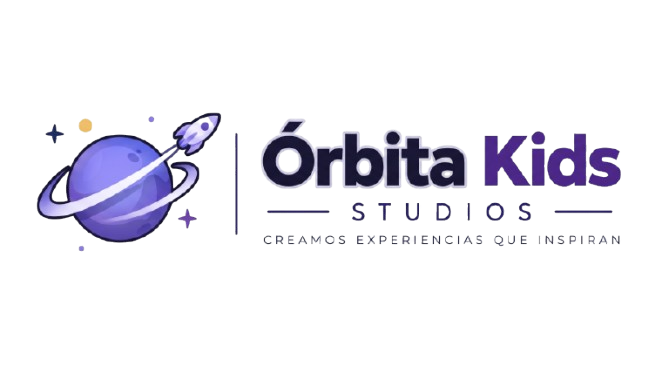
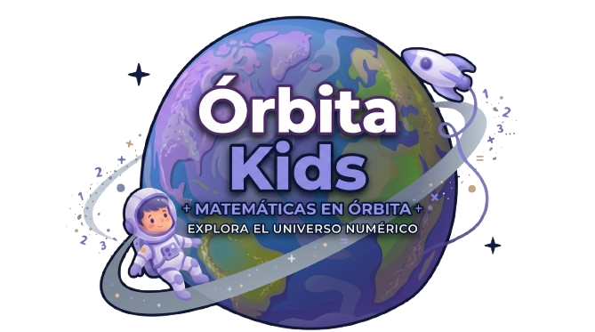
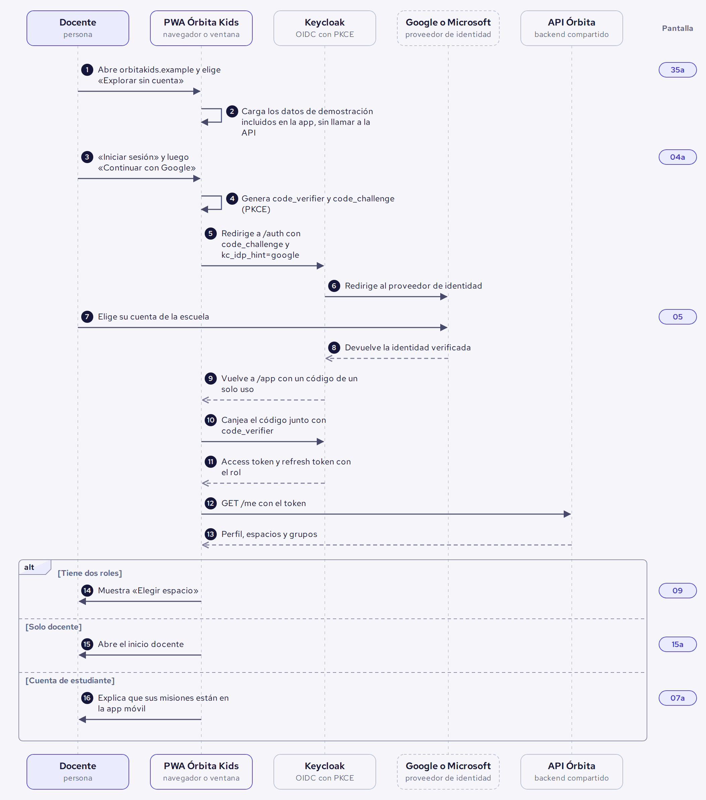
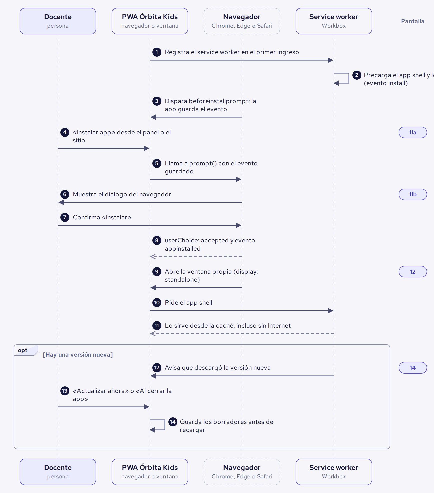
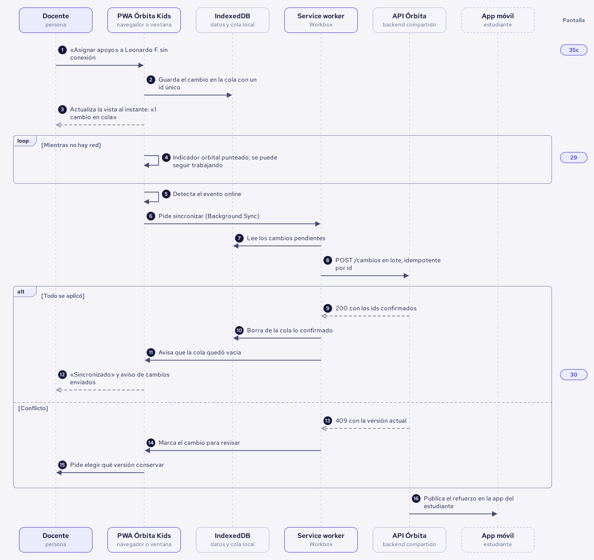
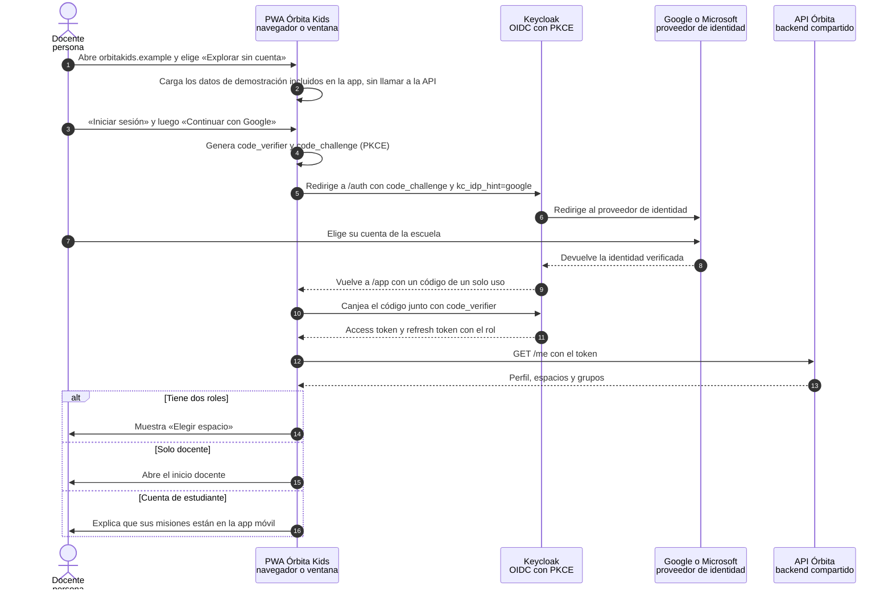
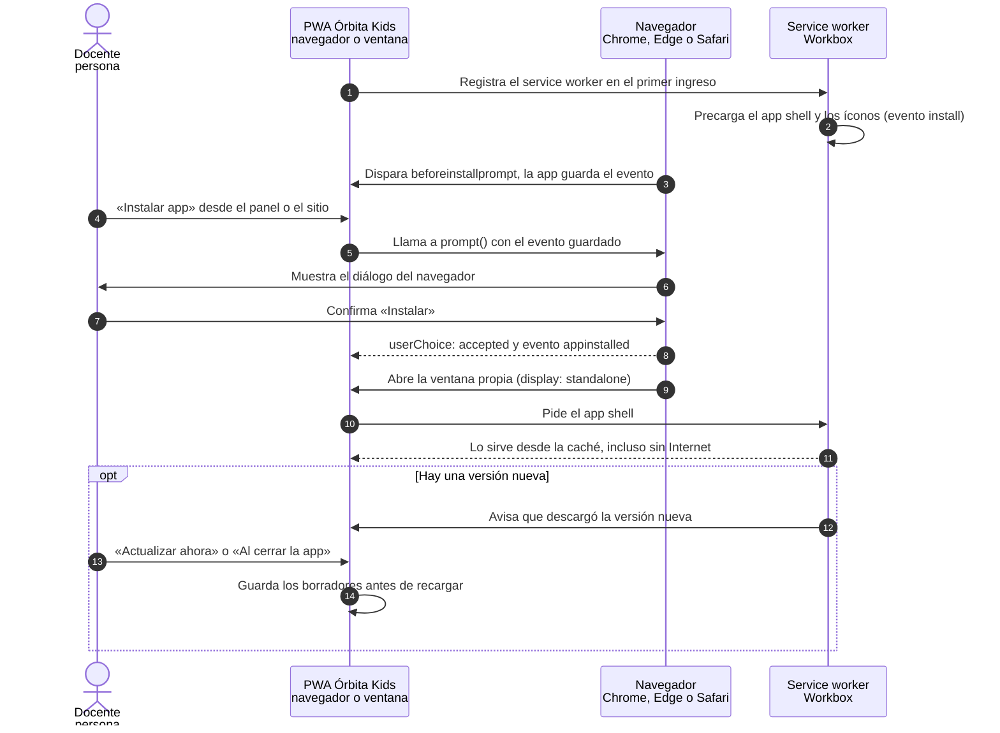
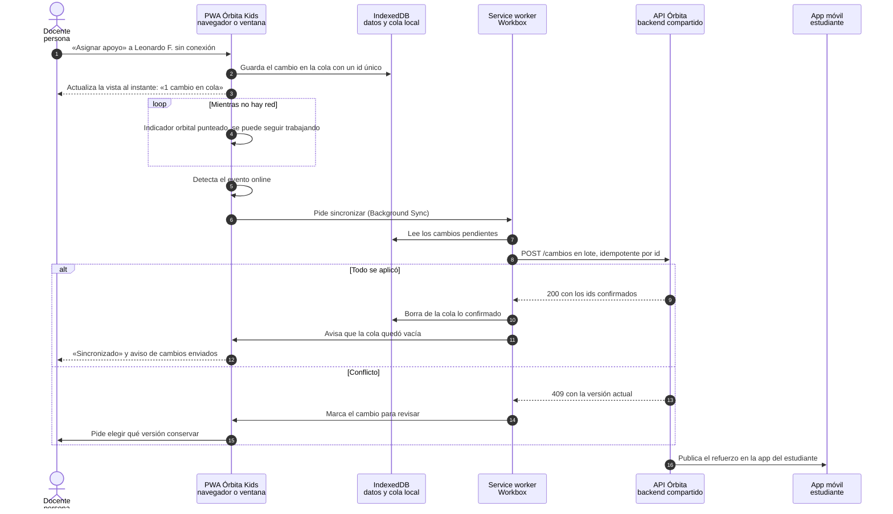
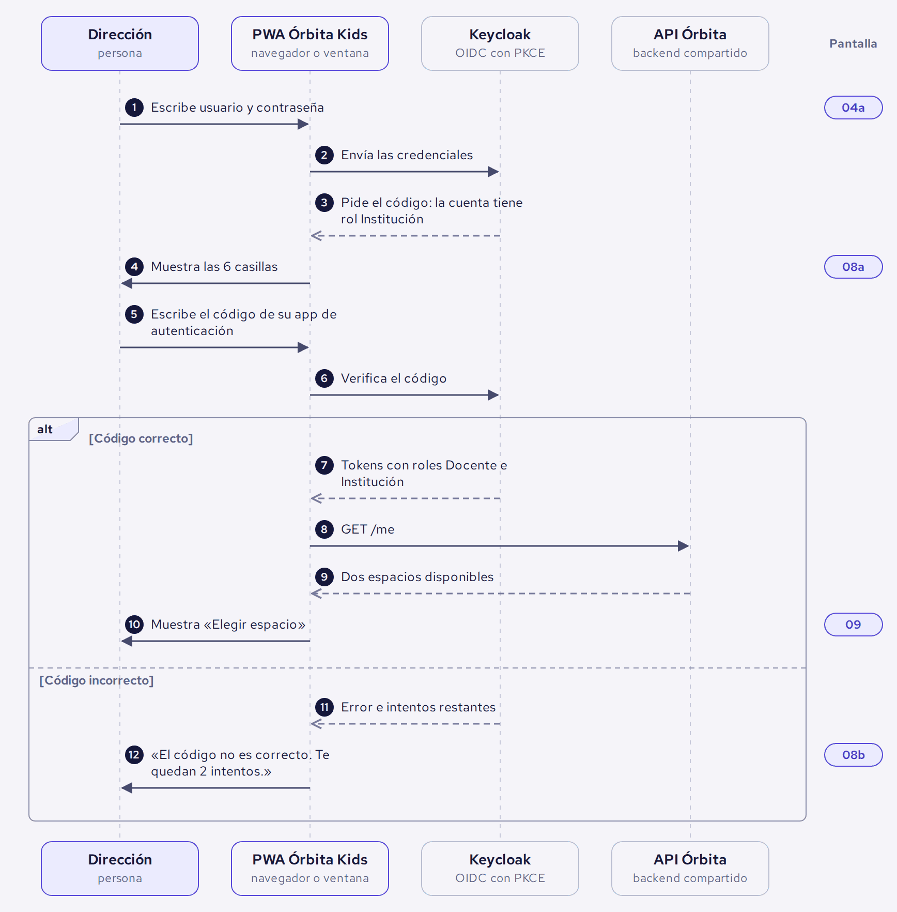
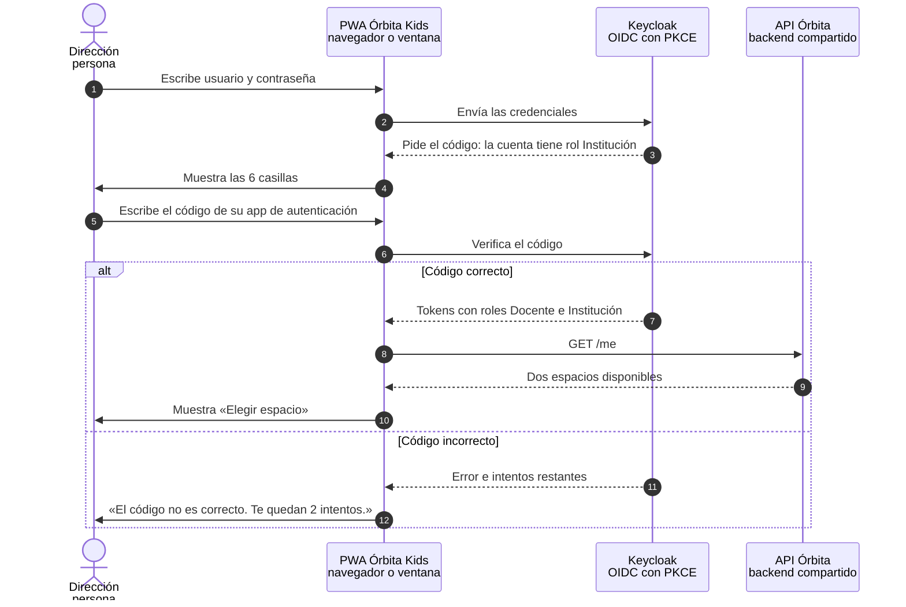

 

# 🪐 ` Ó R B I T A · K I D S ` 🚀

### ✨ CADA CONEXIÓN IMPULSA EL PROGRESO ✨

# 🔄 DIAGRAMAS DE SECUENCIA · WEB

**FLUJOS DE INTERACCIÓN · ARQUITECTURA DE LA PWA**

 

  

### 🔗 CONECTA · ORGANIZA · COMUNICA

---

## 📸 Previsualización de diagramas

*Representación visual de los flujos principales de la PWA.*

| Acceso | Escritorio | Sin conexión |
|:---:|:---:|:---:|
|  |  |  |

---

## Contexto dentro de Órbita Kids

Los diagramas de secuencia explican qué sucede detrás de los recorridos visibles de la PWA. Mientras los sketches, wireframes y capturas muestran la interfaz, estos diagramas muestran la comunicación entre el usuario, la aplicación web, Keycloak, los proveedores de identidad y la API.

## 🎯 Objetivo dentro del desarrollo web

Permiten comprender y validar los flujos de exploración sin cuenta, inicio de sesión, instalación de escritorio, asignación sin conexión y sincronización. Funcionan como referencia para conectar las decisiones de UX con la lógica que deberá implementar la aplicación.

## 🧭 Proceso y alcance

Se elaboran en Mermaid a partir del prototipo y de la arquitectura prevista para la PWA. Los cuatro diagramas documentan los flujos clave y sus alternativas, sin describir cada pantalla de forma aislada.

## 🛠️ Tecnologías y herramientas

- **Mermaid:** creación y edición de los diagramas.
- **React, Vite y JavaScript:** contexto de la PWA.
- **Keycloak y PKCE:** autenticación e identidad.
- **API Órbita:** comunicación con los servicios del backend.
- **PNG y SVG:** consulta y presentación de los diagramas.

## ✨ Principios de diseño

Los diagramas priorizan trazabilidad, claridad, separación de responsabilidades, seguridad de sesión, continuidad sin conexión y coordinación entre interfaz y servicios.

| Diagrama | Flujo | Mensajes |
|---|---|---|
| [SD-W01](#sd-w01) | Explorar sin cuenta e iniciar sesión con Google | 16 |
| [SD-W02](#sd-w02) | Instalar la app de escritorio | 14 |
| [SD-W03](#sd-w03) | Asignar apoyo sin conexión y sincronizar | 16 |
| [SD-W04](#sd-w04) | Dirección entra con verificación en dos pasos | 12 |

Los diagramas de la app móvil y el diagrama general del sistema están en `../../Movil/diagrama_de_secuencia/`.

## Archivos

| Carpeta | Contenido |
|---|---|
| `png/` | Imagen 2× de cada diagrama |
| `svg/` | Vector de cada diagrama |
| `mermaid/` | Código `.mmd` editable (mermaid.live, GitHub, Notion, Obsidian) |

## Notación

| Elemento | Significado |
|---|---|
| Flecha continua con punta llena | Mensaje |
| Flecha punteada | Respuesta |
| Flecha que vuelve al mismo participante | Proceso interno |
| Marco `alt` · `opt` · `loop` | Alternativas · opcional · repetición |
| Etiqueta morada a la derecha | Código del estado de pantalla en el prototipo |

---

## SD-W01

### Explorar sin cuenta e iniciar sesión con Google

De la portada del sitio a la app. La demostración no llama a la API; el inicio de sesión usa Keycloak con PKCE y el rol lo decide el backend.

- **Participantes:** Docente, PWA Órbita Kids, Keycloak, Google o Microsoft, API Órbita

Archivos: [PNG](png/SD-W01_explorar_sin_cuenta_e_iniciar_sesion_con_google.png) · [SVG](svg/SD-W01_explorar_sin_cuenta_e_iniciar_sesion_con_google.svg) · [Mermaid](mermaid/SD-W01_explorar_sin_cuenta_e_iniciar_sesion_con_google.mmd)

Código Mermaid

| # | De → a | Tipo | Mensaje | Pantalla | Contexto |
|---|---|---|---|---|---|
| 1 | Docente → PWA Órbita Kids | Mensaje | Abre orbitakids.example y elige «Explorar sin cuenta» | 35a · Explorar sin cuenta · Vista docente | — |
| 2 | PWA Órbita Kids → PWA Órbita Kids | Interno | Carga los datos de demostración incluidos en la app, sin llamar a la API | — | — |
| 3 | Docente → PWA Órbita Kids | Mensaje | «Iniciar sesión» y luego «Continuar con Google» | 04a · Iniciar sesión · Métodos de acceso | — |
| 4 | PWA Órbita Kids → PWA Órbita Kids | Interno | Genera code_verifier y code_challenge (PKCE) | — | — |
| 5 | PWA Órbita Kids → Keycloak | Mensaje | Redirige a /auth con code_challenge y kc_idp_hint=google | — | — |
| 6 | Keycloak → Google o Microsoft | Mensaje | Redirige al proveedor de identidad | — | — |
| 7 | Docente → Google o Microsoft | Mensaje | Elige su cuenta de la escuela | 05 · Proveedor de identidad (simulado) · Elegir identidad de Google | — |
| 8 | Google o Microsoft → Keycloak | Respuesta | Devuelve la identidad verificada | — | — |
| 9 | Keycloak → PWA Órbita Kids | Respuesta | Vuelve a /app con un código de un solo uso | — | — |
| 10 | PWA Órbita Kids → Keycloak | Mensaje | Canjea el código junto con code_verifier | — | — |
| 11 | Keycloak → PWA Órbita Kids | Respuesta | Access token y refresh token con el rol | — | — |
| 12 | PWA Órbita Kids → API Órbita | Mensaje | GET /me con el token | — | — |
| 13 | API Órbita → PWA Órbita Kids | Respuesta | Perfil, espacios y grupos | — | — |
| 14 | PWA Órbita Kids → Docente | Mensaje | Muestra «Elegir espacio» | 09 · Elegir espacio · Docente e institución | alt [Tiene dos roles] |
| 15 | PWA Órbita Kids → Docente | Mensaje | Abre el inicio docente | 15a · Inicio docente · En el navegador | alt [Solo docente] |
| 16 | PWA Órbita Kids → Docente | Mensaje | Explica que sus misiones están en la app móvil | 07a · Estados de acceso · Cuenta de estudiante | alt [Cuenta de estudiante] |

---

## SD-W02

### Instalar la app de escritorio

El service worker deja lista la app antes de instalar. El navegador confirma la instalación y la ventana propia abre desde la caché.

- **Participantes:** Docente, PWA Órbita Kids, Navegador, Service worker

Archivos: [PNG](png/SD-W02_instalar_la_app_de_escritorio.png) · [SVG](svg/SD-W02_instalar_la_app_de_escritorio.svg) · [Mermaid](mermaid/SD-W02_instalar_la_app_de_escritorio.mmd)

Código Mermaid

| # | De → a | Tipo | Mensaje | Pantalla | Contexto |
|---|---|---|---|---|---|
| 1 | PWA Órbita Kids → Service worker | Mensaje | Registra el service worker en el primer ingreso | — | — |
| 2 | Service worker → Service worker | Interno | Precarga el app shell y los íconos (evento install) | — | — |
| 3 | Navegador → PWA Órbita Kids | Mensaje | Dispara beforeinstallprompt; la app guarda el evento | — | — |
| 4 | Docente → PWA Órbita Kids | Mensaje | «Instalar app» desde el panel o el sitio | 11a · Instalar la app · Antes de instalar | — |
| 5 | PWA Órbita Kids → Navegador | Mensaje | Llama a prompt() con el evento guardado | — | — |
| 6 | Navegador → Docente | Mensaje | Muestra el diálogo del navegador | 11b · Instalar la app · Diálogo del navegador | — |
| 7 | Docente → Navegador | Mensaje | Confirma «Instalar» | — | — |
| 8 | Navegador → PWA Órbita Kids | Respuesta | userChoice: accepted y evento appinstalled | — | — |
| 9 | Navegador → PWA Órbita Kids | Mensaje | Abre la ventana propia (display: standalone) | 12 · Primer arranque instalada · Primer arranque | — |
| 10 | PWA Órbita Kids → Service worker | Mensaje | Pide el app shell | — | — |
| 11 | Service worker → PWA Órbita Kids | Respuesta | Lo sirve desde la caché, incluso sin Internet | — | — |
| 12 | Service worker → PWA Órbita Kids | Mensaje | Avisa que descargó la versión nueva | 14 · Nueva versión disponible · Versión nueva lista | opt [Hay una versión nueva] |
| 13 | Docente → PWA Órbita Kids | Mensaje | «Actualizar ahora» o «Al cerrar la app» | — | opt [Hay una versión nueva] |
| 14 | PWA Órbita Kids → PWA Órbita Kids | Interno | Guarda los borradores antes de recargar | — | opt [Hay una versión nueva] |

---

## SD-W03

### Asignar apoyo sin conexión y sincronizar

Los cambios se guardan primero en el equipo. Cuando vuelve la red, el service worker los envía en lote y el backend los aplica una sola vez.

- **Participantes:** Docente, PWA Órbita Kids, IndexedDB, Service worker, API Órbita, App móvil

Archivos: [PNG](png/SD-W03_asignar_apoyo_sin_conexion_y_sincronizar.png) · [SVG](svg/SD-W03_asignar_apoyo_sin_conexion_y_sincronizar.svg) · [Mermaid](mermaid/SD-W03_asignar_apoyo_sin_conexion_y_sincronizar.mmd)

Código Mermaid

| # | De → a | Tipo | Mensaje | Pantalla | Contexto |
|---|---|---|---|---|---|
| 1 | Docente → PWA Órbita Kids | Mensaje | «Asignar apoyo» a Leonardo F. sin conexión | 35c · Explorar sin cuenta · Asignar sin conexión | — |
| 2 | PWA Órbita Kids → IndexedDB | Mensaje | Guarda el cambio en la cola con un id único | — | — |
| 3 | PWA Órbita Kids → Docente | Respuesta | Actualiza la vista al instante: «1 cambio en cola» | — | — |
| 4 | PWA Órbita Kids → PWA Órbita Kids | Interno | Indicador orbital punteado; se puede seguir trabajando | 29 · Sin conexión · Sin conexión en la app | loop [Mientras no hay red] |
| 5 | PWA Órbita Kids → PWA Órbita Kids | Interno | Detecta el evento online | — | — |
| 6 | PWA Órbita Kids → Service worker | Mensaje | Pide sincronizar (Background Sync) | — | — |
| 7 | Service worker → IndexedDB | Mensaje | Lee los cambios pendientes | — | — |
| 8 | Service worker → API Órbita | Mensaje | POST /cambios en lote, idempotente por id | — | — |
| 9 | API Órbita → Service worker | Respuesta | 200 con los ids confirmados | — | alt [Todo se aplicó] |
| 10 | Service worker → IndexedDB | Mensaje | Borra de la cola lo confirmado | — | alt [Todo se aplicó] |
| 11 | Service worker → PWA Órbita Kids | Mensaje | Avisa que la cola quedó vacía | — | alt [Todo se aplicó] |
| 12 | PWA Órbita Kids → Docente | Respuesta | «Sincronizado» y aviso de cambios enviados | 30 · Sincronización · Un borrador en cola | alt [Todo se aplicó] |
| 13 | API Órbita → Service worker | Respuesta | 409 con la versión actual | — | alt [Conflicto] |
| 14 | Service worker → PWA Órbita Kids | Mensaje | Marca el cambio para revisar | — | alt [Conflicto] |
| 15 | PWA Órbita Kids → Docente | Mensaje | Pide elegir qué versión conservar | — | alt [Conflicto] |
| 16 | API Órbita → App móvil | Mensaje | Publica el refuerzo en la app del estudiante | — | — |

---

## SD-W04

### Dirección entra con verificación en dos pasos

Las cuentas que administran una institución piden un segundo factor. Si la persona también es docente, elige el espacio al entrar.

- **Participantes:** Dirección, PWA Órbita Kids, Keycloak, API Órbita

Archivos: [PNG](png/SD-W04_direccion_entra_con_verificacion_en_dos_pasos.png) · [SVG](svg/SD-W04_direccion_entra_con_verificacion_en_dos_pasos.svg) · [Mermaid](mermaid/SD-W04_direccion_entra_con_verificacion_en_dos_pasos.mmd)

Código Mermaid

| # | De → a | Tipo | Mensaje | Pantalla | Contexto |
|---|---|---|---|---|---|
| 1 | Dirección → PWA Órbita Kids | Mensaje | Escribe usuario y contraseña | 04a · Iniciar sesión · Métodos de acceso | — |
| 2 | PWA Órbita Kids → Keycloak | Mensaje | Envía las credenciales | — | — |
| 3 | Keycloak → PWA Órbita Kids | Respuesta | Pide el código: la cuenta tiene rol Institución | — | — |
| 4 | PWA Órbita Kids → Dirección | Mensaje | Muestra las 6 casillas | 08a · Verificación en dos pasos · Código de 6 dígitos | — |
| 5 | Dirección → PWA Órbita Kids | Mensaje | Escribe el código de su app de autenticación | — | — |
| 6 | PWA Órbita Kids → Keycloak | Mensaje | Verifica el código | — | — |
| 7 | Keycloak → PWA Órbita Kids | Respuesta | Tokens con roles Docente e Institución | — | alt [Código correcto] |
| 8 | PWA Órbita Kids → API Órbita | Mensaje | GET /me | — | alt [Código correcto] |
| 9 | API Órbita → PWA Órbita Kids | Respuesta | Dos espacios disponibles | — | alt [Código correcto] |
| 10 | PWA Órbita Kids → Dirección | Mensaje | Muestra «Elegir espacio» | 09 · Elegir espacio · Docente e institución | alt [Código correcto] |
| 11 | Keycloak → PWA Órbita Kids | Respuesta | Error e intentos restantes | — | alt [Código incorrecto] |
| 12 | PWA Órbita Kids → Dirección | Mensaje | «El código no es correcto. Te quedan 2 intentos.» | 08b · Verificación en dos pasos · Código incorrecto | alt [Código incorrecto] |

### 🪐 ÓRBITA KIDS

**EXPLORA · APRENDE · DESCUBRE**

*Cada descubrimiento comienza con una pregunta.*

 

 

### ✨ ¡GRACIAS POR EXPLORAR CON NOSOTROS! ✨

**DESARROLLADO POR ÓRBITA STUDIO**

© 2026 Órbita Studio · Todos los derechos reservados.

