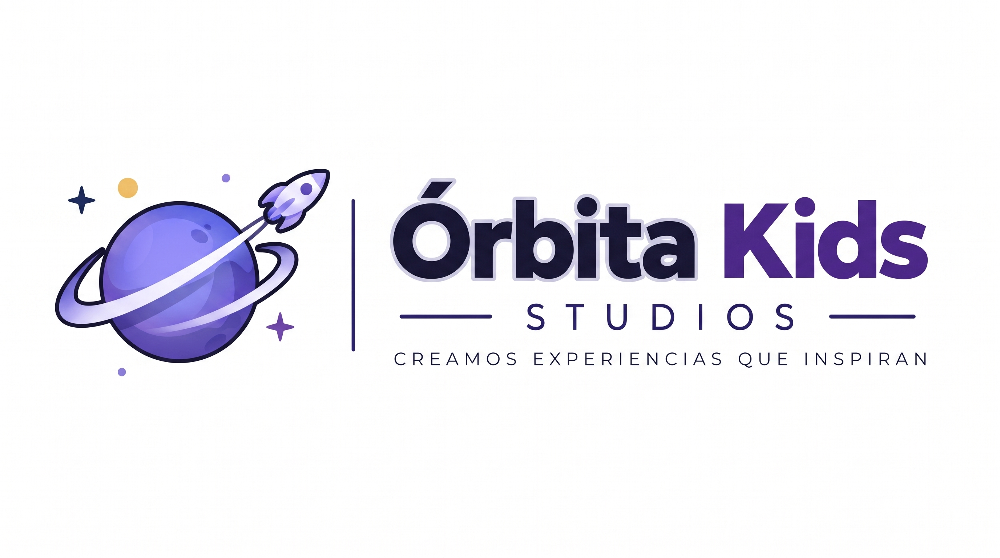
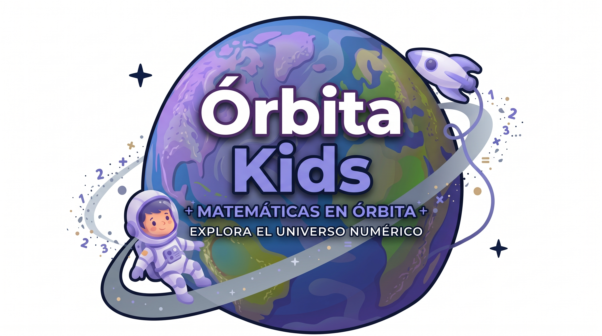
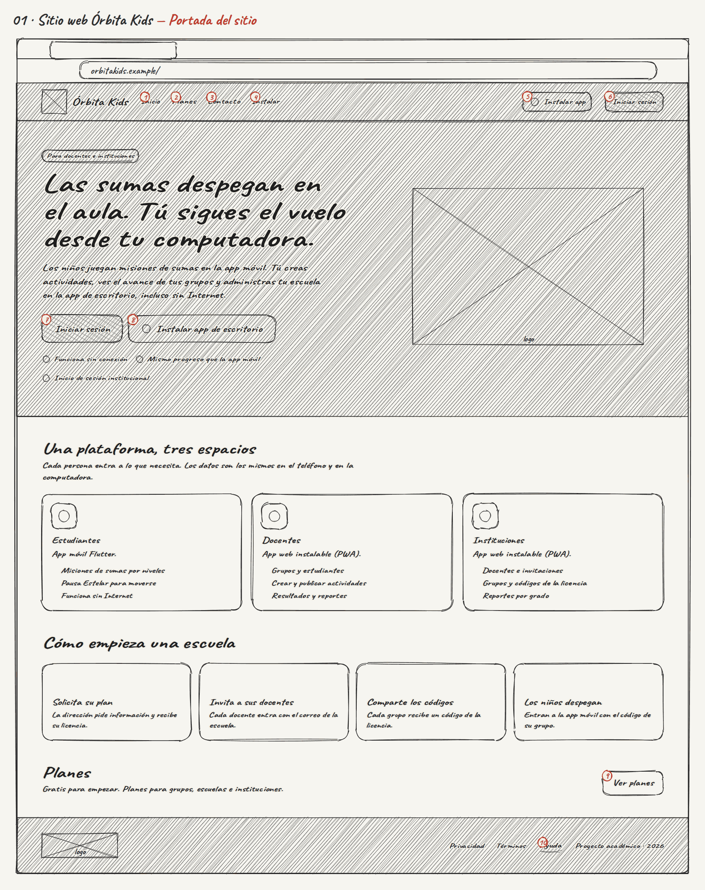
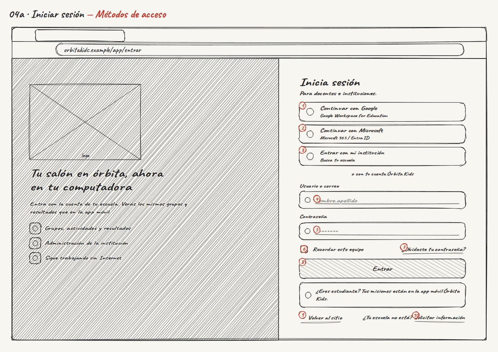
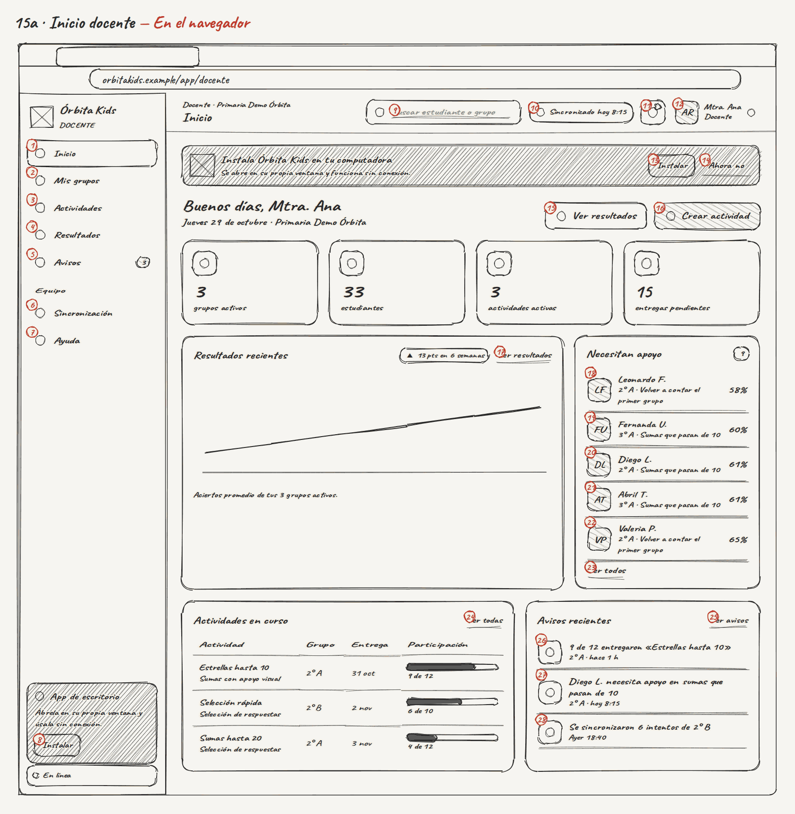
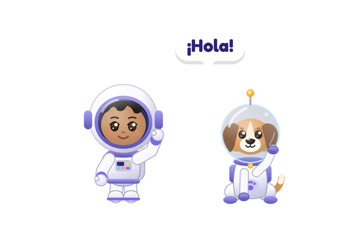

 

# 🪐 ` Ó R B I T A · K I D S ` 🚀

### ✨ CADA PANTALLA COMIENZA CON UNA IDEA ✨

# ✏️ SKETCHES · WEB

**BOCETOS DE BAJA FIDELIDAD · FLUJOS DE LA PWA**

 

  

### 💡 IMAGINA · ORGANIZA · CONECTA

---

## 📸 Previsualización de sketches

*Bocetos de baja fidelidad que representan la exploración inicial de la experiencia web.*

| Sitio web | Acceso | Docente |
|:---:|:---:|:---:|
|  |  |  |

---

## Contexto dentro de Órbita Kids

Los sketches son la primera representación de la PWA y permiten explorar la organización de una interfaz para docentes e instituciones antes de definir su acabado visual. Ayudan a revisar la jerarquía de la información, la navegación y las acciones principales del sitio web, el acceso, el espacio docente y el espacio institucional.

## 🎯 Objetivo dentro del desarrollo web

Sirven para validar rápidamente los recorridos y la claridad de la experiencia sin depender todavía de estilos finales o componentes implementados. También permiten comprobar cómo se adapta la propuesta de Órbita Kids a una ventana web y a los distintos perfiles de usuario.

## 🧭 Proceso y alcance

Se elaboran a partir de ideas y flujos organizados en Figma, y después se relacionan con wireframes, prototipo y capturas mediante la misma nomenclatura. El conjunto cubre el sitio público, autenticación, aplicación de escritorio, experiencia docente, institución, modo sin conexión y cuenta.

## 🛠️ Tecnologías y herramientas

- **Figma:** organización de ideas, flujos y referencias visuales.
- **Rough.js y PNG:** representación de baja fidelidad.
- **React, Vite y JavaScript:** contexto de implementación de la PWA.
- **Markdown:** documentación y relación entre entregables.

## ✨ Principios de diseño

Los sketches priorizan claridad, jerarquía de información, navegación consistente, adaptación a distintos tamaños de ventana y comprensión de las acciones para docentes e instituciones.

## Cómo leerlos

| Símbolo | Significado |
|---|---|
| Círculo rojo con número | Acción que se puede hacer (se describe en la tabla) |
| Rectángulo con una X | Imagen, logotipo o ilustración |
| Línea quebrada | Gráfico |
| Rayado diagonal | Zona con fondo oscuro |
| Línea punteada | Elemento secundario o desactivado |

## Carpetas

| Carpeta | Sección | Sketches |
|---|---|---|
| `01_sitio_web/` | 01 · Sitio web | 4 |
| `02_acceso/` | 02 · Acceso | 14 |
| `03_app_de_escritorio/` | 03 · App de escritorio | 5 |
| `04_docente/` | 04 · Docente | 13 |
| `05_institucion/` | 05 · Institución | 8 |
| `06_sin_conexion/` | 06 · Sin conexión | 2 |
| `07_cuenta/` | 07 · Cuenta | 4 |

## Índice

### 01 · Sitio web

| # | Sketch | Pantalla | Estado | Cómo se llega | Acciones |
|---|---|---|---|---|---|
| 1 | [01](01_sitio_web/001_01_sitio-web-orbita-kids_portada-del-sitio.png) | Sitio web Órbita Kids | Portada del sitio | Abrir orbitakids.example | 1. Inicio → abre «Sitio web Órbita Kids» 2. Planes → abre «Planes institucionales» 3. Contacto → abre «Solicitar información» 4. Instalar → abre «Instalar en otros navegadores» 5. Instalar app → abre «Instalar la app» 6. Iniciar sesión → abre «Iniciar sesión» 7. Iniciar sesión → abre «Iniciar sesión» 8. Instalar app de escritorio → abre «Instalar la app» 9. Ver planes → abre «Planes institucionales» 10. Ayuda → abre «Ayuda y soporte» |
| 2 | [02](01_sitio_web/002_02_planes-institucionales_comparativa-anual.png) | Planes institucionales | Comparativa anual | Menú «Planes» del sitio | 1. Inicio → abre «Sitio web Órbita Kids» 2. Planes → abre «Planes institucionales» 3. Contacto → abre «Solicitar información» 4. Instalar → abre «Instalar en otros navegadores» 5. Instalar app → abre «Instalar la app» 6. Iniciar sesión → abre «Iniciar sesión» 7. Mensual → cambia mensual o anual 8. Anual · ~15 % de ahorro → cambia mensual o anual 9. Solicitar información → abre «Solicitar información» 10. Solicitar información → abre «Solicitar información» 11. Solicitar información → abre «Solicitar información» 12. Solicitar información → abre «Solicitar información» 13. ¿Se puede pagar con tarjeta en la app? → abre o cierra la respuesta 14. ¿Qué pasa si se acaban los lugares? → abre o cierra la respuesta 15. Ayuda → abre «Ayuda y soporte» |
| 3 | [03a](01_sitio_web/003_03a_solicitar-informacion_formulario-con-errores.png) | Solicitar información | Formulario con errores | «Solicitar información» y enviar sin datos | 1. Inicio → abre «Sitio web Órbita Kids» 2. Planes → abre «Planes institucionales» 3. Contacto → abre «Solicitar información» 4. Instalar → abre «Instalar en otros navegadores» 5. Instalar app → abre «Instalar la app» 6. Iniciar sesión → abre «Iniciar sesión» 7. Nombre de la institución → campo para escribir 8. Responsable → campo para escribir 9. Correo institucional → campo para escribir 10. Estudiantes aproximados → elige una opción 11. Plan de interés → elige una opción 12. Mensaje (opcional) → campo para escribir 13. Acepto el aviso de privacidad. Solo usamos e → activa o desactiva 14. Enviar solicitud → valida y envía la solicitud 15. Ver planes → abre «Planes institucionales» |
| 4 | [03b](01_sitio_web/004_03b_solicitar-informacion_solicitud-enviada.png) | Solicitar información | Solicitud enviada | Enviar el formulario completo | 1. Inicio → abre «Sitio web Órbita Kids» 2. Planes → abre «Planes institucionales» 3. Contacto → abre «Solicitar información» 4. Instalar → abre «Instalar en otros navegadores» 5. Instalar app → abre «Instalar la app» 6. Iniciar sesión → abre «Iniciar sesión» 7. Volver al sitio → abre «Sitio web Órbita Kids» |

### 02 · Acceso

| # | Sketch | Pantalla | Estado | Cómo se llega | Acciones |
|---|---|---|---|---|---|
| 5 | [04a](02_acceso/005_04a_iniciar-sesion_metodos-de-acceso.png) | Iniciar sesión | Métodos de acceso | «Iniciar sesión» en el sitio | 1. Continuar con Google → abre «Proveedor de identidad (simulado)» 2. Continuar con Microsoft → abre «Proveedor de identidad (simulado)» 3. Entrar con mi institución → abre «Acceso institucional» 4. Usuario o correo → campo para escribir 5. Contraseña → campo para escribir 6. Recordar este equipo → activa o desactiva 7. ¿Olvidaste tu contraseña? → abre «Estados de acceso» 8. Entrar → valida usuario y contraseña 9. Volver al sitio → abre «Sitio web Órbita Kids» 10. Solicitar información → abre «Solicitar información» |
| 6 | [04b](02_acceso/006_04b_iniciar-sesion_sin-conexion.png) | Iniciar sesión | Sin conexión | Abrir el inicio de sesión sin Internet | 1. Continuar con Google → abre «Proveedor de identidad (simulado)» 2. Continuar con Microsoft → abre «Proveedor de identidad (simulado)» 3. Entrar con mi institución → abre «Acceso institucional» 4. Usuario o correo → campo para escribir 5. Contraseña → campo para escribir 6. Recordar este equipo → activa o desactiva 7. ¿Olvidaste tu contraseña? → abre «Estados de acceso» 8. Entrar → valida usuario y contraseña 9. Volver al sitio → abre «Sitio web Órbita Kids» 10. Solicitar información → abre «Solicitar información» |
| 7 | [04c](02_acceso/007_04c_iniciar-sesion_contrasena-incorrecta.png) | Iniciar sesión | Contraseña incorrecta | Entrar con una contraseña equivocada | 1. Continuar con Google → abre «Proveedor de identidad (simulado)» 2. Continuar con Microsoft → abre «Proveedor de identidad (simulado)» 3. Entrar con mi institución → abre «Acceso institucional» 4. Usuario o correo → campo para escribir 5. Contraseña → campo para escribir 6. Recordar este equipo → activa o desactiva 7. ¿Olvidaste tu contraseña? → abre «Estados de acceso» 8. Entrar → valida usuario y contraseña 9. Volver al sitio → abre «Sitio web Órbita Kids» 10. Solicitar información → abre «Solicitar información» |
| 8 | [05](02_acceso/008_05_proveedor-de-identidad-simulad_elegir-identidad-de-google.png) | Proveedor de identidad (simulado) | Elegir identidad de Google | «Continuar con Google» | 1. ana.rios@escuela.example → elige la identidad y vuelve a Keycloak 2. laura.mendez@escuela.example → elige la identidad y vuelve a Keycloak 3. nuevo.docente@correo.example → elige la identidad y vuelve a Keycloak 4. luna.m@alumnos.escuela.example → elige la identidad y vuelve a Keycloak 5. Cancelar → cancela y vuelve con estado «cancelado» |
| 9 | [06](02_acceso/009_06_acceso-institucional_buscar-institucion.png) | Acceso institucional | Buscar institución | «Entrar con mi institución» | 1. Otros métodos → abre «Iniciar sesión» 2. Buscar institución → campo para escribir 3. Escuela Primaria Demo Órbita → continúa con el proveedor de la escuela 4. Colegio Demo Horizonte → continúa con el proveedor de la escuela 5. Instituto Demo Cometa → continúa con el proveedor de la escuela |
| 10 | [07a](02_acceso/010_07a_estados-de-acceso_cuenta-de-estudiante.png) | Estados de acceso | Cuenta de estudiante | Entrar con luna.astro | 1. Volver al inicio de sesión → abre «Iniciar sesión» 2. Cómo instalar la app móvil → abre «Ayuda y soporte» |
| 11 | [07b](02_acceso/011_07b_estados-de-acceso_sin-rol-asignado.png) | Estados de acceso | Sin rol asignado | Identidad de Microsoft sin licencia | 1. Solicitar acceso → envía una solicitud a la dirección 2. Volver → abre «Iniciar sesión» |
| 12 | [07c](02_acceso/012_07c_estados-de-acceso_solicitud-pendiente.png) | Estados de acceso | Solicitud pendiente | «Solicitar acceso» | 1. Entendido → abre «Iniciar sesión» 2. Ayuda → abre «Ayuda y soporte» |
| 13 | [07d](02_acceso/013_07d_estados-de-acceso_cuenta-bloqueada.png) | Estados de acceso | Cuenta bloqueada | 3 contraseñas incorrectas | 1. Recuperar contraseña → abre «Estados de acceso» 2. Volver → abre «Iniciar sesión» |
| 14 | [07e](02_acceso/014_07e_estados-de-acceso_recuperar-contrasena.png) | Estados de acceso | Recuperar contraseña | «¿Olvidaste tu contraseña?» | 1. Inicio de sesión → abre «Iniciar sesión» 2. Correo de tu cuenta → campo para escribir 3. Enviar instrucciones → envía instrucciones |
| 15 | [08a](02_acceso/015_08a_verificacion-en-dos-pasos_codigo-de-6-digitos.png) | Verificación en dos pasos | Código de 6 dígitos | Entrar con laura.mendez | 1. Dígito 1 → campo para escribir 2. Dígito 2 → campo para escribir 3. Dígito 3 → campo para escribir 4. Dígito 4 → campo para escribir 5. Dígito 5 → campo para escribir 6. Dígito 6 → campo para escribir 7. Recordar este equipo 30 días → activa o desactiva 8. Verificar → valida el código 9. Cancelar → abre «Iniciar sesión» 10. Reenviar en 0:28 → reenvía el código |
| 16 | [08b](02_acceso/016_08b_verificacion-en-dos-pasos_codigo-incorrecto.png) | Verificación en dos pasos | Código incorrecto | Escribir un código equivocado | 1. Dígito 1 → campo para escribir 2. Dígito 2 → campo para escribir 3. Dígito 3 → campo para escribir 4. Dígito 4 → campo para escribir 5. Dígito 5 → campo para escribir 6. Dígito 6 → campo para escribir 7. Recordar este equipo 30 días → activa o desactiva 8. Verificar → valida el código 9. Cancelar → abre «Iniciar sesión» 10. Reenviar en 0:28 → reenvía el código |
| 17 | [09](02_acceso/017_09_elegir-espacio_docente-e-institucion.png) | Elegir espacio | Docente e institución | Verificar el código con una cuenta de dos roles | 1. Docente → entra a ese espacio 2. Institución → entra a ese espacio 3. Recordar mi elección en este equipo → activa o desactiva |
| 18 | [10](02_acceso/018_10_aceptar-invitacion_invitacion-por-correo.png) | Aceptar invitación | Invitación por correo | Abrir el enlace del correo de invitación | 1. Aceptar con Google → vincula la cuenta y acepta 2. Aceptar con Microsoft → vincula la cuenta y acepta 3. Crear cuenta Órbita Kids → vincula la cuenta y acepta 4. Rechazar invitación → rechaza la invitación |

### 03 · App de escritorio

| # | Sketch | Pantalla | Estado | Cómo se llega | Acciones |
|---|---|---|---|---|---|
| 19 | [11a](03_app_de_escritorio/019_11a_instalar-la-app_antes-de-instalar.png) | Instalar la app | Antes de instalar | «Instalar app» en el sitio, el panel o la barra de direcciones | 1. Instalar app → abre el diálogo de instalación del navegador 2. Ahora no → oculta la sugerencia de instalar 3. ¿No ves el botón? Instrucciones por navegado → abre «Instalar en otros navegadores» |
| 20 | [11b](03_app_de_escritorio/020_11b_instalar-la-app_dialogo-del-navegador.png) | Instalar la app | Diálogo del navegador | «Instalar app» | 1. Instalar → instala y abre la app en su ventana 2. Cancelar → cierra el diálogo sin instalar |
| 21 | [12](03_app_de_escritorio/021_12_primer-arranque-instalada_primer-arranque.png) | Primer arranque instalada | Primer arranque | Confirmar «Instalar» en el diálogo | 1. Continuar → continúa al panel o al inicio de sesión |
| 22 | [13](03_app_de_escritorio/022_13_instalar-en-otros-navegadores_pasos-por-navegador.png) | Instalar en otros navegadores | Pasos por navegador | «¿No ves el botón?» | 1. Inicio → abre «Sitio web Órbita Kids» 2. Planes → abre «Planes institucionales» 3. Contacto → abre «Solicitar información» 4. Instalar → abre «Instalar en otros navegadores» 5. Instalar app → abre «Instalar la app» 6. Iniciar sesión → abre «Iniciar sesión» 7. Instalar ahora → abre «Instalar la app» |
| 23 | [14](03_app_de_escritorio/023_14_nueva-version-disponible_version-nueva-lista.png) | Nueva versión disponible | Versión nueva lista | El service worker descargó una versión nueva | 1. Actualizar ahora → activa la versión nueva y recarga 2. Al cerrar la app → actualiza al cerrar la app |

### 04 · Docente

| # | Sketch | Pantalla | Estado | Cómo se llega | Acciones |
|---|---|---|---|---|---|
| 24 | [15a](04_docente/024_15a_inicio-docente_en-el-navegador.png) | Inicio docente | En el navegador | Entrar como docente | 1. Inicio → abre «Inicio docente» 2. Mis grupos → abre «Mis grupos» 3. Actividades → abre «Actividades» 4. Resultados → abre «Resultados y reportes» 5. Avisos → abre «Avisos» 6. Sincronización → abre «Sincronización» 7. Ayuda → abre «Ayuda y soporte» 8. Instalar → abre «Instalar la app» 9. Buscar → campo para escribir 10. Sincronizado hoy 8:15 → abre «Sincronización» 11. Avisos → abre «Avisos» 12. Mtra. Ana → abre el menú de la cuenta 13. Instalar → abre «Instalar la app» 14. Ahora no → oculta el aviso 15. Ver resultados → abre «Resultados y reportes» 16. Crear actividad → abre «Crear actividad» 17. Ver resultados → abre «Resultados y reportes» 18. Leonardo F. → abre «Detalle del estudiante» 19. Fernanda U. → abre «Detalle del estudiante» 20. Diego L. → abre «Detalle del estudiante» 21. Abril T. → abre «Detalle del estudiante» 22. Valeria P. → abre «Detalle del estudiante» 23. Ver todos → abre «Detalle del grupo» 24. Ver todas → abre «Actividades» 25. Ver avisos → abre «Avisos» 26. 9 de 12 entregaron «Estrellas hasta 10» → abre «Actividades» 27. Diego L. necesita apoyo en sumas que pasan d → abre «Detalle del estudiante» 28. Se sincronizaron 6 intentos de 2° B → abre «Sincronización» |
| 25 | [15b](04_docente/025_15b_inicio-docente_en-la-app-instalada.png) | Inicio docente | En la app instalada | Abrir la app desde el escritorio | 1. Inicio → abre «Inicio docente» 2. Mis grupos → abre «Mis grupos» 3. Actividades → abre «Actividades» 4. Resultados → abre «Resultados y reportes» 5. Avisos → abre «Avisos» 6. Sincronización → abre «Sincronización» 7. Ayuda → abre «Ayuda y soporte» 8. Buscar → campo para escribir 9. Sincronizado hoy 8:15 → abre «Sincronización» 10. Avisos → abre «Avisos» 11. Mtra. Ana → abre el menú de la cuenta 12. Ver resultados → abre «Resultados y reportes» 13. Crear actividad → abre «Crear actividad» 14. Ver resultados → abre «Resultados y reportes» 15. Leonardo F. → abre «Detalle del estudiante» 16. Fernanda U. → abre «Detalle del estudiante» 17. Diego L. → abre «Detalle del estudiante» 18. Abril T. → abre «Detalle del estudiante» 19. Valeria P. → abre «Detalle del estudiante» 20. Ver todos → abre «Detalle del grupo» 21. Ver todas → abre «Actividades» 22. Ver avisos → abre «Avisos» 23. 9 de 12 entregaron «Estrellas hasta 10» → abre «Actividades» 24. Diego L. necesita apoyo en sumas que pasan d → abre «Detalle del estudiante» 25. Se sincronizaron 6 intentos de 2° B → abre «Sincronización» |
| 26 | [15c](04_docente/026_15c_inicio-docente_menu-de-la-cuenta.png) | Inicio docente | Menú de la cuenta | Tocar tu foto | 1. Perfil y configuración → abre «Perfil y configuración» 2. Seguridad y sesiones → abre «Seguridad y sesiones» 3. Ayuda → abre «Ayuda y soporte» 4. Cerrar sesión → abre «Cerrar sesión» |
| 27 | [16](04_docente/027_16_mis-grupos_activos-y-archivados.png) | Mis grupos | Activos y archivados | Menú «Mis grupos» | 1. Inicio → abre «Inicio docente» 2. Mis grupos → abre «Mis grupos» 3. Actividades → abre «Actividades» 4. Resultados → abre «Resultados y reportes» 5. Avisos → abre «Avisos» 6. Sincronización → abre «Sincronización» 7. Ayuda → abre «Ayuda y soporte» 8. Buscar → campo para escribir 9. Sincronizado hoy 8:15 → abre «Sincronización» 10. Avisos → abre «Avisos» 11. Mtra. Ana → abre el menú de la cuenta 12. Solicitar grupo → abre un diálogo 13. Copiar código ORB-2A7K → copia al portapapeles 14. Abrir → abre «Detalle del grupo» 15. Copiar código ORB-2B3M → copia al portapapeles 16. Abrir → abre «Detalle del grupo» 17. Copiar código ORB-3A9Q → copia al portapapeles 18. Abrir → abre «Detalle del grupo» 19. Copiar código ORB-1C2P → copia al portapapeles 20. Abrir → abre «Detalle del grupo» |
| 28 | [17a](04_docente/028_17a_detalle-del-grupo_estudiantes-de-2-a.png) | Detalle del grupo | Estudiantes de 2° A | «Abrir» en un grupo | 1. Inicio → abre «Inicio docente» 2. Mis grupos → abre «Mis grupos» 3. Actividades → abre «Actividades» 4. Resultados → abre «Resultados y reportes» 5. Avisos → abre «Avisos» 6. Sincronización → abre «Sincronización» 7. Ayuda → abre «Ayuda y soporte» 8. Buscar → campo para escribir 9. Sincronizado hoy 8:15 → abre «Sincronización» 10. Avisos → abre «Avisos» 11. Mtra. Ana → abre el menú de la cuenta 12. Mis grupos → abre «Mis grupos» 13. Copiar → copia al portapapeles 14. Asignar actividad → abre «Crear actividad» 15. Estudiantes → filtra o cambia de pestaña 16. Actividades → filtra o cambia de pestaña 17. Resultados → filtra o cambia de pestaña 18. Todos (12) → filtra o cambia de pestaña 19. Necesita apoyo (3) → filtra o cambia de pestaña 20. Sin actividad reciente (4) → filtra o cambia de pestaña 21. Al día (5) → filtra o cambia de pestaña 22. Buscar estudiante → campo para escribir 23. Abrir Luna M. → abre «Detalle del estudiante» 24. Abrir Mateo R. → abre «Detalle del estudiante» 25. Abrir Sofía G. → abre «Detalle del estudiante» 26. Abrir Diego L. → abre «Detalle del estudiante» 27. Abrir Valeria P. → abre «Detalle del estudiante» 28. Abrir Emiliano C. → abre «Detalle del estudiante» 29. Abrir Camila H. → abre «Detalle del estudiante» 30. Abrir Santiago T. → abre «Detalle del estudiante» 31. Abrir Regina V. → abre «Detalle del estudiante» 32. Abrir Iker S. → abre «Detalle del estudiante» 33. Abrir Ximena D. → abre «Detalle del estudiante» 34. Abrir Leonardo F. → abre «Detalle del estudiante» |
| 29 | [17b](04_docente/029_17b_detalle-del-grupo_filtro-necesita-apoyo.png) | Detalle del grupo | Filtro «Necesita apoyo» | Elegir el filtro | 1. Inicio → abre «Inicio docente» 2. Mis grupos → abre «Mis grupos» 3. Actividades → abre «Actividades» 4. Resultados → abre «Resultados y reportes» 5. Avisos → abre «Avisos» 6. Sincronización → abre «Sincronización» 7. Ayuda → abre «Ayuda y soporte» 8. Buscar → campo para escribir 9. Sincronizado hoy 8:15 → abre «Sincronización» 10. Avisos → abre «Avisos» 11. Mtra. Ana → abre el menú de la cuenta 12. Mis grupos → abre «Mis grupos» 13. Copiar → copia al portapapeles 14. Asignar actividad → abre «Crear actividad» 15. Estudiantes → filtra o cambia de pestaña 16. Actividades → filtra o cambia de pestaña 17. Resultados → filtra o cambia de pestaña 18. Todos (12) → filtra o cambia de pestaña 19. Necesita apoyo (3) → filtra o cambia de pestaña 20. Sin actividad reciente (4) → filtra o cambia de pestaña 21. Al día (5) → filtra o cambia de pestaña 22. Buscar estudiante → campo para escribir 23. Abrir Diego L. → abre «Detalle del estudiante» 24. Abrir Valeria P. → abre «Detalle del estudiante» 25. Abrir Leonardo F. → abre «Detalle del estudiante» |
| 30 | [18](04_docente/030_18_detalle-del-estudiante_detalle-de-diego-l.png) | Detalle del estudiante | Detalle de Diego L. | «Abrir» en un estudiante | 1. Inicio → abre «Inicio docente» 2. Mis grupos → abre «Mis grupos» 3. Actividades → abre «Actividades» 4. Resultados → abre «Resultados y reportes» 5. Avisos → abre «Avisos» 6. Sincronización → abre «Sincronización» 7. Ayuda → abre «Ayuda y soporte» 8. Buscar → campo para escribir 9. Sincronizado hoy 8:15 → abre «Sincronización» 10. Avisos → abre «Avisos» 11. Mtra. Ana → abre el menú de la cuenta 12. 2° A → abre «Detalle del grupo» 13. Asignar refuerzo → abre «Crear actividad» |
| 31 | [19a](04_docente/031_19a_crear-actividad_formulario-y-vista-previa.png) | Crear actividad | Formulario y vista previa | «Crear actividad» | 1. Inicio → abre «Inicio docente» 2. Mis grupos → abre «Mis grupos» 3. Actividades → abre «Actividades» 4. Resultados → abre «Resultados y reportes» 5. Avisos → abre «Avisos» 6. Sincronización → abre «Sincronización» 7. Ayuda → abre «Ayuda y soporte» 8. Buscar → campo para escribir 9. Sincronizado hoy 8:15 → abre «Sincronización» 10. Avisos → abre «Avisos» 11. Mtra. Ana → abre el menú de la cuenta 12. Actividades → abre «Actividades» 13. Nombre de la actividad → campo para escribir 14. Grupo → elige una opción 15. Todo el grupo → cambia una opción del formulario 16. Algunos estudiantes → cambia una opción del formulario 17. Sumas con apoyo visual → cambia una opción del formulario 18. Selección de respuestas → cambia una opción del formulario 19. Visual + selección → cambia una opción del formulario 20. Nivel → elige una opción 21. Menos ejercicios → cambia una opción del formulario 22. Más ejercicios → cambia una opción del formulario 23. Entrega → campo para escribir 24. Instrucciones para el estudiante → campo para escribir 25. Publicar → envía el formulario 26. Guardar borrador → envía el formulario |
| 32 | [19b](04_docente/032_19b_crear-actividad_errores-de-validacion.png) | Crear actividad | Errores de validación | Publicar sin nombre | 1. Inicio → abre «Inicio docente» 2. Mis grupos → abre «Mis grupos» 3. Actividades → abre «Actividades» 4. Resultados → abre «Resultados y reportes» 5. Avisos → abre «Avisos» 6. Sincronización → abre «Sincronización» 7. Ayuda → abre «Ayuda y soporte» 8. Buscar → campo para escribir 9. Sincronizado hoy 8:15 → abre «Sincronización» 10. Avisos → abre «Avisos» 11. Mtra. Ana → abre el menú de la cuenta 12. Actividades → abre «Actividades» 13. Nombre de la actividad → campo para escribir 14. Grupo → elige una opción 15. Todo el grupo → cambia una opción del formulario 16. Algunos estudiantes → cambia una opción del formulario 17. Sumas con apoyo visual → cambia una opción del formulario 18. Selección de respuestas → cambia una opción del formulario 19. Visual + selección → cambia una opción del formulario 20. Nivel → elige una opción 21. Menos ejercicios → cambia una opción del formulario 22. Más ejercicios → cambia una opción del formulario 23. Entrega → campo para escribir 24. Instrucciones para el estudiante → campo para escribir 25. Publicar → envía el formulario 26. Guardar borrador → envía el formulario |
| 33 | [19c](04_docente/033_19c_crear-actividad_confirmar-publicacion.png) | Crear actividad | Confirmar publicación | «Publicar» | 1. Cancelar → cierra el diálogo 2. Publicar → publica la actividad |
| 34 | [20](04_docente/034_20_actividades_todas-las-actividades.png) | Actividades | Todas las actividades | Menú «Actividades» | 1. Inicio → abre «Inicio docente» 2. Mis grupos → abre «Mis grupos» 3. Actividades → abre «Actividades» 4. Resultados → abre «Resultados y reportes» 5. Avisos → abre «Avisos» 6. Sincronización → abre «Sincronización» 7. Ayuda → abre «Ayuda y soporte» 8. Buscar → campo para escribir 9. Sincronizado hoy 8:15 → abre «Sincronización» 10. Avisos → abre «Avisos» 11. Mtra. Ana → abre el menú de la cuenta 12. Crear actividad → abre «Crear actividad» 13. Todas (5) → filtra o cambia de pestaña 14. Activas (3) → filtra o cambia de pestaña 15. Programadas (1) → filtra o cambia de pestaña 16. Borradors (0) → filtra o cambia de pestaña 17. Cerradas (1) → filtra o cambia de pestaña 18. Filtrar por grupo → filtra por grupo 19. Abrir → abre «Detalle del grupo» 20. Abrir → abre «Detalle del grupo» 21. Abrir → abre «Detalle del grupo» 22. Abrir → abre «Detalle del grupo» 23. Abrir → abre «Detalle del grupo» |
| 35 | [21](04_docente/035_21_resultados-y-reportes_resultados-de-2-a.png) | Resultados y reportes | Resultados de 2° A | Menú «Resultados» | 1. Inicio → abre «Inicio docente» 2. Mis grupos → abre «Mis grupos» 3. Actividades → abre «Actividades» 4. Resultados → abre «Resultados y reportes» 5. Avisos → abre «Avisos» 6. Sincronización → abre «Sincronización» 7. Ayuda → abre «Ayuda y soporte» 8. Buscar → campo para escribir 9. Sincronizado hoy 8:15 → abre «Sincronización» 10. Avisos → abre «Avisos» 11. Mtra. Ana → abre el menú de la cuenta 12. 2° A → filtra o cambia de pestaña 13. 2° B → filtra o cambia de pestaña 14. 3° A → filtra o cambia de pestaña 15. CSV → exporta el reporte 16. PDF → exporta el reporte 17. Asignar → abre «Crear actividad» 18. Asignar → abre «Crear actividad» 19. Asignar → abre «Crear actividad» |
| 36 | [22](04_docente/036_22_avisos_avisos-y-canales.png) | Avisos | Avisos y canales | Campana o menú «Avisos» | 1. Inicio → abre «Inicio docente» 2. Mis grupos → abre «Mis grupos» 3. Actividades → abre «Actividades» 4. Resultados → abre «Resultados y reportes» 5. Avisos → abre «Avisos» 6. Sincronización → abre «Sincronización» 7. Ayuda → abre «Ayuda y soporte» 8. Buscar → campo para escribir 9. Sincronizado hoy 8:15 → abre «Sincronización» 10. Avisos → abre «Avisos» 11. Mtra. Ana → abre el menú de la cuenta 12. Marcar todo como leído → marca todo como leído 13. 9 de 12 entregaron «Estrellas hasta 10» → abre el aviso 14. Diego L. necesita apoyo en sumas que pasan d → abre el aviso 15. Se sincronizaron 6 intentos de 2° B → abre el aviso 16. La dirección aprobó tu grupo 3° A para el ci → abre el aviso 17. En la app → activa o desactiva 18. Notificaciones de escritorio → activa avisos de escritorio 19. Resumen por correo → activa o desactiva 20. Horario sin avisos → activa o desactiva |

### 05 · Institución

| # | Sketch | Pantalla | Estado | Cómo se llega | Acciones |
|---|---|---|---|---|---|
| 37 | [23](05_institucion/037_23_inicio-institucion_panel-de-la-institucion.png) | Inicio institución | Panel de la institución | Elegir el espacio «Institución» | 1. Inicio → abre «Inicio institución» 2. Docentes → abre «Docentes» 3. Grupos y códigos → abre «Grupos y códigos» 4. Licencia y plan → abre «Licencia y plan» 5. Reportes → abre «Reportes institucionales» 6. Avisos → abre «Avisos» 7. Configuración → abre «Configuración institucional» 8. Sincronización → abre «Sincronización» 9. Ayuda → abre «Ayuda y soporte» 10. Buscar → campo para escribir 11. Sincronizado hoy 8:15 → abre «Sincronización» 12. Avisos → abre «Avisos» 13. Lic. Laura → abre el menú de la cuenta 14. Generar código → abre un diálogo 15. Invitar docente → abre un diálogo 16. Ver reportes → abre «Reportes institucionales» 17. Revisar → abre «Docentes» 18. Renovar → renueva el código 19. Ajustar → abre «Grupos y códigos» 20. Ver → abre «Licencia y plan» |
| 38 | [24a](05_institucion/038_24a_docentes_docentes-y-solicitudes.png) | Docentes | Docentes y solicitudes | Menú «Docentes» | 1. Inicio → abre «Inicio institución» 2. Docentes → abre «Docentes» 3. Grupos y códigos → abre «Grupos y códigos» 4. Licencia y plan → abre «Licencia y plan» 5. Reportes → abre «Reportes institucionales» 6. Avisos → abre «Avisos» 7. Configuración → abre «Configuración institucional» 8. Sincronización → abre «Sincronización» 9. Ayuda → abre «Ayuda y soporte» 10. Buscar → campo para escribir 11. Sincronizado hoy 8:15 → abre «Sincronización» 12. Avisos → abre «Avisos» 13. Lic. Laura → abre el menú de la cuenta 14. Invitar docente → abre un diálogo 15. Todos (7) → filtra o cambia de pestaña 16. Activos (5) → filtra o cambia de pestaña 17. Solicitudes (1) → filtra o cambia de pestaña 18. Invitaciones (1) → filtra o cambia de pestaña 19. Desactivados (0) → filtra o cambia de pestaña 20. Buscar docente → campo para escribir 21. Desactivar → desactiva al docente 22. Desactivar → desactiva al docente 23. Desactivar → desactiva al docente 24. Desactivar → desactiva al docente 25. Aprobar → aprueba la solicitud 26. Rechazar → rechaza la solicitud 27. Reenviar → reenvía la invitación |
| 39 | [24b](05_institucion/039_24b_docentes_invitar-docente.png) | Docentes | Invitar docente | «Invitar docente» | 1. Correo de la escuela → campo para escribir 2. Nombre → campo para escribir 3. 1° A → activa o desactiva 4. 1° B → activa o desactiva 5. 2° C → activa o desactiva 6. 3° C → activa o desactiva 7. Cancelar → cierra el diálogo 8. Enviar invitación → valida y envía la invitación |
| 40 | [25a](05_institucion/040_25a_grupos-y-codigos_grupos-y-lugares.png) | Grupos y códigos | Grupos y lugares | Menú «Grupos y códigos» | 1. Inicio → abre «Inicio institución» 2. Docentes → abre «Docentes» 3. Grupos y códigos → abre «Grupos y códigos» 4. Licencia y plan → abre «Licencia y plan» 5. Reportes → abre «Reportes institucionales» 6. Avisos → abre «Avisos» 7. Configuración → abre «Configuración institucional» 8. Sincronización → abre «Sincronización» 9. Ayuda → abre «Ayuda y soporte» 10. Buscar → campo para escribir 11. Sincronizado hoy 8:15 → abre «Sincronización» 12. Avisos → abre «Avisos» 13. Lic. Laura → abre el menú de la cuenta 14. Generar código → abre un diálogo 15. Todos los grados → filtra o cambia de pestaña 16. 1.º grado → filtra o cambia de pestaña 17. 2.º grado → filtra o cambia de pestaña 18. 3.º grado → filtra o cambia de pestaña 19. Copiar ORB-1A5D → copia al portapapeles 20. Archivar → archiva el grupo 21. Copiar ORB-1B4T → copia al portapapeles 22. Renovar → renueva el código 23. Copiar ORB-1C8W → copia al portapapeles 24. Archivar → archiva el grupo 25. Copiar ORB-2A7K → copia al portapapeles 26. Archivar → archiva el grupo 27. Copiar ORB-2B3M → copia al portapapeles 28. Archivar → archiva el grupo 29. Copiar ORB-2C6H → copia al portapapeles 30. Archivar → archiva el grupo 31. Copiar ORB-3A9Q → copia al portapapeles 32. Archivar → archiva el grupo 33. Copiar ORB-3B2R → copia al portapapeles 34. Archivar → archiva el grupo 35. Copiar ORB-3C7N → copia al portapapeles 36. +5 lugares → agrega 5 lugares |
| 41 | [25b](05_institucion/041_25b_grupos-y-codigos_generar-codigo.png) | Grupos y códigos | Generar código | «Generar código» | 1. Grupo → campo para escribir 2. Docente → elige una opción 3. Menos lugares → cambia los lugares 4. Más lugares → cambia los lugares 5. Vigencia → elige una opción 6. Cancelar → cierra el diálogo 7. Generar código → genera el código |
| 42 | [26](05_institucion/042_26_licencia-y-plan_plan-escuela.png) | Licencia y plan | Plan Escuela | Menú «Licencia y plan» | 1. Inicio → abre «Inicio institución» 2. Docentes → abre «Docentes» 3. Grupos y códigos → abre «Grupos y códigos» 4. Licencia y plan → abre «Licencia y plan» 5. Reportes → abre «Reportes institucionales» 6. Avisos → abre «Avisos» 7. Configuración → abre «Configuración institucional» 8. Sincronización → abre «Sincronización» 9. Ayuda → abre «Ayuda y soporte» 10. Buscar → campo para escribir 11. Sincronizado hoy 8:15 → abre «Sincronización» 12. Avisos → abre «Avisos» 13. Lic. Laura → abre el menú de la cuenta 14. Contrato → muestra un aviso 15. Solicitar cambio de plan → abre un diálogo |
| 43 | [27](05_institucion/043_27_reportes-institucionales_datos-agregados.png) | Reportes institucionales | Datos agregados | Menú «Reportes» | 1. Inicio → abre «Inicio institución» 2. Docentes → abre «Docentes» 3. Grupos y códigos → abre «Grupos y códigos» 4. Licencia y plan → abre «Licencia y plan» 5. Reportes → abre «Reportes institucionales» 6. Avisos → abre «Avisos» 7. Configuración → abre «Configuración institucional» 8. Sincronización → abre «Sincronización» 9. Ayuda → abre «Ayuda y soporte» 10. Buscar → campo para escribir 11. Sincronizado hoy 8:15 → abre «Sincronización» 12. Avisos → abre «Avisos» 13. Lic. Laura → abre el menú de la cuenta 14. Todos → filtra o cambia de pestaña 15. 1.º → filtra o cambia de pestaña 16. 2.º → filtra o cambia de pestaña 17. 3.º → filtra o cambia de pestaña 18. Exportar CSV → exporta el reporte |
| 44 | [28](05_institucion/044_28_configuracion-institucional_proveedor-y-reglas.png) | Configuración institucional | Proveedor y reglas | Menú «Configuración» | 1. Inicio → abre «Inicio institución» 2. Docentes → abre «Docentes» 3. Grupos y códigos → abre «Grupos y códigos» 4. Licencia y plan → abre «Licencia y plan» 5. Reportes → abre «Reportes institucionales» 6. Avisos → abre «Avisos» 7. Configuración → abre «Configuración institucional» 8. Sincronización → abre «Sincronización» 9. Ayuda → abre «Ayuda y soporte» 10. Buscar → campo para escribir 11. Sincronizado hoy 8:15 → abre «Sincronización» 12. Avisos → abre «Avisos» 13. Lic. Laura → abre el menú de la cuenta 14. Guardar cambios → muestra un aviso 15. Nombre → campo para escribir 16. Ciclo escolar → elige una opción 17. Zona horaria → elige una opción 18. Probar → prueba la conexión con el proveedor 19. Configurar → muestra un aviso 20. Aprobar solos a docentes del dominio → activa o desactiva 21. Verificación en dos pasos para la dirección → activa o desactiva 22. Cerrar sesión tras 8 h sin actividad → activa o desactiva 23. Cambiar → muestra un aviso 24. Solicitar → exporta el reporte 25. Leer → abre «Ayuda y soporte» |

### 06 · Sin conexión

| # | Sketch | Pantalla | Estado | Cómo se llega | Acciones |
|---|---|---|---|---|---|
| 45 | [29](06_sin_conexion/045_29_sin-conexion_sin-conexion-en-la-app.png) | Sin conexión | Sin conexión en la app | Perder Internet con la app abierta | 1. Inicio → abre «Inicio docente» 2. Mis grupos → abre «Mis grupos» 3. Actividades → abre «Actividades» 4. Resultados → abre «Resultados y reportes» 5. Avisos → abre «Avisos» 6. Sincronización → abre «Sincronización» 7. Ayuda → abre «Ayuda y soporte» 8. Buscar → campo para escribir 9. Sin conexión · datos de hoy 8:15 → abre «Sin conexión» 10. Avisos → abre «Avisos» 11. Mtra. Ana → abre el menú de la cuenta 12. Ver pendientes (1) → abre «Sincronización» 13. Reintentar → reintenta la conexión |
| 46 | [30](06_sin_conexion/046_30_sincronizacion_un-borrador-en-cola.png) | Sincronización | Un borrador en cola | Menú «Sincronización» | 1. Inicio → abre «Inicio docente» 2. Mis grupos → abre «Mis grupos» 3. Actividades → abre «Actividades» 4. Resultados → abre «Resultados y reportes» 5. Avisos → abre «Avisos» 6. Sincronización → abre «Sincronización» 7. Ayuda → abre «Ayuda y soporte» 8. Buscar → campo para escribir 9. Sin conexión · datos de hoy 8:15 → abre «Sin conexión» 10. Avisos → abre «Avisos» 11. Mtra. Ana → abre el menú de la cuenta 12. Sincronizar ahora → sincroniza la cola |

### 07 · Cuenta

| # | Sketch | Pantalla | Estado | Cómo se llega | Acciones |
|---|---|---|---|---|---|
| 47 | [31](07_cuenta/047_31_perfil-y-configuracion_preferencias-y-app-instalada.png) | Perfil y configuración | Preferencias y app instalada | Tu foto → «Perfil y configuración» | 1. Inicio → abre «Inicio docente» 2. Mis grupos → abre «Mis grupos» 3. Actividades → abre «Actividades» 4. Resultados → abre «Resultados y reportes» 5. Avisos → abre «Avisos» 6. Sincronización → abre «Sincronización» 7. Ayuda → abre «Ayuda y soporte» 8. Buscar → campo para escribir 9. Sincronizado hoy 8:15 → abre «Sincronización» 10. Avisos → abre «Avisos» 11. Mtra. Ana → abre el menú de la cuenta 12. Editar nombre visible → muestra un aviso 13. Claro → cambia el tema 14. Oscuro → cambia el tema 15. Sistema → cambia el tema 16. Texto más grande → activa texto grande 17. Reducir movimiento → reduce el movimiento 18. Abrir enlaces de Órbita Kids en la app → activa o desactiva 19. Borrar → abre un diálogo |
| 48 | [32](07_cuenta/048_32_seguridad-y-sesiones_sesiones-activas.png) | Seguridad y sesiones | Sesiones activas | Tu foto → «Seguridad y sesiones» | 1. Inicio → abre «Inicio docente» 2. Mis grupos → abre «Mis grupos» 3. Actividades → abre «Actividades» 4. Resultados → abre «Resultados y reportes» 5. Avisos → abre «Avisos» 6. Sincronización → abre «Sincronización» 7. Ayuda → abre «Ayuda y soporte» 8. Buscar → campo para escribir 9. Sincronizado hoy 8:15 → abre «Sincronización» 10. Avisos → abre «Avisos» 11. Mtra. Ana → abre el menú de la cuenta 12. Pedir un código al entrar → activa o desactiva 13. Cerrar las otras sesiones → cierra las otras sesiones 14. Cerrar → muestra un aviso 15. Cerrar → muestra un aviso |
| 49 | [33](07_cuenta/049_33_ayuda-y-soporte_preguntas-y-reporte.png) | Ayuda y soporte | Preguntas y reporte | Menú «Ayuda» | 1. Inicio → abre «Inicio docente» 2. Mis grupos → abre «Mis grupos» 3. Actividades → abre «Actividades» 4. Resultados → abre «Resultados y reportes» 5. Avisos → abre «Avisos» 6. Sincronización → abre «Sincronización» 7. Ayuda → abre «Ayuda y soporte» 8. Buscar → campo para escribir 9. Sincronizado hoy 8:15 → abre «Sincronización» 10. Avisos → abre «Avisos» 11. Mtra. Ana → abre el menú de la cuenta 12. Guía de instalación → abre «Instalar en otros navegadores» 13. ¿Cómo instalo la app en mi computadora? → abre o cierra la respuesta 14. ¿Qué pasa si me quedo sin Internet? → abre o cierra la respuesta 15. ¿Los estudiantes pueden entrar aquí? → abre o cierra la respuesta 16. ¿Cómo comparto el código de un grupo? → abre o cierra la respuesta 17. ¿Quién ve los datos de los niños? → abre o cierra la respuesta 18. ¿Cómo desinstalo la app? → abre o cierra la respuesta 19. Tipo → elige una opción 20. Qué pasó → campo para escribir 21. Enviar reporte → envía el reporte 22. Copiar → copia al portapapeles |
| 50 | [34](07_cuenta/050_34_cerrar-sesion_con-un-cambio-pendiente.png) | Cerrar sesión | Con un cambio pendiente | Tu foto → «Cerrar sesión» | 1. Cerrar sesión → cierra la sesión 2. Quedarme → regresa a la pantalla anterior |

### 🪐 ÓRBITA KIDS

**EXPLORA · APRENDE · DESCUBRE**

*Cada descubrimiento comienza con una pregunta.*

 

 

### ✨ ¡GRACIAS POR EXPLORAR CON NOSOTROS! ✨

**DESARROLLADO POR ÓRBITA STUDIO**

© 2026 Órbita Studio · Todos los derechos reservados.

