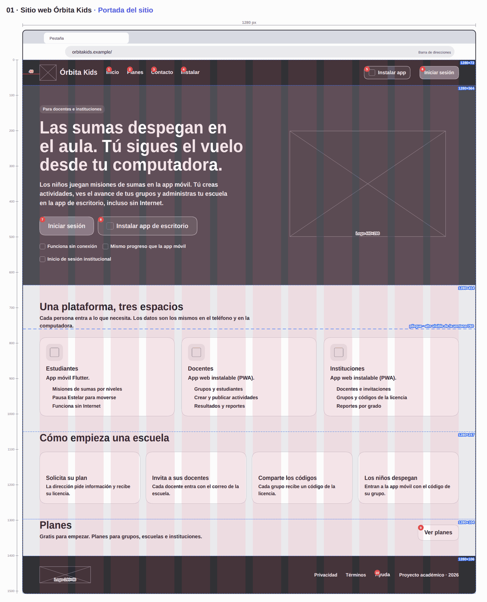
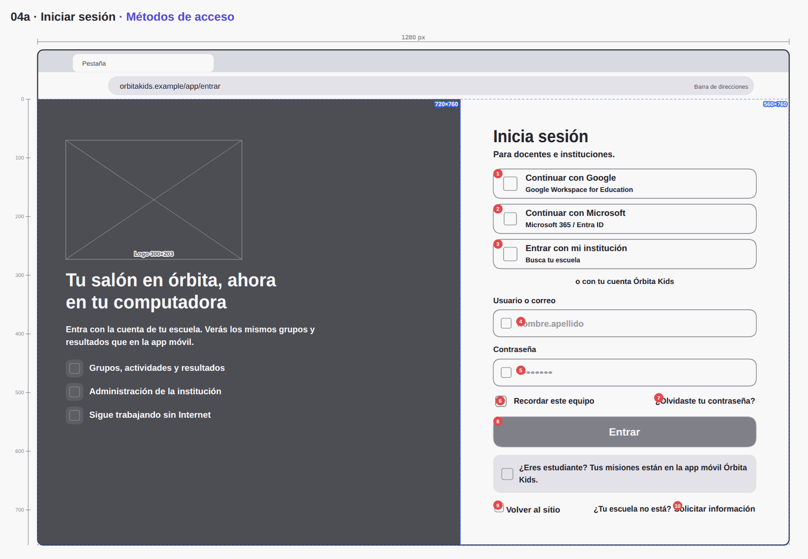
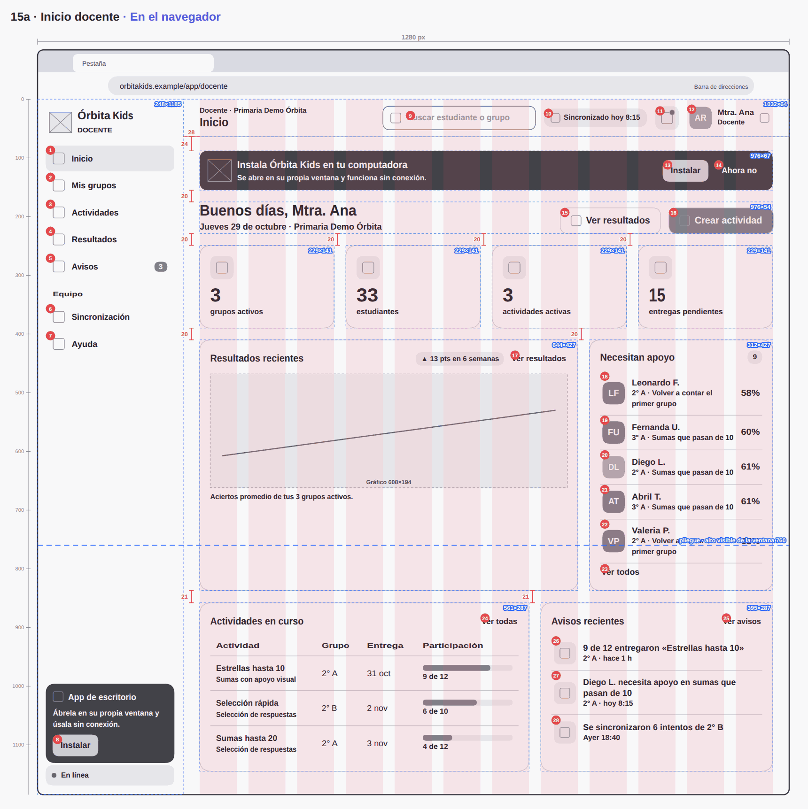

<div align="center">


<br>

# 🪐 ` Ó R B I T A · K I D S ` 🚀

### ✨ CADA DETALLE HACE MÁS CLARO EL CAMINO ✨

# 📐 WIREFRAMES · WEB

**ESTRUCTURA VISUAL · MEDIDAS Y ACCIONES DE LA PWA**

<br>


<br><br>

### 📏 DEFINE · ORDENA · CONSTRUYE

---

</div>

## 📸 Previsualización de wireframes

*Estructuras visuales que organizan las pantallas y sus medidas para la implementación web.*

| Sitio web | Acceso | Docente |
|:---:|:---:|:---:|
|  |  |  |

---

## Contexto dentro de Órbita Kids

Los wireframes convierten las ideas de la PWA en una estructura visual medible. En ellos se revisan jerarquías, distribución de contenidos, navegación, áreas interactivas y comportamiento de las vistas para docentes e instituciones.

## 🎯 Objetivo dentro del desarrollo web

Funcionan como una especificación visual intermedia entre el diseño y el código. Permiten definir cómo se organiza cada pantalla antes de construirla con React, CSS y componentes reutilizables.

## 🧭 Proceso y alcance

Se elaboran a partir de los sketches y de los flujos definidos en Figma. Usan una ventana de referencia de **1280 × 760 px**, una rejilla de 12 columnas y medidas CSS que ayudan a mantener consistencia en el sitio público, acceso, escritorio, espacios docente e institucional, modo sin conexión y cuenta.

## 🛠️ Tecnologías y herramientas

- **Figma:** organización de pantallas y flujos de referencia.
- **CSS y px:** unidad de medida y contexto de implementación web.
- **React y Vite:** destino de las decisiones estructurales.
- **PNG y SVG:** consulta, presentación y edición de los wireframes.
- **Markdown:** documentación de medidas y componentes.

## ✨ Principios de diseño

Los wireframes priorizan claridad, consistencia, legibilidad, accesibilidad, adaptación de ventanas y una navegación comprensible para los perfiles docente e institucional.

## Cómo leerlos

| Marca | Significado |
|---|---|
| Columnas rosas | Rejilla de 12 columnas |
| Recuadro azul punteado con «ancho×alto» | Bloque y su tamaño en px |
| Cota roja | Espacio vertical o margen (px) |
| Círculo rojo con número | Acción numerada (misma numeración que el sketch) |
| Línea azul «pliegue» | Fin de la primera vista (760 px) |

## Sistema de medidas

- **Unidad:** px CSS a 100 % de zoom; el texto usa rem (1 rem = 16 px).
- **Ventana de referencia:** 1280 × 760 px de contenido. Navegador: +84 px de pestañas y barra; app instalada: +36 px de barra de título.
- **Estructura:** barra lateral de 248 px + contenido fluido; padding de 24 px arriba y 28 px a los lados; rejilla de 12 columnas con medianil de 20 px.
- **Escala de espacio:** 4 · 8 · 12 · 16 · 20 · 24 · 32 px.
- **Componentes:** botón de 44 px de alto (36 pequeño, 52 grande) y radio 14 · campo de 46 px y radio 13 · tarjeta con radio 20 y padding 18.

```css
:root { --side: 248px; --top: 64px; --gutter: 20px; --pad-x: 28px; --pad-y: 24px; --r-card: 20px; --r-btn: 14px; --btn-h: 44px; --field-h: 46px; }
.shell { display: grid; grid-template-columns: var(--side) 1fr; }
.page  { padding: var(--pad-y) var(--pad-x) 40px; }
.g12   { display: grid; grid-template-columns: repeat(12, minmax(0, 1fr)); gap: var(--gutter); }
@container app (max-width: 1100px) { .shell { grid-template-columns: 76px 1fr; } }
@container app (max-width: 900px)  { .g12 > * { grid-column: span 12; } }
```

La especificación completa de cada wireframe está en la pestaña **Wireframes** de `../prototipo/Órbita_Kids_PWA_v3.html`.

## Carpetas

| Carpeta | Sección | Wireframes |
|---|---|---|
| `01_sitio_web/` | 01 · Sitio web | 4 |
| `02_acceso/` | 02 · Acceso | 14 |
| `03_app_de_escritorio/` | 03 · App de escritorio | 5 |
| `04_docente/` | 04 · Docente | 13 |
| `05_institucion/` | 05 · Institución | 8 |
| `06_sin_conexion/` | 06 · Sin conexión | 2 |
| `07_cuenta/` | 07 · Cuenta | 4 |

## Índice


### 01 · Sitio web

| # | PNG | SVG | Pantalla · estado | Ventana | Acciones |
|---|---|---|---|---|---|
| 1 | [01](01_sitio_web/001_01_sitio-web-orbita-kids_portada-del-sitio.png) | [svg](01_sitio_web/svg/001_01_sitio-web-orbita-kids_portada-del-sitio.svg) | Sitio web Órbita Kids · Portada del sitio | Navegador · 1280 × 1507 | 10 |
| 2 | [02](01_sitio_web/002_02_planes-institucionales_comparativa-anual.png) | [svg](01_sitio_web/svg/002_02_planes-institucionales_comparativa-anual.svg) | Planes institucionales · Comparativa anual | Navegador · 1280 × 849 | 15 |
| 3 | [03a](01_sitio_web/003_03a_solicitar-informacion_formulario-con-errores.png) | [svg](01_sitio_web/svg/003_03a_solicitar-informacion_formulario-con-errores.svg) | Solicitar información · Formulario con errores | Navegador · 1280 × 763 | 15 |
| 4 | [03b](01_sitio_web/004_03b_solicitar-informacion_solicitud-enviada.png) | [svg](01_sitio_web/svg/004_03b_solicitar-informacion_solicitud-enviada.svg) | Solicitar información · Solicitud enviada | Navegador · 1280 × 760 | 7 |

### 02 · Acceso

| # | PNG | SVG | Pantalla · estado | Ventana | Acciones |
|---|---|---|---|---|---|
| 5 | [04a](02_acceso/005_04a_iniciar-sesion_metodos-de-acceso.png) | [svg](02_acceso/svg/005_04a_iniciar-sesion_metodos-de-acceso.svg) | Iniciar sesión · Métodos de acceso | Navegador · 1280 × 760 | 10 |
| 6 | [04b](02_acceso/006_04b_iniciar-sesion_sin-conexion.png) | [svg](02_acceso/svg/006_04b_iniciar-sesion_sin-conexion.svg) | Iniciar sesión · Sin conexión | Navegador · 1280 × 806 | 10 |
| 7 | [04c](02_acceso/007_04c_iniciar-sesion_contrasena-incorrecta.png) | [svg](02_acceso/svg/007_04c_iniciar-sesion_contrasena-incorrecta.svg) | Iniciar sesión · Contraseña incorrecta | Navegador · 1280 × 760 | 10 |
| 8 | [05](02_acceso/008_05_proveedor-de-identidad-simulad_elegir-identidad-de-google.png) | [svg](02_acceso/svg/008_05_proveedor-de-identidad-simulad_elegir-identidad-de-google.svg) | Proveedor de identidad (simulado) · Elegir identidad de Google | Navegador · 1280 × 760 | 5 |
| 9 | [06](02_acceso/009_06_acceso-institucional_buscar-institucion.png) | [svg](02_acceso/svg/009_06_acceso-institucional_buscar-institucion.svg) | Acceso institucional · Buscar institución | Navegador · 1280 × 760 | 5 |
| 10 | [07a](02_acceso/010_07a_estados-de-acceso_cuenta-de-estudiante.png) | [svg](02_acceso/svg/010_07a_estados-de-acceso_cuenta-de-estudiante.svg) | Estados de acceso · Cuenta de estudiante | Navegador · 1280 × 760 | 2 |
| 11 | [07b](02_acceso/011_07b_estados-de-acceso_sin-rol-asignado.png) | [svg](02_acceso/svg/011_07b_estados-de-acceso_sin-rol-asignado.svg) | Estados de acceso · Sin rol asignado | Navegador · 1280 × 760 | 2 |
| 12 | [07c](02_acceso/012_07c_estados-de-acceso_solicitud-pendiente.png) | [svg](02_acceso/svg/012_07c_estados-de-acceso_solicitud-pendiente.svg) | Estados de acceso · Solicitud pendiente | Navegador · 1280 × 760 | 2 |
| 13 | [07d](02_acceso/013_07d_estados-de-acceso_cuenta-bloqueada.png) | [svg](02_acceso/svg/013_07d_estados-de-acceso_cuenta-bloqueada.svg) | Estados de acceso · Cuenta bloqueada | Navegador · 1280 × 760 | 2 |
| 14 | [07e](02_acceso/014_07e_estados-de-acceso_recuperar-contrasena.png) | [svg](02_acceso/svg/014_07e_estados-de-acceso_recuperar-contrasena.svg) | Estados de acceso · Recuperar contraseña | Navegador · 1280 × 760 | 3 |
| 15 | [08a](02_acceso/015_08a_verificacion-en-dos-pasos_codigo-de-6-digitos.png) | [svg](02_acceso/svg/015_08a_verificacion-en-dos-pasos_codigo-de-6-digitos.svg) | Verificación en dos pasos · Código de 6 dígitos | Navegador · 1280 × 760 | 10 |
| 16 | [08b](02_acceso/016_08b_verificacion-en-dos-pasos_codigo-incorrecto.png) | [svg](02_acceso/svg/016_08b_verificacion-en-dos-pasos_codigo-incorrecto.svg) | Verificación en dos pasos · Código incorrecto | Navegador · 1280 × 760 | 10 |
| 17 | [09](02_acceso/017_09_elegir-espacio_docente-e-institucion.png) | [svg](02_acceso/svg/017_09_elegir-espacio_docente-e-institucion.svg) | Elegir espacio · Docente e institución | Navegador · 1280 × 760 | 3 |
| 18 | [10](02_acceso/018_10_aceptar-invitacion_invitacion-por-correo.png) | [svg](02_acceso/svg/018_10_aceptar-invitacion_invitacion-por-correo.svg) | Aceptar invitación · Invitación por correo | Navegador · 1280 × 760 | 4 |

### 03 · App de escritorio

| # | PNG | SVG | Pantalla · estado | Ventana | Acciones |
|---|---|---|---|---|---|
| 19 | [11a](03_app_de_escritorio/019_11a_instalar-la-app_antes-de-instalar.png) | [svg](03_app_de_escritorio/svg/019_11a_instalar-la-app_antes-de-instalar.svg) | Instalar la app · Antes de instalar | Navegador · 1280 × 760 | 3 |
| 20 | [11b](03_app_de_escritorio/020_11b_instalar-la-app_dialogo-del-navegador.png) | [svg](03_app_de_escritorio/svg/020_11b_instalar-la-app_dialogo-del-navegador.svg) | Instalar la app · Diálogo del navegador | Navegador · 1280 × 760 | 2 |
| 21 | [12](03_app_de_escritorio/021_12_primer-arranque-instalada_primer-arranque.png) | [svg](03_app_de_escritorio/svg/021_12_primer-arranque-instalada_primer-arranque.svg) | Primer arranque instalada · Primer arranque | App instalada · 1280 × 760 | 1 |
| 22 | [13](03_app_de_escritorio/022_13_instalar-en-otros-navegadores_pasos-por-navegador.png) | [svg](03_app_de_escritorio/svg/022_13_instalar-en-otros-navegadores_pasos-por-navegador.svg) | Instalar en otros navegadores · Pasos por navegador | Navegador · 1280 × 760 | 7 |
| 23 | [14](03_app_de_escritorio/023_14_nueva-version-disponible_version-nueva-lista.png) | [svg](03_app_de_escritorio/svg/023_14_nueva-version-disponible_version-nueva-lista.svg) | Nueva versión disponible · Versión nueva lista | App instalada · 1280 × 760 | 2 |

### 04 · Docente

| # | PNG | SVG | Pantalla · estado | Ventana | Acciones |
|---|---|---|---|---|---|
| 24 | [15a](04_docente/024_15a_inicio-docente_en-el-navegador.png) | [svg](04_docente/svg/024_15a_inicio-docente_en-el-navegador.svg) | Inicio docente · En el navegador | Navegador · 1280 × 1185 | 28 |
| 25 | [15b](04_docente/025_15b_inicio-docente_en-la-app-instalada.png) | [svg](04_docente/svg/025_15b_inicio-docente_en-la-app-instalada.svg) | Inicio docente · En la app instalada | App instalada · 1280 × 1098 | 25 |
| 26 | [15c](04_docente/026_15c_inicio-docente_menu-de-la-cuenta.png) | [svg](04_docente/svg/026_15c_inicio-docente_menu-de-la-cuenta.svg) | Inicio docente · Menú de la cuenta | App instalada · 1280 × 1098 | 4 |
| 27 | [16](04_docente/027_16_mis-grupos_activos-y-archivados.png) | [svg](04_docente/svg/027_16_mis-grupos_activos-y-archivados.svg) | Mis grupos · Activos y archivados | App instalada · 1280 × 760 | 20 |
| 28 | [17a](04_docente/028_17a_detalle-del-grupo_estudiantes-de-2-a.png) | [svg](04_docente/svg/028_17a_detalle-del-grupo_estudiantes-de-2-a.svg) | Detalle del grupo · Estudiantes de 2° A | App instalada · 1280 × 1268 | 34 |
| 29 | [17b](04_docente/029_17b_detalle-del-grupo_filtro-necesita-apoyo.png) | [svg](04_docente/svg/029_17b_detalle-del-grupo_filtro-necesita-apoyo.svg) | Detalle del grupo · Filtro «Necesita apoyo» | App instalada · 1280 × 760 | 25 |
| 30 | [18](04_docente/030_18_detalle-del-estudiante_detalle-de-diego-l.png) | [svg](04_docente/svg/030_18_detalle-del-estudiante_detalle-de-diego-l.svg) | Detalle del estudiante · Detalle de Diego L. | App instalada · 1280 × 1023 | 13 |
| 31 | [19a](04_docente/031_19a_crear-actividad_formulario-y-vista-previa.png) | [svg](04_docente/svg/031_19a_crear-actividad_formulario-y-vista-previa.svg) | Crear actividad · Formulario y vista previa | App instalada · 1280 × 846 | 26 |
| 32 | [19b](04_docente/032_19b_crear-actividad_errores-de-validacion.png) | [svg](04_docente/svg/032_19b_crear-actividad_errores-de-validacion.svg) | Crear actividad · Errores de validación | App instalada · 1280 × 870 | 26 |
| 33 | [19c](04_docente/033_19c_crear-actividad_confirmar-publicacion.png) | [svg](04_docente/svg/033_19c_crear-actividad_confirmar-publicacion.svg) | Crear actividad · Confirmar publicación | App instalada · 1280 × 846 | 2 |
| 34 | [20](04_docente/034_20_actividades_todas-las-actividades.png) | [svg](04_docente/svg/034_20_actividades_todas-las-actividades.svg) | Actividades · Todas las actividades | App instalada · 1280 × 760 | 23 |
| 35 | [21](04_docente/035_21_resultados-y-reportes_resultados-de-2-a.png) | [svg](04_docente/svg/035_21_resultados-y-reportes_resultados-de-2-a.svg) | Resultados y reportes · Resultados de 2° A | App instalada · 1280 × 931 | 19 |
| 36 | [22](04_docente/036_22_avisos_avisos-y-canales.png) | [svg](04_docente/svg/036_22_avisos_avisos-y-canales.svg) | Avisos · Avisos y canales | App instalada · 1280 × 760 | 20 |

### 05 · Institución

| # | PNG | SVG | Pantalla · estado | Ventana | Acciones |
|---|---|---|---|---|---|
| 37 | [23](05_institucion/037_23_inicio-institucion_panel-de-la-institucion.png) | [svg](05_institucion/svg/037_23_inicio-institucion_panel-de-la-institucion.svg) | Inicio institución · Panel de la institución | App instalada · 1280 × 770 | 20 |
| 38 | [24a](05_institucion/038_24a_docentes_docentes-y-solicitudes.png) | [svg](05_institucion/svg/038_24a_docentes_docentes-y-solicitudes.svg) | Docentes · Docentes y solicitudes | App instalada · 1280 × 793 | 27 |
| 39 | [24b](05_institucion/039_24b_docentes_invitar-docente.png) | [svg](05_institucion/svg/039_24b_docentes_invitar-docente.svg) | Docentes · Invitar docente | App instalada · 1280 × 793 | 8 |
| 40 | [25a](05_institucion/040_25a_grupos-y-codigos_grupos-y-lugares.png) | [svg](05_institucion/svg/040_25a_grupos-y-codigos_grupos-y-lugares.svg) | Grupos y códigos · Grupos y lugares | App instalada · 1280 × 878 | 36 |
| 41 | [25b](05_institucion/041_25b_grupos-y-codigos_generar-codigo.png) | [svg](05_institucion/svg/041_25b_grupos-y-codigos_generar-codigo.svg) | Grupos y códigos · Generar código | App instalada · 1280 × 878 | 7 |
| 42 | [26](05_institucion/042_26_licencia-y-plan_plan-escuela.png) | [svg](05_institucion/svg/042_26_licencia-y-plan_plan-escuela.svg) | Licencia y plan · Plan Escuela | App instalada · 1280 × 832 | 15 |
| 43 | [27](05_institucion/043_27_reportes-institucionales_datos-agregados.png) | [svg](05_institucion/svg/043_27_reportes-institucionales_datos-agregados.svg) | Reportes institucionales · Datos agregados | App instalada · 1280 × 909 | 18 |
| 44 | [28](05_institucion/044_28_configuracion-institucional_proveedor-y-reglas.png) | [svg](05_institucion/svg/044_28_configuracion-institucional_proveedor-y-reglas.svg) | Configuración institucional · Proveedor y reglas | App instalada · 1280 × 760 | 25 |

### 06 · Sin conexión

| # | PNG | SVG | Pantalla · estado | Ventana | Acciones |
|---|---|---|---|---|---|
| 45 | [29](06_sin_conexion/045_29_sin-conexion_sin-conexion-en-la-app.png) | [svg](06_sin_conexion/svg/045_29_sin-conexion_sin-conexion-en-la-app.svg) | Sin conexión · Sin conexión en la app | App instalada · 1280 × 760 | 13 |
| 46 | [30](06_sin_conexion/046_30_sincronizacion_un-borrador-en-cola.png) | [svg](06_sin_conexion/svg/046_30_sincronizacion_un-borrador-en-cola.svg) | Sincronización · Un borrador en cola | App instalada · 1280 × 760 | 12 |

### 07 · Cuenta

| # | PNG | SVG | Pantalla · estado | Ventana | Acciones |
|---|---|---|---|---|---|
| 47 | [31](07_cuenta/047_31_perfil-y-configuracion_preferencias-y-app-instalada.png) | [svg](07_cuenta/svg/047_31_perfil-y-configuracion_preferencias-y-app-instalada.svg) | Perfil y configuración · Preferencias y app instalada | App instalada · 1280 × 760 | 19 |
| 48 | [32](07_cuenta/048_32_seguridad-y-sesiones_sesiones-activas.png) | [svg](07_cuenta/svg/048_32_seguridad-y-sesiones_sesiones-activas.svg) | Seguridad y sesiones · Sesiones activas | App instalada · 1280 × 760 | 15 |
| 49 | [33](07_cuenta/049_33_ayuda-y-soporte_preguntas-y-reporte.png) | [svg](07_cuenta/svg/049_33_ayuda-y-soporte_preguntas-y-reporte.svg) | Ayuda y soporte · Preguntas y reporte | App instalada · 1280 × 760 | 22 |
| 50 | [34](07_cuenta/050_34_cerrar-sesion_con-un-cambio-pendiente.png) | [svg](07_cuenta/svg/050_34_cerrar-sesion_con-un-cambio-pendiente.svg) | Cerrar sesión · Con un cambio pendiente | App instalada · 1280 × 760 | 2 |
<div align="center">

### 🪐 ÓRBITA KIDS

**EXPLORA · APRENDE · DESCUBRE**

*Cada descubrimiento comienza con una pregunta.*

<br>


<br>

### ✨ ¡GRACIAS POR EXPLORAR CON NOSOTROS! ✨

**DESARROLLADO POR ÓRBITA STUDIO**


<sub>© 2026 Órbita Studio · Todos los derechos reservados.</sub>

</div>
