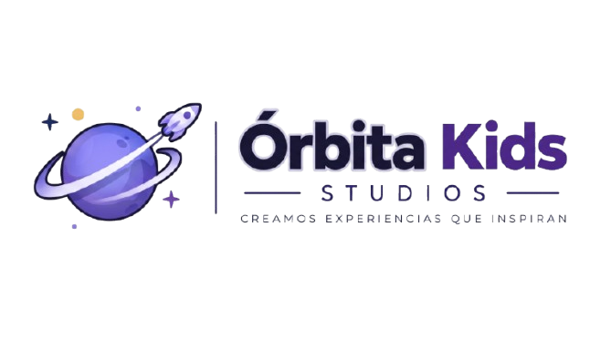
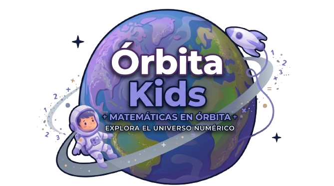
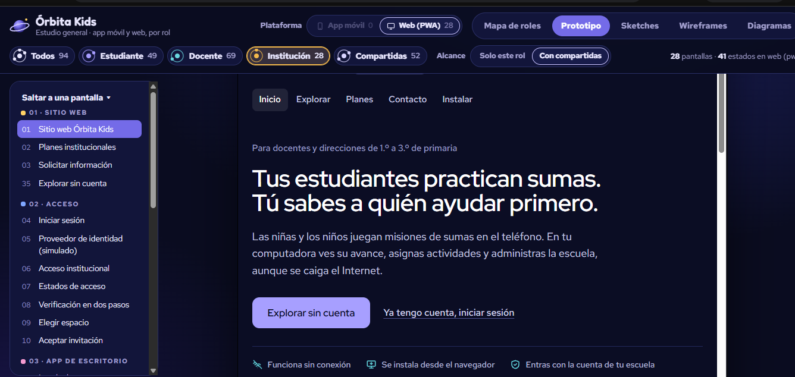
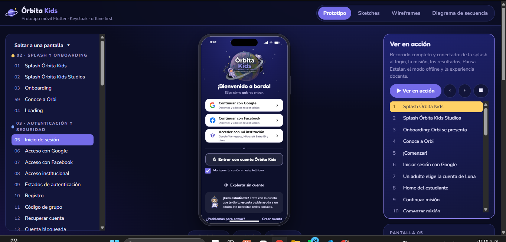
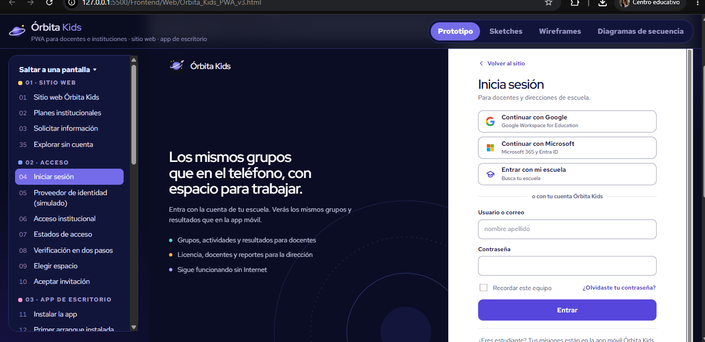

 

# 🪐 ` Ó R B I T A · K I D S ` 🚀

### ✨ CREAMOS EXPERIENCIAS QUE INSPIRAN ✨

 

# 💻 FRONTEND · DISEÑO Y PROTOTIPOS

**ENTREGABLES DE EXPERIENCIA · WEB & MOBILE**

 

  

### 🌌 DISEÑA · PRUEBA · TRANSFORMA

## 🪐 BIENVENIDO AL UNIVERSO DE ÓRBITA KIDS

*Una experiencia educativa diseñada para explorar nuevas formas de aprender.*

## 🚀 01. Acerca del módulo

El módulo **Frontend de Órbita Kids** comprende el diseño de interfaces, la conceptualización visual, el prototipado y el desarrollo de las experiencias de usuario que dan vida a nuestra plataforma educativa.

Su propósito es transformar las necesidades del proyecto en experiencias digitales intuitivas, atractivas y accesibles, manteniendo una identidad visual coherente con la esencia de **Órbita Studio**.

El desarrollo contempla dos plataformas complementarias: una aplicación web y una aplicación móvil. Ambas comparten la identidad de Órbita Kids, pero cuentan con estructuras, interfaces y enfoques de interacción adaptados a las características de cada entorno.

## 🎯 02. Objetivo del módulo

Diseñar y desarrollar experiencias digitales que faciliten el acceso a los contenidos y funcionalidades de Órbita Kids, proporcionando una navegación comprensible, una identidad visual consistente y una interacción adecuada para sus usuarios.

Los principales objetivos son:

- **Experiencia de usuario (UX):** establecer recorridos de navegación claros, intuitivos y coherentes.
- **Interfaz de usuario (UI):** construir interfaces atractivas, organizadas y visualmente consistentes.
- **Prototipado:** representar las interacciones y transiciones entre las diferentes pantallas.
- **Diseño adaptable:** considerar las características de navegación y visualización de cada plataforma.
- **Componentes reutilizables:** favorecer la consistencia, organización y mantenimiento de las interfaces.
- **Accesibilidad y usabilidad:** incorporar criterios que faciliten la comprensión y utilización de la plataforma.

## 🌐 03. Plataformas de desarrollo

Órbita Kids contempla dos entornos de interacción diseñados para ofrecer experiencias educativas complementarias, conservando una misma identidad visual y funcional.

### 💻 PLATAFORMA WEB

La plataforma web está orientada a proporcionar una experiencia educativa desde navegadores de escritorio y dispositivos compatibles.

Su desarrollo utiliza React y Vite, con una arquitectura basada en componentes que permite organizar las interfaces, reutilizar elementos visuales y mantener una estructura flexible.

**Enfoque de desarrollo:**

- Interfaces web organizadas y adaptables.
- Componentes visuales reutilizables.
- Navegación entre secciones y módulos.
- Presentación clara de contenidos y funcionalidades.
- Experiencias de usuario consistentes.

### 📱 APLICACIÓN MÓVIL

La aplicación móvil busca llevar la experiencia de Órbita Kids a dispositivos móviles, priorizando la interacción táctil, la navegación intuitiva y una presentación adaptada a las características de cada pantalla.

Su desarrollo utiliza Flutter y Dart para construir una experiencia multiplataforma que conserve la identidad y los criterios de diseño del proyecto.

**Enfoque de desarrollo:**

- Interfaces adaptadas a dispositivos móviles.
- Navegación intuitiva mediante interacción táctil.
- Componentes visuales coherentes con la identidad de marca.
- Experiencias educativas adaptadas al entorno móvil.
- Organización de pantallas y recorridos de usuario.

---

## 🧭 04. ARQUITECTURA Y DIAGRAMAS DEL PROYECTO

*Explora la estructura de Órbita Kids desde una perspectiva general hasta cada una de sus plataformas.*

Los siguientes diagramas representan la arquitectura, organización y relación de los entornos que conforman el módulo Frontend.

Se presentan en un orden de lectura que comienza con la visión integral del proyecto y continúa con el análisis individual de cada plataforma.

### 🌌 01. DIAGRAMA GENERAL · WEB + MOBILE

**Visión integral de la arquitectura Frontend**

Representación global de las plataformas web y móvil, sus relaciones, componentes principales y estructura dentro del ecosistema Órbita Kids.

---

### 📱 02. DIAGRAMA DE APLICACIÓN MÓVIL

**Arquitectura y organización del entorno Mobile**

Describe la estructura de la aplicación desarrollada con Flutter, incluyendo la organización de sus pantallas, componentes, navegación y relaciones funcionales.

---

### 💻 03. DIAGRAMA DE PLATAFORMA WEB

**Arquitectura y organización del entorno Web**

Representa la estructura de la plataforma desarrollada con React y Vite, mostrando sus componentes, módulos, vistas y principales relaciones.

---

## 🎨 05. DISEÑO Y ENTREGABLES

*De la conceptualización visual a las experiencias digitales.*

El módulo reúne los recursos visuales y funcionales necesarios para definir, representar y construir la experiencia de Órbita Kids en sus dos plataformas.

### 🖌️ Diseño de interfaces (UI)

Definición de la apariencia de las pantallas, distribución de elementos, jerarquías visuales, tipografías, colores, iconografía y componentes de interfaz.

### 🧩 Experiencia de usuario (UX)

Organización de los recorridos, interacciones y estructuras de navegación, considerando las necesidades de los diferentes perfiles de usuario.

### 📐 Prototipos interactivos

Representación visual de las pantallas y sus conexiones para comprender el comportamiento esperado de las interfaces y evaluar los recorridos de navegación.

### 📊 Diagramas y flujos

Documentación gráfica de la arquitectura, relaciones entre componentes, organización de las plataformas y procesos de interacción.

### 💻 Entregables Web

Conjunto de diseños, prototipos e interfaces correspondientes a la experiencia de Órbita Kids en su versión web.

### 📱 Entregables Mobile

Conjunto de diseños, prototipos e interfaces correspondientes a la experiencia de Órbita Kids en dispositivos móviles.

---

## 🛠️ 06. TECNOLOGÍAS Y HERRAMIENTAS

*Tecnologías seleccionadas para cada entorno de desarrollo.*

 

**DESARROLLO WEB**

  

**DESARROLLO MÓVIL**

  

**DOCUMENTACIÓN Y DIAGRAMACIÓN**

---

## ✨ 07. PRINCIPIOS DE DISEÑO

*Una identidad compartida, experiencias adaptadas a cada usuario.*

Las decisiones de diseño y desarrollo de Órbita Kids consideran principios que orientan la construcción de interfaces y experiencias digitales coherentes.

| Principio | Aplicación en el proyecto |
|---|---|
| **Claridad** | Interfaces fáciles de comprender y recorrer. |
| **Accesibilidad** | Diseño que considera diferentes necesidades de interacción. |
| **Consistencia** | Identidad visual compartida entre las plataformas. |
| **Interactividad** | Elementos que favorecen la participación y exploración. |
| **Adaptabilidad** | Experiencias adecuadas a distintos dispositivos. |
| **Usabilidad** | Navegación sencilla y organización lógica de contenidos. |
| **Creatividad** | Lenguaje visual inspirado en la exploración espacial. |

## 🌠 08. NUESTRA VISIÓN

Órbita Kids busca convertir la tecnología en una herramienta para despertar la curiosidad, fomentar la exploración y acercar el aprendizaje a nuevas experiencias digitales.

Desde el diseño de cada pantalla hasta la interacción entre sus componentes, el Frontend representa el punto de encuentro entre la identidad de nuestra marca y la experiencia de sus usuarios.

### 💜 NO SOLO DISEÑAMOS INTERFACES, CREAMOS EXPERIENCIAS.

*Cada interacción es una oportunidad para descubrir algo nuevo.*

---

### 🪐 ÓRBITA KIDS

**EXPLORA · APRENDE · DESCUBRE**

*Cada descubrimiento comienza con una pregunta.*

 

 

### ✨ ¡GRACIAS POR EXPLORAR CON NOSOTROS! ✨

**DESARROLLADO POR ÓRBITA STUDIO**

WEB · REACT + VITE &nbsp; | &nbsp; MOBILE · FLUTTER

 

© 2026 Órbita Studio · Todos los derechos reservados.

